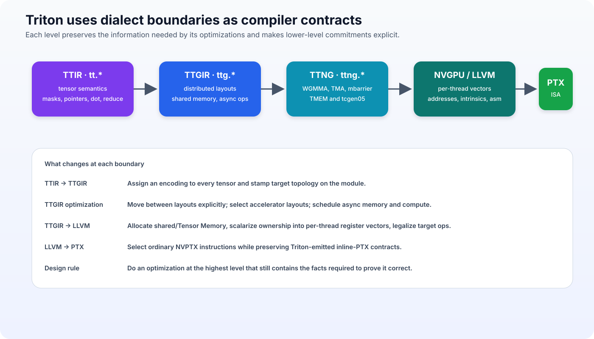
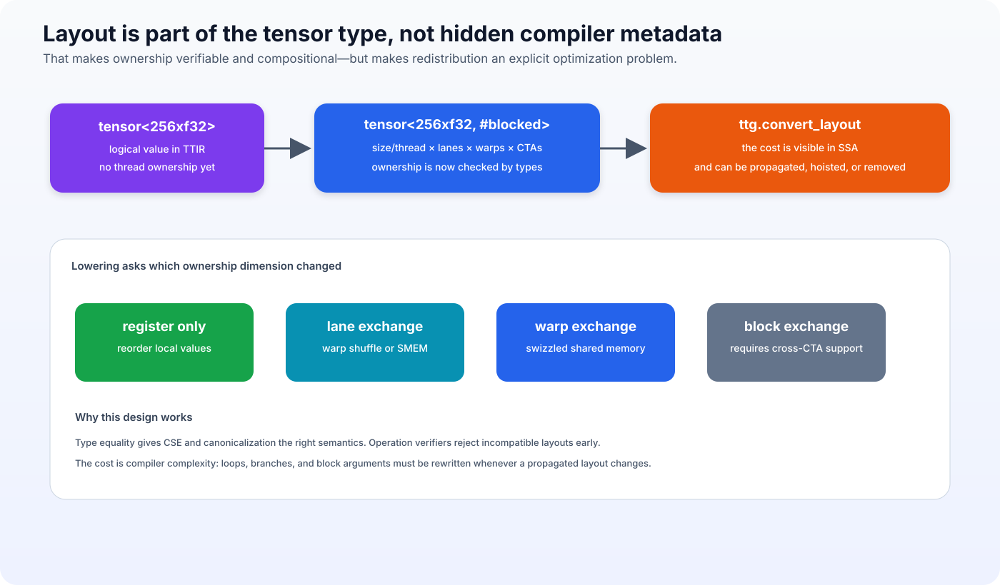
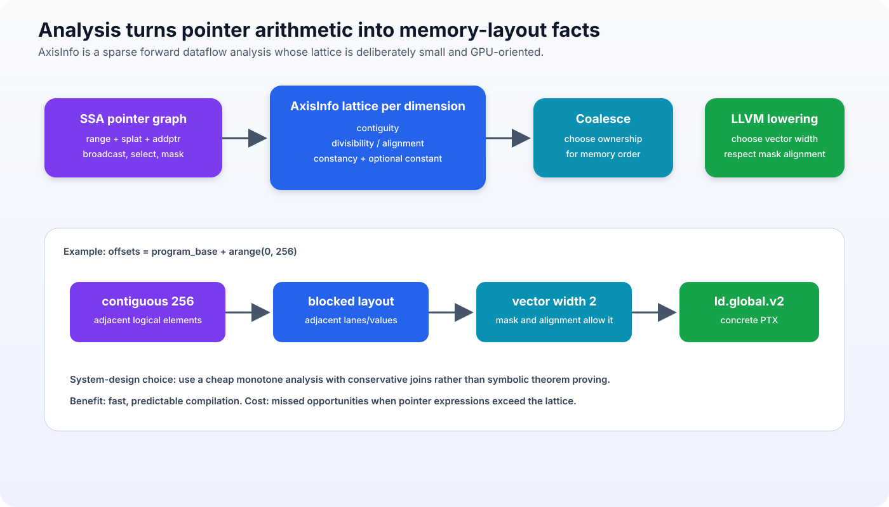
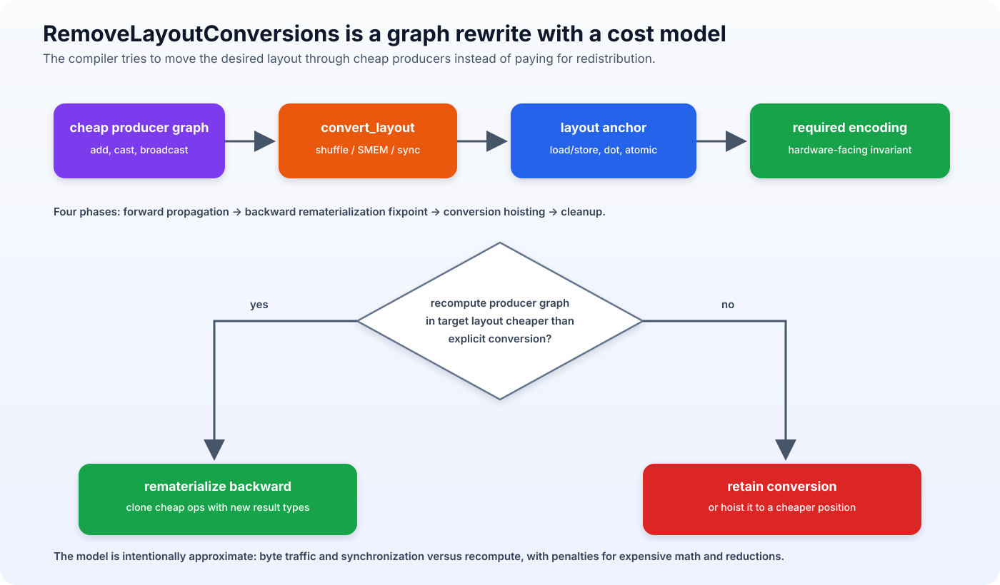
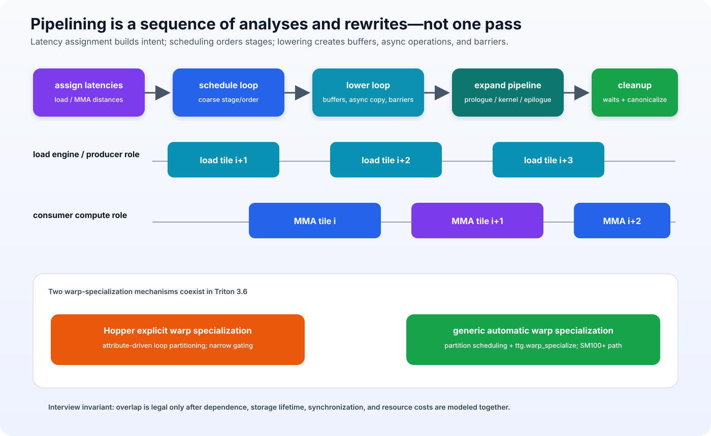

> The experiments in this post ran with **Triton 3.6.0**, CUDA 13.0, and
> PyTorch 2.11 on an NVIDIA H100, compute capability 9.0. All Triton source
> links are pinned to the
> [`v3.6.0` commit](https://github.com/triton-lang/triton/tree/7c56a5e40f7fd928dfd5c72902d5def0097db73a)
> so that the code and line numbers remain stable.

## The compiler pipeline in one picture

Triton lets a Python function describe a grid of GPU programs. Each program
works on blocks of values rather than explicitly naming CUDA threads. The
compiler decides how those values are distributed across warps, registers,
shared memory, and accelerator instructions.

For NVIDIA GPUs, the useful mental model is:

```text
Python @triton.jit kernel
        │
        │ parse Python AST and specialize constexpr arguments
        ▼
TTIR: target-independent Triton IR
        │
        │ choose layouts, coalesce accesses, accelerate matrix multiply,
        │ pipeline loops, and apply target-specific optimizations
        ▼
TTGIR: Triton GPU IR with explicit GPU layouts
        │
        │ allocate shared memory and lower Triton GPU/NVIDIA GPU dialects
        ▼
LLVM IR with NVVM operations and inline PTX
        │
        │ LLVM NVPTX code generation
        ▼
PTX
        │
        │ ptxas
        ▼
cubin loaded by the CUDA driver
```

These are not merely debugging labels. A compiled kernel exposes the stages:

```python
compiled = kernel[grid](...)
print(compiled.asm.keys())
```

On the environment used for this post, both examples returned:

```text
dict_keys(["source", "ttir", "ttgir", "llir", "ptx", "cubin"])
```

Triton's `CompiledKernel` constructs this `asm` dictionary from cached stage
files in
[`compiler.py:418-428`](https://github.com/triton-lang/triton/blob/7c56a5e40f7fd928dfd5c72902d5def0097db73a/python/triton/compiler/compiler.py#L418-L428).
This makes `compiled.asm["ttir"]`, `compiled.asm["ttgir"]`,
`compiled.asm["llir"]`, and `compiled.asm["ptx"]` the simplest way to inspect
one exact specialization.

## Compiler vocabulary for reading the pipeline

The names HIR, MIR, and LIR are useful categories, but they are not universal
formats. Each compiler chooses its own boundaries. For Triton, a practical
mapping is:

| General term | Triton example | What it is useful for |
|---|---|---|
| Source representation | Python AST | Syntax, constants, function calls, and source locations |
| High-level IR | TTIR | Tensor operations, pointer arithmetic, masks, loops, and reductions |
| Hardware-oriented IR | TTGIR | Thread/warp ownership, shared-memory layouts, and MMA encodings |
| Low-level compiler IR | LLVM IR plus NVVM operations | Scalar control flow, addresses, target intrinsics, and inline assembly |
| Virtual ISA | PTX | NVIDIA instructions for a virtual GPU target |
| Machine ISA | SASS in the cubin | Instructions executed by one GPU architecture |

The boundaries matter because an optimization should run while its required
information still exists. Tensor-layout optimization belongs in TTGIR; generic
SSA simplification fits LLVM IR; physical register allocation happens after
the program has become target instructions.

### IR, SSA, and values

An intermediate representation is a compiler-controlled form of the program.
It is easier to analyze and rewrite than either the original Python source or
final machine instructions.

TTIR, TTGIR, and LLVM IR use
[static single assignment](https://llvm.org/docs/LangRef.html#well-formedness)
ideas: an SSA value is defined once, and each transformation creates new
values rather than mutating an old definition.

Conceptually:

```text
source:
    x = a + b
    x = x * 2

SSA:
    %x0 = add %a, %b
    %x1 = mul %x0, 2
```

This makes def-use chains explicit. A compiler can ask exactly which
operations consume `%x0`, whether a computation is dead, or how far a value
must remain live.

At control-flow merges, LLVM IR uses `phi` nodes to choose the value arriving
from the executed predecessor:

```llvm
merge:
  %x = phi i32 [ 10, %then ], [ 20, %else ]
```

MLIR can express the same dataflow through block arguments and structured
operations such as `scf.if` and `scf.for`. These forms are progressively
lowered to explicit branches and LLVM `phi` nodes. Loop-carried values are the
common GPU-kernel example: the next accumulator value depends on the previous
iteration.

### CFGs, basic blocks, and dominance

A control-flow graph, or CFG, contains:

- **basic blocks:** straight-line instruction sequences with one entry;
- **edges:** branches between blocks;
- **loop headers:** blocks that control loop entry and iteration; and
- **back edges:** edges that return control to a loop header.

A block A **dominates** block B when every path from the function entry to B
passes through A. Dominance is what lets a compiler verify that an SSA
definition is available at every use and decide where computations can safely
move.

CFG and dominance analyses support loop-invariant code motion, dead-code
elimination, scheduling, and liveness analysis. Liveness then answers when a
value must remain available, which directly affects GPU register pressure.

### MLIR dialects and progressive lowering

An [MLIR dialect](https://mlir.llvm.org/docs/LangRef/#dialects) is a coherent
collection of operations, types, and attributes. A single module may contain
operations from several dialects:

```text
arith.*    scalar and tensor arithmetic
scf.*      structured control flow
tt.*       target-independent Triton operations
ttg.*      Triton GPU layouts and memory operations
ttng.*     NVIDIA-specific Triton GPU operations
llvm.*     LLVM dialect operations
```

This supports **progressive lowering**. A pass does not need to translate an
entire kernel directly to PTX. It can replace one abstraction with a lower
one while leaving unrelated operations intact.

Related terms have distinct meanings:

| Term | Meaning in this pipeline |
|---|---|
| Lowering | Replace a higher-level construct with lower-level operations, such as `tt.dot` becoming `ttng.warp_group_dot` |
| Legalization | Rewrite or reject operations that the selected target cannot execute |
| Canonicalization | Put equivalent IR into simpler standard forms so later patterns match reliably |
| Pattern rewriting | Match an operation or graph shape and replace it with another |
| Dialect conversion | Enforce which dialect operations are legal after a lowering boundary |

For example, the Hopper WGMMA conversion is both lowering and legalization:
it turns a warp-group dot into lower-level NVIDIA GPU operations while
checking that its dtype, shape, and layouts are supported.

### Passes and pass pipelines

A compiler pass analyzes or transforms IR. Triton's NVIDIA backend assembles
different pass pipelines for each level rather than applying every
optimization everywhere.

Common pass names in the source include:

| Pass or transformation | Purpose | GPU tradeoff |
|---|---|---|
| Inlining | Replace calls with their bodies | Exposes optimization opportunities but can increase code size |
| Constant folding/propagation | Evaluate and substitute compile-time values | Removes runtime work and enables more specialization |
| CSE | Reuse common subexpressions | Reduces work but may extend value lifetimes |
| DCE / symbol DCE | Remove unused operations or symbols | Reduces code and resource use |
| Canonicalization | Simplify operations into standard forms | Makes later rewrites more predictable |
| LICM | Move loop-invariant work outside a loop | Reduces repeated work but can increase live ranges |
| Loop unrolling | Duplicate loop bodies | Exposes ILP but increases code size and registers |
| Coalescing | Arrange accesses for efficient memory transactions | Improves bandwidth and constrains layouts |
| Layout conversion removal | Eliminate unnecessary redistribution | Avoids shuffles and shared-memory traffic |
| Matmul acceleration | Choose MMA layouts and target operations | Enables Tensor Cores subject to dtype/shape constraints |
| Scheduling and pipelining | Overlap loads, synchronization, and compute | Hides latency at the cost of buffering and registers |

The TTIR pipeline runs inlining, canonicalization, CSE, symbol DCE, and loop
unrolling
([`make_ttir():230-244`](https://github.com/triton-lang/triton/blob/7c56a5e40f7fd928dfd5c72902d5def0097db73a/third_party/nvidia/backend/compiler.py#L230-L244)).
The TTGIR pipeline adds coalescing, locality optimization, matmul
acceleration, dot-operand optimization, scheduling, software pipelining, TMA
lowering, and fence insertion
([`make_ttgir():247-310`](https://github.com/triton-lang/triton/blob/7c56a5e40f7fd928dfd5c72902d5def0097db73a/third_party/nvidia/backend/compiler.py#L247-L310)).

Passes interact rather than providing independent wins. CSE can save an
instruction but increase a value's live range. Unrolling can expose
instruction-level parallelism while causing register spills. A good compiler
pipeline repeatedly canonicalizes and eliminates dead work after structural
transformations.

### SIMD, SIMT, warps, and divergence

**SIMD** applies one vector instruction to multiple data lanes. CPU AVX
instructions are the conventional example.

NVIDIA GPUs expose **SIMT**: a warp executes one instruction stream for
multiple threads, while each thread retains its own registers and logical
state. On current NVIDIA GPUs a warp has 32 threads.

When threads in one warp take different control-flow paths, the hardware uses
predication or serializes paths. This is warp divergence. Triton's tensor
layouts describe which elements belong to each thread, and lowering turns
tensor masks into per-lane predicates.

NVIDIA GPUs are not conventionally VLIW processors. A VLIW architecture asks
the compiler to pack independent operations into one wide instruction.
NVIDIA instead combines compiler scheduling with hardware warp scheduling and
instruction issue. VLIW remains a useful contrast because both designs care
about dependencies, execution-unit availability, and latency, but they assign
different responsibilities to software and hardware.

### ILP, software pipelining, and `num_stages`

Instruction-level parallelism, or ILP, means having independent operations
that can execute or make progress concurrently:

```text
independent:
    %a = add %x, %y
    %b = mul %p, %q

dependent:
    %a = add %x, %y
    %b = mul %a, %q
```

Loop unrolling and code motion can expose ILP. GPU kernels need it because a
single instruction may have substantial latency.

Software pipelining overlaps stages from different loop iterations:

```text
time 0: load tile 0
time 1: load tile 1 | compute tile 0
time 2: load tile 2 | compute tile 1 | retire tile 0
```

For applicable loops, Triton's `num_stages` influences how many iterations of
the load/compute pipeline may be in flight. More stages can hide memory
latency, but require additional shared-memory buffers, barriers, and live
registers. It is a resource tradeoff, not a universal "higher is better"
setting.

### Instruction selection, registers, and spills

After high-level layout decisions, backend compilation still must perform:

1. **instruction selection:** choose target operations for generic IR;
2. **instruction scheduling:** order operations around dependencies and
   latencies;
3. **register allocation:** map virtual values to physical registers; and
4. **spilling:** store values in local memory when physical registers are
   insufficient.

LLVM IR and PTX can name an effectively unbounded number of SSA values or
virtual registers. The final backend must fit live values into the GPU's
physical register file. A transformation that reduces arithmetic can still
slow a kernel if it raises register pressure enough to reduce occupancy or
cause spills.

This is why compiler inspection should not stop at one level:

```text
TTIR       Did the algorithm specialize and simplify as expected?
TTGIR      Are layouts, memory spaces, and accelerator operations correct?
LLVM/PTX   Did lowering create reasonable scalar code and instructions?
metadata   How many registers and how much shared memory does the kernel use?
SASS       What machine instructions and scheduling decisions remain?
```

## 1. Start with an executable vector add

The first kernel maps one Triton program to 256 adjacent elements:

```python
import torch
import triton
import triton.language as tl


@triton.jit
def add_kernel(
    x_ptr,
    y_ptr,
    output_ptr,
    n_elements: tl.constexpr,
    BLOCK_SIZE: tl.constexpr,
):
    offsets = tl.program_id(0) * BLOCK_SIZE + tl.arange(0, BLOCK_SIZE)
    mask = offsets < n_elements
    x = tl.load(x_ptr + offsets, mask=mask)
    y = tl.load(y_ptr + offsets, mask=mask)
    tl.store(output_ptr + offsets, x + y, mask=mask)


n = 4096
x = torch.randn(n, device="cuda", dtype=torch.float32)
y = torch.randn_like(x)
output = torch.empty_like(x)

grid = (triton.cdiv(n, 256),)
compiled = add_kernel[grid](
    x,
    y,
    output,
    n,
    BLOCK_SIZE=256,
    num_warps=4,
)

torch.testing.assert_close(output, x + y)

for stage in ("ttir", "ttgir", "llir", "ptx"):
    with open(f"vector_add.{stage}", "w") as f:
        f.write(compiled.asm[stage])
```

This experiment marks `n_elements` as `constexpr` so the dump shows a fully
specialized bound of 4096. A reusable production vector-add kernel would
normally make `n_elements` a runtime scalar and keep only `BLOCK_SIZE` as
`constexpr`; different vector lengths could then share the same compiled
kernel while changing the launch grid and mask.

The launch has 16 program instances. `tl.program_id(0)` identifies one of
them, while `tl.arange(0, 256)` creates the block of logical lanes handled by
that program. This is Triton's programming model: describe work per program
and let the compiler map the block to hardware.

### TTIR: preserve the tensor program

The Python frontend specializes `n_elements=4096` and `BLOCK_SIZE=256`, then
emits target-independent Triton IR:

```mlir
%pid = tt.get_program_id x : i32
%base = arith.muli %pid, %c256_i32 : i32
%range = tt.make_range {end = 256 : i32, start = 0 : i32}
%offsets = arith.addi %base_splat, %range : tensor<256xi32>
%mask = arith.cmpi slt, %offsets, %c4096 : tensor<256xi32>

%x = tt.load %x_ptrs, %mask : tensor<256x!tt.ptr<f32>>
%y = tt.load %y_ptrs, %mask : tensor<256x!tt.ptr<f32>>
%sum = arith.addf %x, %y : tensor<256xf32>
tt.store %output_ptrs, %sum, %mask : tensor<256x!tt.ptr<f32>>
```

The important property is what TTIR does **not** say. There is no thread index,
warp ID, register number, or vectorized PTX load. It still describes a block
of 256 values using Triton operations.

The frontend path begins when `ASTSource.make_ir()` calls `ast_to_ttir()`
([`compiler.py:78-81`](https://github.com/triton-lang/triton/blob/7c56a5e40f7fd928dfd5c72902d5def0097db73a/python/triton/compiler/compiler.py#L78-L81)).
`ast_to_ttir()` derives argument and `constexpr` types, creates a
`CodeGenerator`, visits the Python AST, verifies the resulting module, and
returns it
([`code_generator.py:1600-1639`](https://github.com/triton-lang/triton/blob/7c56a5e40f7fd928dfd5c72902d5def0097db73a/python/triton/compiler/code_generator.py#L1600-L1639)).

### TTGIR: attach a hardware layout

The next stage contains nearly the same operations, but every block tensor now
has an encoding:

```mlir
#blocked = #ttg.blocked<{
  sizePerThread = [2],
  threadsPerWarp = [32],
  warpsPerCTA = [4],
  order = [0]
}>

module attributes {
  "ttg.num-ctas" = 1 : i32,
  "ttg.num-warps" = 4 : i32,
  ttg.target = "cuda:90",
  "ttg.threads-per-warp" = 32 : i32
} {
  ...
  %x = tt.load %x_ptrs, %mask
      : tensor<256x!tt.ptr<f32>, #blocked>
  %sum = arith.addf %x, %y : tensor<256xf32, #blocked>
  tt.store %output_ptrs, %sum, %mask
      : tensor<256x!tt.ptr<f32>, #blocked>
}
```

The `#blocked` encoding is the bridge between a logical tensor and GPU
execution. Here:

- a CTA has four warps;
- each warp has 32 threads;
- each thread owns two adjacent values; and
- $4 \times 32 \times 2 = 256$ values cover the block.

This information lets later passes reason about coalescing, register
ownership, layout conversion, and shared-memory movement without immediately
flattening everything into scalar instructions.

### PTX: the layout becomes concrete instructions

The relevant PTX from this specialization is:

```ptx
@%p1 ld.global.v2.b32 { %r1, %r2 }, [ %rd1 + 0 ];
@%p1 ld.global.v2.b32 { %r3, %r4 }, [ %rd2 + 0 ];

add.f32 %r5, %r1, %r3;
add.f32 %r6, %r2, %r4;

@%p1 st.global.v2.b32 [ %rd3 + 0 ], { %r5, %r6 };
```

The `sizePerThread = [2]` decision is now visible as two-element global loads,
two scalar FP32 additions, and a two-element store. TTIR said "add a block of
256 values"; TTGIR assigned two values to each of 128 threads; PTX implements
that assignment.

## 2. A minimal matrix multiply that reaches Hopper WGMMA

Vector add shows layout lowering, but matrix multiplication shows why Triton
needs multiple IR levels. The source contains one `tl.dot`; the generated
Hopper kernel contains asynchronous warp-group matrix instructions.

This deliberately small kernel computes exactly one $64 \times 128$ output
tile with reduction dimension 32:

```python
@triton.jit
def matmul_kernel(
    a_ptr,
    b_ptr,
    c_ptr,
    M: tl.constexpr,
    N: tl.constexpr,
    K: tl.constexpr,
    BLOCK_M: tl.constexpr,
    BLOCK_N: tl.constexpr,
    BLOCK_K: tl.constexpr,
):
    pid = tl.program_id(0)
    offsets_m = pid * BLOCK_M + tl.arange(0, BLOCK_M)
    offsets_n = tl.arange(0, BLOCK_N)
    offsets_k = tl.arange(0, BLOCK_K)

    a = tl.load(
        a_ptr + offsets_m[:, None] * K + offsets_k[None, :]
    )
    b = tl.load(
        b_ptr + offsets_k[:, None] * N + offsets_n[None, :]
    )
    accumulator = tl.dot(a, b)

    c_ptrs = c_ptr + offsets_m[:, None] * N + offsets_n[None, :]
    tl.store(c_ptrs, accumulator)


M, N, K = 64, 128, 32
a = torch.randn((M, K), device="cuda", dtype=torch.float16)
b = torch.randn((K, N), device="cuda", dtype=torch.float16)
c = torch.empty((M, N), device="cuda", dtype=torch.float32)

compiled = matmul_kernel[(1,)](
    a,
    b,
    c,
    M=M,
    N=N,
    K=K,
    BLOCK_M=M,
    BLOCK_N=N,
    BLOCK_K=K,
    num_warps=8,
    num_stages=3,
)

torch.testing.assert_close(
    c,
    a.float() @ b.float(),
    atol=0.05,
    rtol=0.01,
)
```

This is intentionally not a production GEMM. It has no boundary masks,
grouped launch ordering, autotuning, or loop over multiple K tiles. Its value
is that the complete lowering fits on one page.

### TTIR still says `tt.dot`

The key TTIR operation is direct:

```mlir
%a = tt.load %a_ptrs : tensor<64x32x!tt.ptr<f16>>
%b = tt.load %b_ptrs : tensor<32x128x!tt.ptr<f16>>
%acc = tt.dot %a, %b, %zero
    : tensor<64x32xf16> * tensor<32x128xf16>
      -> tensor<64x128xf32>
```

At this level, `tt.dot` specifies the mathematical operation and its types. It
does not commit to CUDA Cores, `mma.sync`, Hopper WGMMA, a shared-memory
layout, or a particular division of the output among warps.

### TTGIR selects Hopper layouts and `warp_group_dot`

On the H100, the observed TTGIR lowered the dot to:

```mlir
%a_smem = ttg.local_alloc %a
    : tensor<64x32xf16, #blocked>
      -> !ttg.memdesc<64x32xf16, #shared, #smem>

%b_smem = ttg.local_alloc %b
    : tensor<32x128xf16, #blocked1>
      -> !ttg.memdesc<32x128xf16, #shared1, #smem>

ttng.fence_async_shared {bCluster = false}

%acc = ttng.warp_group_dot %a_smem, %b_smem, %zero
    : !ttg.memdesc<64x32xf16, #shared, #smem>
    * !ttg.memdesc<32x128xf16, #shared1, #smem>
    -> tensor<64x128xf32, #mma>
```

Several decisions have appeared:

1. both operands are staged in shared memory;
2. their shared-memory encodings describe the swizzled layouts consumed by
   Hopper matrix instructions;
3. an asynchronous shared-memory fence is inserted; and
4. the generic `tt.dot` becomes NVIDIA-specific `ttng.warp_group_dot` with an
   MMA result layout.

This is the central role of TTGIR: retain tensor structure while making the
GPU execution plan explicit.

The NVIDIA backend builds this stage in `make_ttgir()`
([`compiler.py:247-310`](https://github.com/triton-lang/triton/blob/7c56a5e40f7fd928dfd5c72902d5def0097db73a/third_party/nvidia/backend/compiler.py#L247-L310)).
The pass sequence converts TTIR to TTGIR, coalesces accesses, runs
`accelerate_matmul`, optimizes dot operands, applies Hopper scheduling and
pipelining, lowers TMA operations, removes layout conversions, and inserts
fences.

`accelerate_matmul` is where a generic dot can acquire an NVIDIA MMA encoding.
Later passes have enough target and layout information to represent the
operation as `ttng.warp_group_dot`.

### LLVM IR contains the WGMMA contract

The LLVM IR generated for the kernel already contains the PTX operation as
inline assembly:

```llvm
call { float, ..., float } asm sideeffect
  "wgmma.mma_async.sync.aligned.m64n64k16.f32.f16.f16
   {$0,...,$31}, $32, $33, 0, 1, 1, 0, 1;",
  ...

call void @llvm.nvvm.wgmma.commit_group.sync.aligned()

call { float, ..., float } asm sideeffect
  "wgmma.wait_group.sync.aligned 0;",
  ...
```

The shared-memory descriptors have become 64-bit operands, and the FP32
accumulator is represented by a structure of registers.

The lowering path is visible in the source:

1. `WarpGroupDotOpConversion` dispatches `ttng.warp_group_dot` to
   `convertWGMMA()`
   ([`DotOpToLLVM.cpp:89-100`](https://github.com/triton-lang/triton/blob/7c56a5e40f7fd928dfd5c72902d5def0097db73a/third_party/nvidia/lib/TritonNVIDIAGPUToLLVM/DotOpToLLVM.cpp#L89-L100)).
2. `convertWGMMA()` derives instruction shapes, builds shared-memory
   descriptors, maps element types and layouts, and creates NVIDIA GPU
   `WGMMAOp`s
   ([`WGMMA.cpp:185-301`](https://github.com/triton-lang/triton/blob/7c56a5e40f7fd928dfd5c72902d5def0097db73a/third_party/nvidia/lib/TritonNVIDIAGPUToLLVM/DotOpToLLVM/WGMMA.cpp#L185-L301)).
3. `WGMMAOpPattern` validates supported shapes and dtypes, assigns register
   constraints, constructs the `wgmma.mma_async.sync.aligned...` instruction
   string, and rewrites the operation as inline PTX
   ([`NVGPUToLLVMPass.cpp:348-520`](https://github.com/triton-lang/triton/blob/7c56a5e40f7fd928dfd5c72902d5def0097db73a/third_party/nvidia/lib/NVGPUToLLVM/NVGPUToLLVMPass.cpp#L348-L520)).

That third step is the most literal answer to "where does Triton generate
WGMMA?" Lines 513-518 concatenate the instruction family, M/N/K shape,
accumulator type, and operand types into the final PTX mnemonic.

### PTX contains the Hopper instructions

The generated PTX includes:


```ptx
wgmma.fence.sync.aligned;

wgmma.mma_async.sync.aligned.m64n64k16.f32.f16.f16
    {%r13, %r14, ..., %r44},
    %rd4, %rd5, 0, 1, 1, 0, 1;

wgmma.mma_async.sync.aligned.m64n64k16.f32.f16.f16
    {%r13, %r14, ..., %r44},
    %rd6, %rd7, %p1, 1, 1, 0, 1;

wgmma.commit_group.sync.aligned;
wgmma.wait_group.sync.aligned 0;
```


Reading the mnemonic:

```text
m64n64k16     one WGMMA instruction's matrix shape
f32           accumulator type
f16.f16       A and B operand types
mma_async     launch the matrix operation asynchronously
```

The source-level `tl.dot` therefore did not map directly to one instruction.
It became a target-independent dot, then a layout-aware Hopper warp-group dot,
then one or more concrete WGMMA instructions plus fence, commit, and wait
operations.

PTX is still a virtual ISA. Triton's next stage invokes `ptxas` to produce a
`cubin`, and the CUDA driver loads that binary. Inspecting PTX proves which
instruction family the compiler requested; inspecting SASS with tools such as
`nvdisasm` or `cuobjdump` verifies the final machine instructions.

### Side note: what LLVM contributes and where WGMMA size comes from

The relevant compiler layers are open source. Triton is open source, as are
LLVM, MLIR, and LLVM's NVPTX backend. LLVM uses the
[Apache License 2.0 with LLVM exceptions](https://llvm.org/LICENSE.txt).
NVIDIA publishes the PTX ISA specification, but `ptxas`, the CUDA driver, and
the implementation that turns PTX into executable machine code are part of
NVIDIA's proprietary CUDA toolchain.

LLVM IR is not simply PTX with information missing. The two representations
retain different information:

- **TTGIR** explicitly retains tensor shapes, thread/warp layouts,
  shared-memory encodings, and MMA layouts.
- **LLVM IR** retains typed SSA values, control flow, address spaces, data
  dependencies, NVVM intrinsics, and inline-assembly constraints. Most TTGIR
  layout semantics have been consumed by this point.
- **PTX** contains selected NVIDIA virtual instructions, PTX registers,
  predicates, parameter declarations, and target directives, but no longer
  expresses the original tensor or layout intent.

Some choices are therefore made only by LLVM's NVPTX backend, such as selecting
ordinary PTX instructions for generic LLVM arithmetic. Other choices are made
earlier by Triton. WGMMA is an example of the latter: its mnemonic, operand
types, and instruction shape are already present as inline assembly in the
LLVM IR.

For the example in this post, the TTGIR module records:

```mlir
#mma = #ttg.nvidia_mma<{
  versionMajor = 3,
  versionMinor = 0,
  warpsPerCTA = [4, 2],
  instrShape = [16, 64, 16]
}>
```

The shape is selected by the `accelerate_matmul` pass, not by the final PTX
printer:

1. SM90 prefers MMA version 3 when the dtype and shape support it
   ([`AccelerateMatmul.cpp:33-57`](https://github.com/triton-lang/triton/blob/7c56a5e40f7fd928dfd5c72902d5def0097db73a/lib/Dialect/TritonGPU/Transforms/AccelerateMatmul.cpp#L33-L57)).
2. `createMMAEncodingForDot()` passes the result tile shape, element type, and
   warp count to `mmaVersionToInstrShape()`, then stores the result in
   `NvidiaMmaEncodingAttr`
   ([`AccelerateMatmul.cpp:310-342`](https://github.com/triton-lang/triton/blob/7c56a5e40f7fd928dfd5c72902d5def0097db73a/lib/Dialect/TritonGPU/Transforms/AccelerateMatmul.cpp#L310-L342)).
3. For MMA version 3, `mmaVersionToInstrShape()` computes
   $K=256/\text{element bit width}$ and selects the largest valid N dimension
   that divides the tile and fits its warp partition
   ([`Utility.cpp:29-73`](https://github.com/triton-lang/triton/blob/7c56a5e40f7fd928dfd5c72902d5def0097db73a/lib/Dialect/TritonGPU/Transforms/Utility.cpp#L29-L73)).

For the $64 \times 128 \times 32$ FP16 example with eight warps:

```text
K instruction size = 256 / 16 bits = 16
M encoding unit    = 16
M warp groups      = 64 / 16 = 4
N warp groups      = 8 warps / 4 = 2
maximum N size     = 128 / 2 = 64
TTGIR instrShape   = [16, 64, 16]
```

Each number has a different origin:

| Dimension | How it is determined |
|---|---|
| M = 64 in PTX | Hopper WGMMA uses a four-warp warp group and the supported WGMMA family has a fixed M dimension of 64. Triton's TTGIR encoding stores an M unit of 16, then `convertWGMMA()` multiplies it by four. |
| N = 64 here | Triton selects N from the legal WGMMA widths according to the output tile and warp partition. For this tile, four warps partition M and two warp groups partition N, so the largest fitting divisor is $128/2=64$. |
| K = 16 | `mmaVersionToInstrShape()` uses $256/\text{operand bit width}$. FP16 has 16-bit operands, so $K=256/16=16$. FP8 instead produces $K=32$, while TF32 uses its separately validated $K=8$ form. |

This example therefore emits `m64n64k16`, not `m64n16k16`. The latter is also
a legal FP16 WGMMA shape and can be selected when the N tile or warp
partition only supports width 16. Triton's legality checks encode the Hopper
rules directly: FP16 and BF16 require `m == 64`, `8 <= n <= 256`, and
`k == 16`
([`NVGPUToLLVMPass.cpp:425-440`](https://github.com/triton-lang/triton/blob/7c56a5e40f7fd928dfd5c72902d5def0097db73a/third_party/nvidia/lib/NVGPUToLLVM/NVGPUToLLVMPass.cpp#L425-L440)).

During TTGIR-to-LLVM lowering, `convertWGMMA()` reads this encoding:

```cpp
auto instrMNK = mmaEncoding.getInstrShape();
unsigned M = 4 * instrMNK[0];
unsigned N = instrMNK[1];
unsigned K = instrMNK[2];
```

The factor of four converts the M unit into the four-warp Hopper warp-group
instruction shape. Thus `[16, 64, 16]` becomes PTX `m64n64k16`
([`WGMMA.cpp:193-221`](https://github.com/triton-lang/triton/blob/7c56a5e40f7fd928dfd5c72902d5def0097db73a/third_party/nvidia/lib/TritonNVIDIAGPUToLLVM/DotOpToLLVM/WGMMA.cpp#L193-L221)).
The same code computes how many M, N, and K repetitions are required to cover
the complete CTA tile. Finally, `WGMMAOpPattern` checks that the selected
shape/type combination is legal and writes those dimensions into the PTX
mnemonic
([`NVGPUToLLVMPass.cpp:402-460`](https://github.com/triton-lang/triton/blob/7c56a5e40f7fd928dfd5c72902d5def0097db73a/third_party/nvidia/lib/NVGPUToLLVM/NVGPUToLLVMPass.cpp#L402-L460),
[`513-518`](https://github.com/triton-lang/triton/blob/7c56a5e40f7fd928dfd5c72902d5def0097db73a/third_party/nvidia/lib/NVGPUToLLVM/NVGPUToLLVMPass.cpp#L513-L518)).

## 3. Where the complete pipeline is assembled

The backend registers its ordered stages here:

[`third_party/nvidia/backend/compiler.py:537-546`](https://github.com/triton-lang/triton/blob/7c56a5e40f7fd928dfd5c72902d5def0097db73a/third_party/nvidia/backend/compiler.py#L537-L546)

```python
stages["ttir"] = ...
stages["ttgir"] = ...
stages["llir"] = ...
stages["ptx"] = ...
stages["cubin"] = ...
```

The generic compiler asks the selected backend to populate that dictionary,
creates the initial IR from the source, and executes each stage in order:

[`python/triton/compiler/compiler.py:278-360`](https://github.com/triton-lang/triton/blob/7c56a5e40f7fd928dfd5c72902d5def0097db73a/python/triton/compiler/compiler.py#L278-L360)

```python
stages = {}
backend.add_stages(stages, options, src.language)
module = src.make_ir(target, options, codegen_fns, module_map, context)

for ext, compile_ir in list(stages.items())[first_stage:]:
    next_module = compile_ir(module, metadata)
    ...
    module = next_module
```

The NVIDIA implementations are:

| Stage | Source | Main work |
|---|---|---|
| TTIR | [`make_ttir():230-244`](https://github.com/triton-lang/triton/blob/7c56a5e40f7fd928dfd5c72902d5def0097db73a/third_party/nvidia/backend/compiler.py#L230-L244) | Inline, canonicalize, combine, eliminate common subexpressions, and unroll |
| TTGIR | [`make_ttgir():247-310`](https://github.com/triton-lang/triton/blob/7c56a5e40f7fd928dfd5c72902d5def0097db73a/third_party/nvidia/backend/compiler.py#L247-L310) | Assign GPU layouts, accelerate matmul, schedule, pipeline, and apply Hopper-specific passes |
| LLVM IR | [`make_llir():339-433`](https://github.com/triton-lang/triton/blob/7c56a5e40f7fd928dfd5c72902d5def0097db73a/third_party/nvidia/backend/compiler.py#L339-L433) | Allocate memory, lower Triton GPU and NVIDIA GPU dialects, translate MLIR LLVM dialect to LLVM IR, and optimize |
| PTX | [`make_ptx():435-455`](https://github.com/triton-lang/triton/blob/7c56a5e40f7fd928dfd5c72902d5def0097db73a/third_party/nvidia/backend/compiler.py#L435-L455) | Ask LLVM's NVPTX backend for assembly and normalize PTX version and target |

This organization also explains why an IR dump is more useful than treating
Triton as a black box. If a kernel has:

- uncoalesced accesses, inspect TTGIR layouts;
- unexpected layout conversions, inspect TTGIR around
  `ttg.convert_layout`;
- no Tensor Core instruction, compare `tt.dot`, its result encoding, and the
  accelerated dot operation;
- spills or excessive registers, inspect LLVM IR, PTX, and final resource
  metadata; or
- unexpected instruction selection, inspect both PTX and SASS.

## 4. A practical inspection workflow

### Print or save `compiled.asm`

For one specialization, use the returned `CompiledKernel`:

```python
compiled = my_kernel[grid](
    *args,
    BLOCK_M=64,
    BLOCK_N=128,
    BLOCK_K=32,
    num_warps=8,
    num_stages=3,
)

for stage, text in compiled.asm.items():
    if isinstance(text, str):
        print(f"\n===== {stage} =====")
        print(text)
```

Remember that changing a `constexpr`, dtype, shape-derived specialization,
`num_warps`, `num_stages`, target GPU, or compiler version can produce a
different kernel.

### Search for the semantic transition

For matrix multiplication, these searches quickly locate the important point:

```bash
grep -n "tt.dot" matmul.ttir
grep -n "warp_group_dot" matmul.ttgir
grep -n "wgmma" matmul.llir
grep -n "wgmma" matmul.ptx
```

For memory-bound code, search for:

```bash
grep -nE "tt.load|tt.store|convert_layout" kernel.ttgir
grep -nE "ld.global|st.global|cp.async|ldmatrix" kernel.ptx
```

### Read layouts before reading scalar instructions

The most useful TTGIR attributes are often at the top of the file:

- `#ttg.blocked` describes ordinary per-thread ownership;
- `#ttg.slice` removes one dimension from a parent layout;
- shared-memory encodings describe swizzles and vectorization;
- `#ttg.nvidia_mma` or related MMA encodings describe matrix-fragment
  ownership; and
- module attributes record target, warps, CTAs, and threads per warp.

Once those layouts make sense, the later PTX usually becomes much easier to
explain.

## 5. What each level is designed to preserve

| Level | Preserves | Deliberately hides |
|---|---|---|
| Python Triton | Algorithm, program grid, block operations | Exact hardware mapping |
| TTIR | Tensor semantics, pointer arithmetic, masks, dot/reduction operations | Thread and warp layout |
| TTGIR | Tensor semantics plus thread, warp, shared-memory, and MMA layouts | Most scalar register details |
| LLVM IR | Control flow, scalar/register values, NVVM operations, inline PTX contracts | Final PTX syntax and physical registers |
| PTX | NVIDIA virtual instructions and registers | Final machine encoding and some scheduling |
| SASS/cubin | Executed machine instructions | High-level tensor intent |

The multilevel design is what gives Triton room to optimize. Lowering directly
from Python to PTX would force high-level transformations, GPU layout
selection, shared-memory planning, instruction selection, and register-level
code generation into one representation.

Instead, each stage answers a narrower question:

1. **TTIR:** What tensor computation did the programmer request?
2. **TTGIR:** How should that computation map to this GPU?
3. **LLVM IR:** How should the mapped program become low-level control flow,
   memory operations, and target intrinsics?
4. **PTX:** Which NVIDIA virtual instructions implement it?
5. **cubin/SASS:** Which machine instructions will execute?

## 6. Why Triton needs several MLIR dialects

The pipeline is often summarized as "TTIR is high level and TTGIR is GPU
specific." That is correct but incomplete. The more useful compiler-design
question is:

> Which invariants should become explicit at each lowering boundary?

Triton 3.6 uses several dialect layers:

| Dialect | Primary responsibility |
|---|---|
| `tt` | Target-independent tensor-program semantics |
| `ttg` | Distributed layouts, shared-memory descriptors, and GPU execution structure |
| `ttng` | NVIDIA-specific TMA, WGMMA, mbarrier, TMEM, and `tcgen05` concepts |
| `nvgpu` | Thin target operations close to PTX or inline assembly |
| `llvm` / `nvvm` | Low-level control flow, pointer arithmetic, intrinsics, and ABI |



The boundaries solve three competing requirements.

### 6.1 Preserve high-level information long enough

`tt.dot`, `tt.reduce`, tensor-shaped masks, and pointer tensors are much easier
to optimize before they become hundreds of scalar instructions. TTIR retains
that structure.

For example, a matmul pass needs to know:

- the logical M/N/K dimensions;
- operand and accumulator types;
- whether transposes or broadcasts are present;
- the desired result shape; and
- how many warps are available.

Those facts are obvious at `tt.dot` and difficult to reconstruct from LLVM IR.

The TTIR operation definitions live in
[`TritonOps.td`](https://github.com/triton-lang/triton/blob/7c56a5e40f7fd928dfd5c72902d5def0097db73a/include/triton/Dialect/Triton/IR/TritonOps.td#L226-L1291).
They include loads, stores, dot products, reductions, scans, broadcasts,
reshapes, joins, gathers, and descriptor operations.

### 6.2 Make GPU commitments inspectable

TTGIR does not merely annotate TTIR with a target name. It makes these
decisions part of the IR:

- which values each thread and warp own;
- how a tensor is distributed across a CTA;
- which operands live in registers or shared memory;
- how shared memory is swizzled;
- which result layout an MMA operation produces;
- where explicit layout conversions occur; and
- which asynchronous operations and barriers exist.

This is enough information to estimate expensive redistribution without
prematurely flattening tensor operations.

The TTGIR dialect is declared in
[`TritonGPUDialect.td`](https://github.com/triton-lang/triton/blob/7c56a5e40f7fd928dfd5c72902d5def0097db73a/include/triton/Dialect/TritonGPU/IR/TritonGPUDialect.td#L6-L30).
Its operations include `ttg.convert_layout`, local shared-memory allocation,
loads/stores, asynchronous copies, and warp-specialized regions.

### 6.3 Isolate target-specific legality

A generic dot can be meaningful on NVIDIA, AMD, or another accelerator.
WGMMA, TMA, and Blackwell TMEM are not.

The NVIDIA-specific dialect therefore contains operations such as:

- `ttng.warp_group_dot`;
- TMA descriptor and copy operations;
- mbarrier operations;
- `tcgen05` matrix operations; and
- TMEM loads, stores, and allocation.

Source:
[`TritonNvidiaGPUOps.td`, lines 50-807](https://github.com/triton-lang/triton/blob/7c56a5e40f7fd928dfd5c72902d5def0097db73a/include/triton/Dialect/TritonNvidiaGPU/IR/TritonNvidiaGPUOps.td#L50-L807).

This separation lets most layout and scheduling infrastructure remain shared
while target-specific conversion code enforces NVIDIA instruction rules.

### 6.4 Why not one giant GPU dialect?

One dialect would reduce the number of conversions, but it would combine
incompatible concerns:

- portable tensor semantics;
- cross-target GPU ownership;
- NVIDIA-only instructions;
- low-level ABI and pointer details; and
- final instruction encoding.

Every pass would need to understand more operation variants, and it would be
easy for target-specific details to leak into target-independent
optimizations.

The cost of multiple dialects is conversion engineering:

- type converters must rebuild tensor types;
- operation conversion patterns must preserve attributes;
- legality must be stated at each boundary; and
- debugging requires following one value across several textual forms.

That trade is usually worthwhile because each pass receives a smaller,
stronger contract.

## 7. Triton's central design choice: layout is part of the type

When TTIR becomes TTGIR, an unencoded tensor type receives a default blocked
encoding. A value conceptually changes from:

```mlir
tensor<256xf32>
```

to:

```mlir
tensor<256xf32, #ttg.blocked<...>>
```

The encoding is not an optional side-table entry. It participates in type
equality, operation verification, block arguments, function signatures, CSE,
and rewriting.



The default encoding is assigned by `TritonGPUTypeConverter`:

[`TritonGPUConversion.cpp`, lines 19-45](https://github.com/triton-lang/triton/blob/7c56a5e40f7fd928dfd5c72902d5def0097db73a/lib/Conversion/TritonToTritonGPU/TritonGPUConversion.cpp#L19-L45).

The conversion also records launch topology such as the number of warps and
threads per warp on the module:

[`TritonToTritonGPUPass.cpp`, lines 829-830](https://github.com/triton-lang/triton/blob/7c56a5e40f7fd928dfd5c72902d5def0097db73a/lib/Conversion/TritonToTritonGPU/TritonToTritonGPUPass.cpp#L829-L830).

### 7.1 What an encoding answers

A distributed encoding can answer:

- Which logical elements belong to one thread?
- Which lane owns the next element?
- How are warps arranged over tensor dimensions?
- How many values are duplicated?
- What is the order of dimensions in memory?
- How does the layout project through a slice?
- Is the value already in an MMA-compatible result layout?

Shared-memory encodings answer a different set of questions:

- What address space stores the tile?
- What swizzle avoids bank conflicts?
- What vector width is legal?
- What layout does an MMA descriptor expect?

Triton's source contains blocked, slice, dot-operand, NVIDIA MMA, AMD MMA,
linear, and several shared-memory encodings:

[`TritonGPUAttrDefs.td`](https://github.com/triton-lang/triton/blob/7c56a5e40f7fd928dfd5c72902d5def0097db73a/include/triton/Dialect/TritonGPU/IR/TritonGPUAttrDefs.td#L45-L1435).

### 7.2 Why shared memory has a separate `MemDescType`

An SSA tensor is immutable: an operation produces a new value. Shared memory
is addressable and mutable.

`MemDescType` therefore carries:

- shape;
- element type;
- layout encoding;
- memory space;
- mutability; and
- allocation shape.

Source:
[`TritonGPUTypes.td`, lines 23-45](https://github.com/triton-lang/triton/blob/7c56a5e40f7fd928dfd5c72902d5def0097db73a/include/triton/Dialect/TritonGPU/IR/TritonGPUTypes.td#L23-L45).

This distinction prevents a shared-memory buffer from pretending to have
ordinary tensor value semantics.

### 7.3 Linear layouts are the common representation

Triton once needed many hand-written conversions between pairs of layouts.
The current design converts encodings into a common `LinearLayout`
representation.

Each linear layout maps logical tensor dimensions to hardware dimensions such
as:

```text
register
lane
warp
block
```

Blocked, NVIDIA MMA, dot-operand, and slice encodings all provide
`toLinearLayout` conversions:

[`LinearLayoutConversions.cpp`, lines 849-1183](https://github.com/triton-lang/triton/blob/7c56a5e40f7fd928dfd5c72902d5def0097db73a/lib/Dialect/TritonGPU/IR/LinearLayoutConversions.cpp#L849-L1183).

The class and its design comparison with CuTe layouts are documented in:

[`LinearLayout.h`, lines 296-315](https://github.com/triton-lang/triton/blob/7c56a5e40f7fd928dfd5c72902d5def0097db73a/include/triton/Tools/LinearLayout.h#L296-L315).

The important systems idea is to choose one algebraic representation that
supports composition, inversion, projection, and comparison. New encodings
then implement one conversion to the common form rather than every pairwise
conversion.

### 7.4 `convert_layout` is both abstraction and cost

If a producer and consumer require different encodings, TTGIR inserts:

```mlir
%new = ttg.convert_layout %old
```

Depending on which hardware dimension changes, lowering may use:

- a register reorder;
- warp shuffles;
- shared-memory store, barrier, and load; or
- a more specialized mechanism.

`ConvertLayoutOpConversion` computes a minimal conversion and dispatches
according to whether register, lane, warp, or block dimensions differ:

[`ConvertLayoutOpToLLVM.cpp`, lines 36-85](https://github.com/triton-lang/triton/blob/7c56a5e40f7fd928dfd5c72902d5def0097db73a/lib/Conversion/TritonGPUToLLVM/ConvertLayoutOpToLLVM.cpp#L36-L85).

This is why layout optimization is central to Triton. Two mathematically
equivalent TTGIR programs can differ by several shared-memory round trips and
synchronizations.

### 7.5 Interview tradeoff: type encoding versus side metadata

**Layout in the type**

- makes illegal producer/consumer combinations visible;
- allows generic MLIR CSE and canonicalization to respect ownership;
- naturally propagates through SSA values; and
- gives every operation a precise contract.

**But it also means**

- loop-carried values need new block-argument types;
- every branch result must agree on an encoding;
- function boundaries may need rewriting;
- layout propagation can cause large IR rewrites; and
- type explosion can hurt compile time and pattern matching.

A side table would be easier to mutate, but correctness would depend on every
pass keeping that metadata synchronized with SSA rewrites.

## 8. Analysis-driven optimization: `AxisInfo`

Triton kernels construct pointer tensors through arithmetic:

```python
offsets = pid * BLOCK + tl.arange(0, BLOCK)
ptrs = base + offsets
```

The compiler needs to recover facts such as:

- consecutive lanes access consecutive addresses;
- a pointer is aligned to 16 bytes;
- a dimension is constant across lanes; or
- a mask is aligned enough for a vectorized access.

`AxisInfo` is the analysis that propagates these properties.



Its lattice records, per dimension:

- **contiguity:** how many consecutive values vary by one;
- **divisibility:** the known power-of-two alignment;
- **constancy:** how many values repeat; and
- an optional exact constant.

Source:
[`AxisInfo.h`, lines 19-60](https://github.com/triton-lang/triton/blob/7c56a5e40f7fd928dfd5c72902d5def0097db73a/include/triton/Analysis/AxisInfo.h#L19-L60).

The implementation is a sparse forward dataflow analysis:

[`AxisInfo.cpp`, lines 136-160](https://github.com/triton-lang/triton/blob/7c56a5e40f7fd928dfd5c72902d5def0097db73a/lib/Analysis/AxisInfo.cpp#L136-L160).

Transfer functions cover ranges, arithmetic, division, remainders, splats,
loads, broadcasts, comparisons, selects, shifts, min/max, and transposes.
The central operation visitor and lattice join are at:

[`AxisInfo.cpp`, lines 1075-1238](https://github.com/triton-lang/triton/blob/7c56a5e40f7fd928dfd5c72902d5def0097db73a/lib/Analysis/AxisInfo.cpp#L1075-L1238).

### 8.1 Coalescing uses analysis to choose a new layout

The coalescing pass does not merely mark a load as coalesced. Its rewrite is:

1. inspect pointer order and AxisInfo;
2. choose a layout better aligned with memory;
3. convert pointer, mask, and other operands to that layout;
4. clone the memory operation;
5. convert its result back if consumers need the previous layout; and
6. let layout propagation remove unnecessary conversions later.

The source documents this protocol:

[`Coalesce.cpp`, lines 101-125](https://github.com/triton-lang/triton/blob/7c56a5e40f7fd928dfd5c72902d5def0097db73a/lib/Dialect/TritonGPU/Transforms/Coalesce.cpp#L101-L125).

`buildCoalescedEncoding` limits per-thread transactions to 128 bits:

[`CoalesceUtils.cpp`, lines 16-87](https://github.com/triton-lang/triton/blob/7c56a5e40f7fd928dfd5c72902d5def0097db73a/lib/Dialect/TritonGPU/Transforms/CoalesceUtils.cpp#L16-L87).

### 8.2 LLVM lowering uses the same facts for vector width

Later, load/store lowering computes a vector size and caps it by mask
alignment:

[`LoadStoreOpToLLVM.cpp`, lines 145-211](https://github.com/triton-lang/triton/blob/7c56a5e40f7fd928dfd5c72902d5def0097db73a/third_party/nvidia/lib/TritonNVIDIAGPUToLLVM/LoadStoreOpToLLVM.cpp#L145-L211).

This connects the levels:

```text
pointer expression
    -> AxisInfo facts
    -> coalesced TTGIR encoding
    -> per-thread vector width
    -> ld.global.v2 / v4 PTX when legal
```

### 8.3 Why use a small power-of-two lattice?

Triton could use a symbolic affine solver or theorem prover. Instead, the
analysis is intentionally conservative and cheap.

Advantages:

- monotone transfer functions;
- fast joins at control-flow merges;
- predictable compile time;
- direct correspondence to GPU alignment and vector widths; and
- simple debugging.

Disadvantages:

- non-power-of-two facts are rounded down or lost;
- complicated pointer expressions can defeat inference;
- joins discard path-sensitive information; and
- a missed fact can prevent both coalescing and vectorization.

For an interactive JIT compiler, bounded compile time often matters more than
proving every legal vectorization.

## 9. Removing layout conversions: propagation plus rematerialization

An explicit layout conversion can be more expensive than the arithmetic
around it. Triton's `RemoveLayoutConversions` pass tries to change the
surrounding graph so the conversion disappears.



The pass has four broad phases:

1. propagate layouts forward from anchors;
2. repeatedly rematerialize producer graphs backward;
3. hoist remaining conversions; and
4. apply cleanup patterns.

The orchestration is visible in:

[`RemoveLayoutConversions.cpp`, lines 1648-1706](https://github.com/triton-lang/triton/blob/7c56a5e40f7fd928dfd5c72902d5def0097db73a/lib/Dialect/TritonGPU/Transforms/RemoveLayoutConversions.cpp#L1648-L1706).

### 9.1 Anchors define non-negotiable layouts

Some operations strongly constrain layout:

- expensive global loads and stores;
- atomics;
- dot products;
- tensor descriptors;
- TMEM loads; and
- selected reshapes.

These are layout **anchors**:

[`RemoveLayoutConversions.cpp`, lines 185-205](https://github.com/triton-lang/triton/blob/7c56a5e40f7fd928dfd5c72902d5def0097db73a/lib/Dialect/TritonGPU/Transforms/RemoveLayoutConversions.cpp#L185-L205).

The compiler propagates those requirements through cheap operations rather
than selecting every value's layout independently.

This is a practical alternative to solving one global combinatorial layout
problem.

### 9.2 Backward rematerialization

Suppose:

```text
cheap arithmetic in layout A
    -> expensive A-to-B conversion
    -> dot requiring layout B
```

The compiler can clone the cheap arithmetic directly in layout B and delete
the conversion.

Not every operation is safe or profitable to clone. `canBeRemat` rejects
atomics, dots, while loops, and expensive memory operations:

[`RemoveLayoutConversions.cpp`, lines 756-768](https://github.com/triton-lang/triton/blob/7c56a5e40f7fd928dfd5c72902d5def0097db73a/lib/Dialect/TritonGPU/Transforms/RemoveLayoutConversions.cpp#L756-L768).

The backward traversal and cost comparison are in:

[`RemoveLayoutConversions.cpp`, lines 1108-1250](https://github.com/triton-lang/triton/blob/7c56a5e40f7fd928dfd5c72902d5def0097db73a/lib/Dialect/TritonGPU/Transforms/RemoveLayoutConversions.cpp#L1108-L1250).

### 9.3 The cost model is deliberately simple

The model estimates conversion cost from bytes moved and synchronization,
then compares it with the cost of cloned producer operations.

Expensive math receives a larger multiplier. Reductions include intra-warp and
inter-warp costs. If rematerialization is more expensive, the conversion
remains.

This is an important interview lesson:

> A production compiler cost model does not need to predict exact cycles. It
> needs to rank common alternatives reliably, cheaply, and conservatively.

A detailed hardware simulator would be slower, harder to maintain, and still
wrong when register pressure, occupancy, and instruction scheduling interact.

### 9.4 Why this pass is difficult

Changing one value's encoding can require rewriting:

- `scf.for` iter arguments and results;
- `scf.while` before/after regions;
- `scf.if` yields;
- function arguments and returns;
- nested broadcasts and extensions; and
- dot-operand conversions.

The control-flow rewrite helpers are concentrated around:

[`RemoveLayoutConversions.cpp`, lines 520-644](https://github.com/triton-lang/triton/blob/7c56a5e40f7fd928dfd5c72902d5def0097db73a/lib/Dialect/TritonGPU/Transforms/RemoveLayoutConversions.cpp#L520-L644).

This complexity is the price of making layout a type-level invariant.

## 10. Matmul acceleration is a family of transformations

`accelerate_matmul` is not simply:

```text
replace tt.dot with WGMMA
```

It must decide:

- whether the target and dtype support an accelerator path;
- which MMA generation to use;
- how warps partition M and N;
- the instruction shape;
- operand and accumulator encodings;
- whether mixed-mode inputs need decomposition; and
- what layout conversions or shared-memory staging are required.

The primary patterns live in:

[`AccelerateMatmul.cpp`](https://github.com/triton-lang/triton/blob/7c56a5e40f7fd928dfd5c72902d5def0097db73a/lib/Dialect/TritonGPU/Transforms/AccelerateMatmul.cpp).

Important entry points include:

| Pattern | Role |
|---|---|
| `getMMAVersionSafe` | Select a legal accelerator generation |
| `BlockedToMMA` | Rewrite blocked dots to MMA encodings |
| `BlockedToMMAv5` | Build Blackwell-generation MMA layouts |
| scaled-dot patterns | Support block-scaled low-precision paths |
| `decomposeMixedModeDotOp` | Legalize mixed input/accumulator modes |

The instruction shape is chosen while tensor shape and warp partitioning are
still explicit, as shown earlier in the WGMMA example. Waiting until LLVM
instruction selection would lose this context.

### 10.1 Dot-operand optimization is a separate pass

After choosing the MMA result layout, Triton still optimizes operand
representation:

- fuse transposes into newer MMA forms;
- choose a swizzled shared-memory conversion;
- reshape shared-memory descriptors; and
- move scale factors into shared memory where profitable.

Source:
[`OptimizeDotOperands.cpp`](https://github.com/triton-lang/triton/blob/7c56a5e40f7fd928dfd5c72902d5def0097db73a/lib/Dialect/TritonGPU/Transforms/OptimizeDotOperands.cpp#L25-L230).

Separating result-layout selection from operand preparation keeps each rewrite
smaller and permits cleanup passes between them.

### 10.2 Why the pipeline removes layout conversions more than once

`make_ttgir()` runs layout-conversion removal before and after matmul
acceleration.

That is intentional:

1. early cleanup simplifies the graph before expensive structural rewrites;
2. matmul acceleration introduces new MMA and dot-operand layouts;
3. operand optimization creates additional conversions; and
4. later cleanup propagates the new hardware-facing layouts.

Compiler pipelines are often iterative. A structural pass creates
opportunities—and messes—that a canonicalization pass must clean before the
next transformation.

## 11. Software pipelining is several compiler problems

`num_stages` is a user-visible hint, but implementing a software pipeline
requires more than cloning a loop body.



Triton 3.6 divides the work into phases.

### 11.1 Assign latency

The compiler estimates how far loads and MMA operations should be separated.
It also checks whether pipelining is beneficial and avoids unsupported loop
dependence distances.

Source:
[`AssignLatencies.cpp`](https://github.com/triton-lang/triton/blob/7c56a5e40f7fd928dfd5c72902d5def0097db73a/lib/Dialect/TritonGPU/Transforms/Pipeliner/AssignLatencies.cpp#L30-L190).

### 11.2 Schedule the loop

`ScheduleLoops` constructs a coarse schedule assigning operations to pipeline
stages and an order within each stage.

Source:
[`ScheduleLoops.cpp`, lines 48-405](https://github.com/triton-lang/triton/blob/7c56a5e40f7fd928dfd5c72902d5def0097db73a/lib/Dialect/TritonGPU/Transforms/Pipeliner/ScheduleLoops.cpp#L48-L405)
and
[`Schedule.h`, lines 43-130](https://github.com/triton-lang/triton/blob/7c56a5e40f7fd928dfd5c72902d5def0097db73a/include/triton/Dialect/TritonGPU/Transforms/Schedule.h#L43-L130).

### 11.3 Lower memory and synchronization

The lowering phase creates:

- multibuffered shared-memory allocations;
- asynchronous copies;
- TMA copies;
- barriers and waits; and
- TMEM multibuffering on applicable targets.

Source:
[`LowerLoops.cpp`](https://github.com/triton-lang/triton/blob/7c56a5e40f7fd928dfd5c72902d5def0097db73a/lib/Dialect/TritonGPU/Transforms/Pipeliner/LowerLoops.cpp#L150-L870).

### 11.4 Expand prologue, steady state, and epilogue

The scheduled loop becomes:

- a **prologue** that fills the initial stages;
- a **kernel** loop where loading and compute overlap; and
- an **epilogue** that drains outstanding work.

Source:
[`PipelineExpander.cpp`, lines 51-520](https://github.com/triton-lang/triton/blob/7c56a5e40f7fd928dfd5c72902d5def0097db73a/lib/Dialect/TritonGPU/Transforms/Pipeliner/PipelineExpander.cpp#L51-L520).

### 11.5 Repair asynchronous waits

After expansion, the compiler updates wait counts, pipelines WGMMA and TMA
stores, removes temporary attributes, and canonicalizes:

[`SoftwarePipeliner.cpp`, lines 175-228](https://github.com/triton-lang/triton/blob/7c56a5e40f7fd928dfd5c72902d5def0097db73a/lib/Dialect/TritonGPU/Transforms/Pipeliner/SoftwarePipeliner.cpp#L175-L228).

### 11.6 What makes this a hard systems problem?

The compiler must preserve:

- loop-carried dependences;
- shared-memory buffer lifetimes;
- barrier phase correctness;
- asynchronous transaction completion;
- ordering between copies and MMA;
- register and shared-memory budgets;
- correct behavior for short or empty loops; and
- a legal prologue/epilogue for every trip count.

Increasing stages may reduce exposed latency but increase:

- shared-memory allocation;
- live pointer and predicate values;
- register pressure;
- generated code size; and
- occupancy loss.

This is why `num_stages=5` is not inherently better than `num_stages=3`.

## 12. Warp specialization has two implementations in Triton 3.6

It is easy to read an older Triton description and assume there is one warp
specialization pass. At the pinned commit, two paths coexist.

### 12.1 Hopper explicit warp specialization

The Hopper pass is attribute-driven and narrowly gated. Python can attach the
request through `tl.range(warp_specialize=...)`.

Frontend source:
[`core.py`, lines 3273-3287](https://github.com/triton-lang/triton/blob/7c56a5e40f7fd928dfd5c72902d5def0097db73a/python/triton/language/core.py#L3273-L3287).

Pass source:
[`WarpSpecialization.cpp`, lines 107-180](https://github.com/triton-lang/triton/blob/7c56a5e40f7fd928dfd5c72902d5def0097db73a/third_party/nvidia/hopper/lib/Transforms/WarpSpecialization.cpp#L107-L180).

This path partitions selected loop work into producer and consumer warp roles,
subject to restrictions such as warp count and control-flow shape.

### 12.2 Generic automatic warp specialization

The SM100+ pipeline uses a generic TritonGPU mechanism:

- partition scheduling;
- partition loops;
- materialize `ttg.warp_specialize` regions;
- optimize partition warp counts; and
- lower the resulting regions later.

The pass declaration is:

[`Passes.td`, lines 99-121](https://github.com/triton-lang/triton/blob/7c56a5e40f7fd928dfd5c72902d5def0097db73a/include/triton/Dialect/TritonGPU/Transforms/Passes.td#L99-L121).

The operation contract is:

[`TritonGPUOps.td`, lines 455-529](https://github.com/triton-lang/triton/blob/7c56a5e40f7fd928dfd5c72902d5def0097db73a/include/triton/Dialect/TritonGPU/IR/TritonGPUOps.td#L455-L529).

### 12.3 System-design tradeoff

**Explicit specialization**

- gives expert programmers control;
- is easier to reason about locally; and
- can target known kernel structures.

But it exposes hardware/scheduling concepts and may be brittle across
architectures.

**Automatic specialization**

- can adapt to target and resource estimates;
- keeps source kernels simpler; and
- centralizes correctness.

But it requires dependence analysis, partitioning heuristics, resource
modeling, and robust fallback when specialization is not profitable.

## 13. Shared-memory allocation is graph coloring with aliases

TTGIR contains logical shared-memory allocations and scratch requirements.
Before LLVM lowering, Triton must assign byte offsets in one physical shared
memory region.

The allocator builds liveness intervals, merges aliases, and constructs an
interference graph:

[`Allocation.cpp`, lines 114-317](https://github.com/triton-lang/triton/blob/7c56a5e40f7fd928dfd5c72902d5def0097db73a/lib/Analysis/Allocation.cpp#L114-L317).

It sorts buffers by size, proposes starts, rebuilds interference information,
and repeats until no conflicting allocations overlap:

[`Allocation.cpp`, lines 405-437](https://github.com/triton-lang/triton/blob/7c56a5e40f7fd928dfd5c72902d5def0097db73a/lib/Analysis/Allocation.cpp#L405-L437).

Scratch memory for layout conversions is included in the same analysis.

The conversion pass that materializes the result is:

[`AllocateSharedMemory.cpp`, lines 17-22](https://github.com/triton-lang/triton/blob/7c56a5e40f7fd928dfd5c72902d5def0097db73a/lib/Conversion/TritonGPUToLLVM/AllocateSharedMemory.cpp#L17-L22).

### 13.1 Why not allocate shared memory when each op is created?

Early assignment would miss lifetime reuse. Two large buffers that are never
live simultaneously could occupy the same bytes.

Late assignment sees the optimized control flow and alias graph, but it still
retains logical buffer identities from TTGIR.

This is the same general principle as register allocation:

> Preserve virtual resources until liveness is stable, then map them to a
> finite physical resource.

## 14. Barrier insertion is a memory-hazard analysis

Software pipelining and layout conversions introduce shared-memory
communication. Correctness requires barriers when:

- one warp writes a buffer another warp reads;
- a shared-memory stage is reused;
- asynchronous copies must complete before consumption; or
- a proxy memory path requires ordering.

Triton's membar analysis tracks shared-memory hazards:

[`Membar.cpp`, lines 12-165](https://github.com/triton-lang/triton/blob/7c56a5e40f7fd928dfd5c72902d5def0097db73a/lib/Analysis/Membar.cpp#L12-L165).

NVIDIA-specific fence insertion handles target memory models:

- [`FenceInsertion.cpp`](https://github.com/triton-lang/triton/blob/7c56a5e40f7fd928dfd5c72902d5def0097db73a/lib/Dialect/TritonNvidiaGPU/Transforms/FenceInsertion.cpp)
- [`ProxFenceInsertion.cpp`](https://github.com/triton-lang/triton/blob/7c56a5e40f7fd928dfd5c72902d5def0097db73a/lib/Dialect/TritonNvidiaGPU/Transforms/ProxFenceInsertion.cpp)

The distinction between an execution barrier and a memory fence matters in
interviews:

- an execution barrier coordinates participants;
- a memory fence constrains visibility and ordering;
- an asynchronous transaction barrier can also track completion bytes or
  phases; and
- using the strongest primitive everywhere is correct but unnecessarily
  expensive.

## 15. The complete optimization pipeline and why its order matters

At Triton 3.6, NVIDIA TTGIR construction includes:

1. convert TTIR to TritonGPU IR;
2. coalesce memory accesses;
3. legalize FP32 dot behavior;
4. plan CTA layout;
5. remove layout conversions;
6. optimize thread locality;
7. accelerate matmul;
8. remove newly introduced layout conversions;
9. optimize dot operands and descriptors;
10. run loop-aware CSE;
11. fuse loops, canonicalize, and run LICM;
12. assign latencies and schedule loops;
13. apply architecture-specific warp specialization;
14. software-pipeline loops;
15. prefetch and coalesce asynchronous copies;
16. lower TMA and optimize TMEM layouts;
17. remove layout conversions again;
18. reduce duplication and reorder instructions;
19. insert fences and lower MMA;
20. finish with SCCP, CSE, and canonicalization.

Source:
[`make_ttgir`, lines 247-314](https://github.com/triton-lang/triton/blob/7c56a5e40f7fd928dfd5c72902d5def0097db73a/third_party/nvidia/backend/compiler.py#L247-L314).

The order encodes dependencies:

- coalescing needs pointer and axis information before scalarization;
- matmul acceleration creates MMA layouts before operand optimization;
- scheduling needs the accelerator and async operations visible;
- pipelining creates barriers and multibuffered storage;
- TMA lowering happens after scheduling decides the transfer structure;
- shared-memory allocation waits until lifetimes are mostly stable; and
- LLVM lowering waits until tensor layouts have served their purpose.

Moving a pass can silently reduce optimization even when correctness remains.
For example, CSE before scheduling can simplify the loop, but aggressive CSE
after scheduling may merge operations intended for different stages unless
pipeline attributes constrain it.

## 16. Lowering uses legality, not only pattern matching

An MLIR conversion does not merely run rewrites and hope everything changed.
It declares:

- which dialects and operations are legal;
- which are illegal after the pass;
- how types convert; and
- which patterns can legalize illegal operations.

The NVIDIA conversion marks Triton, TritonGPU, TritonNvidiaGPU, and GPU
operations illegal while making LLVM/NVVM/NVGPU forms legal:

[`TritonGPUToLLVM.cpp`, lines 49-60](https://github.com/triton-lang/triton/blob/7c56a5e40f7fd928dfd5c72902d5def0097db73a/third_party/nvidia/lib/TritonNVIDIAGPUToLLVM/TritonGPUToLLVM.cpp#L49-L60).

It then populates per-operation conversion patterns:

[`TritonGPUToLLVM.cpp`, lines 71-186](https://github.com/triton-lang/triton/blob/7c56a5e40f7fd928dfd5c72902d5def0097db73a/third_party/nvidia/lib/TritonNVIDIAGPUToLLVM/TritonGPUToLLVM.cpp#L71-L186).

This gives a strong postcondition:

> If conversion succeeds, no operation from an illegal high-level dialect
> remains.

Without legality, a missed pattern could survive until a much later stage and
fail with a confusing error.

### 16.1 Canonicalization versus legalization

These are different responsibilities.

**Canonicalization**

- simplifies equivalent forms;
- removes identities and dead results;
- folds constants;
- normalizes operations so other patterns match.

**Legalization**

- enforces target restrictions;
- replaces unsupported operations;
- rejects shapes or dtypes with no implementation; and
- guarantees the next stage's operation set.

A compiler needs both. Canonicalization improves optimization quality;
legalization provides a correctness boundary.

## 17. Declarative and imperative rewriting

Triton uses multiple rewrite styles.

### 17.1 Declarative TableGen patterns

Simple local algebraic rewrites can be expressed declaratively. For example,
the Triton combine patterns include `addptr` combinations:

[`Combine.td`, lines 1-30](https://github.com/triton-lang/triton/blob/7c56a5e40f7fd928dfd5c72902d5def0097db73a/lib/Dialect/Triton/Transforms/Combine.td#L1-L30).

Hooks preserve discardable attributes such as divisibility, contiguity, and
constancy hints.

Declarative patterns are concise, generated, and easy to test, but awkward for
global analyses or complex profitability logic.

### 17.2 Imperative `OpRewritePattern`

Matmul acceleration and dot-operand optimization need target queries, shape
reasoning, and multi-operation rewrites, so they use C++ patterns.

### 17.3 `OpConversionPattern` plus `TypeConverter`

Dialect lowering changes both operations and types. Conversion patterns make
the target type contract explicit and work with conversion legality.

The engineering rule is:

- use folders and canonicalizers for local identities;
- use declarative patterns for regular graph rewrites;
- use imperative patterns for analysis-driven or multi-op transformations;
- use dialect conversion when the legal operation/type universe changes.

## 18. Compiler observability is a first-class subsystem

A JIT compiler is difficult to debug if users can only see source and final
assembly. Triton exposes several layers.

### 18.1 Per-kernel artifacts

`compiled.asm` exposes TTIR, TTGIR, LLVM IR, PTX, and binary output for one
specialization.

### 18.2 Environment-driven IR dumps

The MLIR bindings support:

- `MLIR_ENABLE_DUMP`;
- `MLIR_ENABLE_DIAGNOSTICS`;
- `MLIR_DISABLE_MULTITHREADING`;
- `MLIR_ENABLE_TIMING`;
- `TRITON_REPRODUCER_PATH`; and
- LLVM debug-only controls.

Source:
[`ir.cc`, lines 127 and 1854-1944](https://github.com/triton-lang/triton/blob/7c56a5e40f7fd928dfd5c72902d5def0097db73a/python/src/ir.cc#L1854-L1944).

Compiler-facing knobs such as kernel dumping and line-info control are in:

[`knobs.py`, lines 358-365](https://github.com/triton-lang/triton/blob/7c56a5e40f7fd928dfd5c72902d5def0097db73a/python/triton/knobs.py#L358-L365).

### 18.3 Reproducer files

A good compiler can emit a self-contained MLIR reproducer at the failing pass.
This separates:

- Python frontend behavior;
- pass-pipeline construction;
- the individual failing transformation; and
- runtime execution.

`triton-opt` can then run one or more passes over the reproducer without
launching Python or a GPU.

### 18.4 Pass timing and stage hooks

Timing answers whether compile latency is dominated by:

- analysis;
- greedy rewriting;
- LLVM optimization;
- PTX generation; or
- external assembly.

The backend stage registration also exposes an inspection hook:

[`compiler.py`, lines 536-546](https://github.com/triton-lang/triton/blob/7c56a5e40f7fd928dfd5c72902d5def0097db73a/third_party/nvidia/backend/compiler.py#L536-L546).

For a compiler service or production JIT, observability should include:

- stable stage names;
- pass timing;
- IR snapshots;
- reproducible target/options metadata;
- diagnostics with source locations; and
- cache-key visibility.

## 19. How Triton tests compiler transformations

Compiler tests need more than end-to-end numerical checks.

### 19.1 Dialect verifier tests

Invalid operations should fail before lowering. Negative tests verify shape,
type, encoding, and attribute constraints.

### 19.2 Pass-level FileCheck tests

Triton contains focused `.mlir` tests for:

- coalescing;
- matmul acceleration;
- layout-conversion removal;
- pipeline latency assignment;
- loop scheduling;
- loop lowering;
- automatic warp specialization; and
- conversion to LLVM.

The tests can assert:

- an operation exists;
- an operation disappeared;
- a layout has exact parameters;
- a barrier appears in the expected place; or
- a pass rejects illegal input.

### 19.3 Phase-specific test passes

The pipeliner exposes internal test passes so latency assignment, scheduling,
and lowering can be validated independently. This makes failures smaller and
avoids asserting an enormous final IR for every feature.

### 19.4 End-to-end tests remain necessary

Pattern tests cannot detect:

- wrong numerical results;
- deadlocks from incorrect barriers;
- race conditions;
- ptxas rejection;
- register spills;
- performance regressions; or
- target-driver incompatibility.

A mature compiler therefore combines:

```text
verifier tests
pattern/FileCheck tests
translation tests
runtime correctness tests
performance benchmarks
```

## 20. System-design interview questions and answer frameworks

### 20.1 "Design a GPU kernel compiler IR stack"

A strong answer should define:

1. the source programming model;
2. the highest-level operations worth preserving;
3. where thread/warp ownership becomes explicit;
4. how shared-memory and accelerator layouts are represented;
5. where target-specific operations enter;
6. which dialect boundary guarantees legality;
7. when storage allocation occurs; and
8. how users inspect each stage.

Avoid saying only "use MLIR because it supports dialects." Explain the
contracts between dialects.

### 20.2 "How would you represent tensor layouts?"

Discuss at least three options:

| Representation | Strength | Weakness |
|---|---|---|
| Layout in tensor type | Strong verification and SSA integration | Expensive control-flow/type rewrites |
| Operation attributes | Local and easy to mutate | Producer/consumer consistency is harder |
| External analysis side table | No IR churn | Easy to invalidate and difficult to serialize/debug |

Then explain why a common algebraic representation such as linear layouts
reduces pairwise conversion code.

### 20.3 "How would you optimize global memory accesses?"

Separate:

- pointer analysis;
- alignment and mask analysis;
- layout selection;
- vector-width selection;
- explicit conversion cleanup; and
- target instruction lowering.

Mention fallback: if proof is insufficient, emit narrower predicated accesses
rather than risking misalignment or out-of-bounds behavior.

### 20.4 "How would you decide whether to recompute or communicate?"

Define:

- communication cost: bytes, address space, synchronization, latency;
- recomputation cost: instruction count and expensive-op weights;
- resource cost: longer live ranges and registers;
- legality: side effects, atomics, nondeterminism, memory reads;
- compile-time budget; and
- a conservative fallback.

Triton's layout-rematerialization pass is a concrete example of this general
compiler problem.

### 20.5 "How would you software-pipeline a loop?"

Walk through:

1. dependence-distance analysis;
2. resource and latency model;
3. stage assignment;
4. schedule construction;
5. multibuffered storage;
6. asynchronous copy conversion;
7. barrier placement;
8. prologue/steady-state/epilogue generation;
9. wait-count repair;
10. verification and fallback.

Do not jump directly to "double buffer shared memory."

### 20.6 "How would you support a new accelerator instruction?"

For a new MMA family:

1. define target-independent eligibility at the dot level;
2. add or extend an encoding describing result ownership;
3. define operand layouts and memory-space requirements;
4. write an acceleration rewrite;
5. add target-specific operations if the semantic gap is large;
6. add legality checks for shape and dtype;
7. lower to LLVM/NVVM or inline PTX;
8. add verifier, pass, translation, runtime, and performance tests;
9. add debugging visibility; and
10. preserve a fallback path.

### 20.7 "How would you control compile time?"

Useful strategies visible in Triton's design include:

- sparse dataflow analyses;
- small lattices and power-of-two facts;
- greedy local patterns;
- anchor-based layout propagation instead of global search;
- approximate cost models;
- staged canonicalization;
- architecture-gated passes;
- caching by specialization and target; and
- early legality rejection.

The danger is phase-order sensitivity and local minima. Mitigate with targeted
repetition, diagnostics, and benchmark-driven heuristics rather than an
unbounded optimizer.

## 21. A source-reading map for interview preparation

Read these files in order:

1. **Pipeline assembly**
   [`third_party/nvidia/backend/compiler.py`](https://github.com/triton-lang/triton/blob/7c56a5e40f7fd928dfd5c72902d5def0097db73a/third_party/nvidia/backend/compiler.py#L230-L455)
2. **TTIR operations**
   [`TritonOps.td`](https://github.com/triton-lang/triton/blob/7c56a5e40f7fd928dfd5c72902d5def0097db73a/include/triton/Dialect/Triton/IR/TritonOps.td)
3. **TTGIR encodings**
   [`TritonGPUAttrDefs.td`](https://github.com/triton-lang/triton/blob/7c56a5e40f7fd928dfd5c72902d5def0097db73a/include/triton/Dialect/TritonGPU/IR/TritonGPUAttrDefs.td)
4. **TTIR-to-TTGIR conversion**
   [`TritonToTritonGPUPass.cpp`](https://github.com/triton-lang/triton/blob/7c56a5e40f7fd928dfd5c72902d5def0097db73a/lib/Conversion/TritonToTritonGPU/TritonToTritonGPUPass.cpp)
5. **Axis analysis and coalescing**
   [`AxisInfo.cpp`](https://github.com/triton-lang/triton/blob/7c56a5e40f7fd928dfd5c72902d5def0097db73a/lib/Analysis/AxisInfo.cpp)
   and
   [`Coalesce.cpp`](https://github.com/triton-lang/triton/blob/7c56a5e40f7fd928dfd5c72902d5def0097db73a/lib/Dialect/TritonGPU/Transforms/Coalesce.cpp)
6. **Layout propagation**
   [`RemoveLayoutConversions.cpp`](https://github.com/triton-lang/triton/blob/7c56a5e40f7fd928dfd5c72902d5def0097db73a/lib/Dialect/TritonGPU/Transforms/RemoveLayoutConversions.cpp)
7. **Matmul acceleration**
   [`AccelerateMatmul.cpp`](https://github.com/triton-lang/triton/blob/7c56a5e40f7fd928dfd5c72902d5def0097db73a/lib/Dialect/TritonGPU/Transforms/AccelerateMatmul.cpp)
8. **Pipeliner**
   [`Pipeliner/`](https://github.com/triton-lang/triton/tree/7c56a5e40f7fd928dfd5c72902d5def0097db73a/lib/Dialect/TritonGPU/Transforms/Pipeliner)
9. **Shared-memory allocation**
   [`Allocation.cpp`](https://github.com/triton-lang/triton/blob/7c56a5e40f7fd928dfd5c72902d5def0097db73a/lib/Analysis/Allocation.cpp)
10. **NVIDIA lowering**
    [`TritonGPUToLLVM.cpp`](https://github.com/triton-lang/triton/blob/7c56a5e40f7fd928dfd5c72902d5def0097db73a/third_party/nvidia/lib/TritonNVIDIAGPUToLLVM/TritonGPUToLLVM.cpp)

For each file, answer:

```text
What invariant does this pass assume?
What invariant does it establish?
Which analysis proves legality?
Which heuristic decides profitability?
What new resource pressure can it create?
What is the fallback when the optimization cannot apply?
How is the pass tested and debugged?
```

Those questions are more transferable than memorizing class names.

## Closing perspective

Triton's abstraction is not "Python that secretly becomes CUDA C++." It is a
tensor-programming frontend backed by a multilevel MLIR compiler. A block
operation such as `tl.load`, `x + y`, or `tl.dot` survives long enough for the
compiler to choose a hardware layout before it is scalarized.

The vector-add trace shows a simple example: a 256-element tensor becomes a
four-warp blocked layout and finally two values per thread in PTX. The matmul
trace shows the more important transformation:

```text
tl.dot
  -> tt.dot
  -> Hopper ttng.warp_group_dot over shared-memory descriptors
  -> NVIDIA GPU WGMMA operations
  -> wgmma.mma_async PTX
```

Once this pipeline is visible, Triton performance debugging becomes a compiler
question rather than guesswork: find the first IR level where the intended
layout or instruction disappears, then inspect the pass responsible for that
transition.
