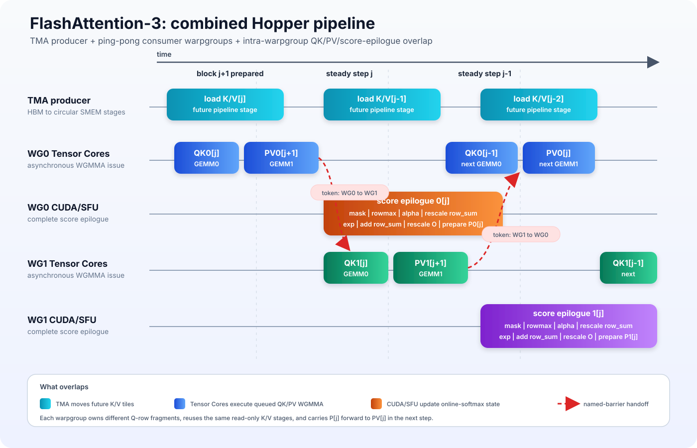

FlashAttention-2 established the modern work partition for exact attention:
one CTA owns a Q tile, streams K/V tiles, updates online softmax state, and
stores the output without materializing the quadratic score matrix.
FlashAttention-3 keeps that algorithmic invariant but changes the schedule to
match NVIDIA Hopper.

The key difference is **asynchrony**. Hopper provides:

- **TMA**, a Tensor Memory Accelerator that moves multidimensional tiles
  between HBM and shared memory;
- **WGMMA**, asynchronous Tensor Core matrix multiplication issued by a
  four-warp warpgroup; and
- named barriers and register reallocation that make producer/consumer warp
  specialization practical.

This post connects the
[FlashAttention-3 paper](https://arxiv.org/html/2407.08608) to the open-source
Hopper implementation. All source links are pinned to
[`Dao-AILab/flash-attention@b038b49`](https://github.com/Dao-AILab/flash-attention/tree/b038b4974f26ba3bc8ab3c8b840c60b0432ce39b).

## 1. What remains unchanged from FA2

For a Q tile and a sequence of K/V tiles, both FA2 and FA3 maintain:

$$
m_j = \max(m_{j-1}, \operatorname{rowmax}(S_j)),
$$

$$
\ell_j =
e^{m_{j-1}-m_j}\ell_{j-1}
+ \operatorname{rowsum}(e^{S_j-m_j}),
$$

$$
O_j =
e^{m_{j-1}-m_j}O_{j-1}
+ e^{S_j-m_j}V_j.
$$

The final output is $O = O_T / \ell_T$. The score and probability tiles are
temporary on-chip values; no $N \times N$ tensor is written to HBM.

The source still makes this state visible. The Hopper loop computes a score
fragment, asks the softmax object for the rescaling factor, applies online
softmax, and updates the output accumulator:

```cpp
cute::copy(
    softmax.max_get_scale<false, Check_inf>(tSrS),
    scores_scale);
softmax.online_softmax<false, Check_inf>(tSrS);
softmax.rescale_o(tOrO, scores_scale);
```

Source:
[`mainloop_fwd_sm90_tma_gmma_ws.hpp`, lines 1225-1237](https://github.com/Dao-AILab/flash-attention/blob/b038b4974f26ba3bc8ab3c8b840c60b0432ce39b/hopper/mainloop_fwd_sm90_tma_gmma_ws.hpp#L1225-L1237).

What changes from FA2 to FA3 is when these operations are issued and which
hardware engine executes each one.

## 2. FA2 versus FA3 in one picture

```text
FlashAttention-2 on Ampere

CTA warps
  cp.async K/V -> wait -> mma.sync QK -> softmax -> mma.sync PV
                  ^ mostly one dependency chain per tile ^


FlashAttention-3 on Hopper

producer warp       TMA K[j+1], V[j+1] ---------------------+
                                                              |
consumer WG 0       WGMMA QK[j] -> softmax[j] -> WGMMA PV[j] |
consumer WG 1             WGMMA QK[j-1] -> softmax[j-1] -----+

hardware engines    TMA | Tensor Cores | CUDA/SFU | Tensor Cores
```

The diagram is conceptual rather than cycle-accurate. The important point is
that TMA, Tensor Cores, and ordinary CUDA/SFU instructions can make progress
concurrently when dependencies and barriers are arranged correctly.

## 3. Hopper-native matrix multiplication: WGMMA

Ampere FA2 uses warp-level `mma.sync`. Hopper's WGMMA is issued by a
**warpgroup**, four contiguous warps, and executes asynchronously.

FA3 selects Hopper GMMA atoms for both matrix products:

```cpp
using TiledMmaQK = decltype(cute::make_tiled_mma(
    cute::GMMA::ss_op_selector<
        Element, Element, ElementAccum, TileShape_MNK>(),
    AtomLayoutQK{}));

using TiledMmaPV = decltype(cute::make_tiled_mma(
    cute::GMMA::rs_op_selector<
        Element, Element, ElementAccum,
        TileShape_MNK_PV, GMMA::Major::K, MmaMajorV>(),
    AtomLayoutPV{}));
```

Source:
[`mainloop_fwd_sm90_tma_gmma_ws.hpp`, lines 88-116](https://github.com/Dao-AILab/flash-attention/blob/b038b4974f26ba3bc8ab3c8b840c60b0432ce39b/hopper/mainloop_fwd_sm90_tma_gmma_ws.hpp#L88-L116).

`ss` means both operands come from shared memory; `rs` means the first comes
from registers and the second from shared memory. The exact choice depends on
head dimension, datatype, and register/shared-memory pressure.

The launch layer selects an SM90 collective for Hopper and an SM80 collective
for Ampere:

```cpp
using CollectiveMainloop = std::conditional_t<
    Arch >= 90,
    CollectiveMainloopFwdSm90<...>,
    CollectiveMainloopFwdSm80<...>>;
```

Source:
[`flash_fwd_launch_template.h`, lines 35-58](https://github.com/Dao-AILab/flash-attention/blob/b038b4974f26ba3bc8ab3c8b840c60b0432ce39b/hopper/flash_fwd_launch_template.h#L35-L58).

This is the first practical FA2-to-FA3 transition: the mathematics is the
same, but the matrix engine, operand layouts, and synchronization model are
different.

## 4. TMA and producer/consumer warp specialization

### 4.1 Why dedicate producer warps?

In FA2, many compute threads participate in address calculation and
`cp.async` copies. Hopper TMA can describe and launch an entire tensor tile
transfer with a small number of issuing threads. FA3 therefore separates:

- **producer warps**, which issue TMA loads into a circular shared-memory
  pipeline; and
- **consumer warpgroups**, which wait for full stages and issue WGMMA,
  softmax, and output updates.

The source reduces the producer side to one warp when Q, K, and V all use
TMA:

```cpp
static constexpr int NumProducerThreads =
    !Transpose_V && Use_TMA_KV && Use_TMA_Q
        ? cutlass::NumThreadsPerWarp
        : cutlass::NumThreadsPerWarpGroup;
```

Source:
[`mainloop_fwd_sm90_tma_gmma_ws.hpp`, lines 117-123](https://github.com/Dao-AILab/flash-attention/blob/b038b4974f26ba3bc8ab3c8b840c60b0432ce39b/hopper/mainloop_fwd_sm90_tma_gmma_ws.hpp#L117-L123).

### 4.2 TMA fills pipeline stages

The producer acquires a stage, binds the TMA copy to that stage's transaction
barrier, and launches K or V:

```cpp
pipeline_k.producer_acquire(smem_pipe_write);
copy(
    params.tma_load_K.with(
        *pipeline_k.producer_get_barrier(smem_pipe_write),
        mcast_mask_kv),
    tKgK_TMA(...),
    tKsK_TMA(_, smem_pipe_write.index()));
```

V follows the same pattern. Source:
[`mainloop_fwd_sm90_tma_gmma_ws.hpp`, lines 749-772](https://github.com/Dao-AILab/flash-attention/blob/b038b4974f26ba3bc8ab3c8b840c60b0432ce39b/hopper/mainloop_fwd_sm90_tma_gmma_ws.hpp#L749-L772).

The consumer does not poll raw memory. It waits on the pipeline state:

```cpp
auto token = pipeline.consumer_try_wait(smem_pipe_read);
pipeline.consumer_wait(smem_pipe_read, token);
```

Source:
[`mainloop_fwd_sm90_tma_gmma_ws.hpp`, lines 1081-1084](https://github.com/Dao-AILab/flash-attention/blob/b038b4974f26ba3bc8ab3c8b840c60b0432ce39b/hopper/mainloop_fwd_sm90_tma_gmma_ws.hpp#L1081-L1084).

The circular buffer lets TMA fill a future stage while consumers operate on a
different one. This overlaps HBM-to-SMEM traffic with arithmetic rather than
serializing every tile load before computation.

## 5. Ping-pong scheduling between consumer warpgroups

TMA overlap hides memory latency, but attention also alternates extremely fast
Tensor Core work with much slower exponentials and reductions. FA3 uses two
consumer warpgroups and named barriers to control which group issues WGMMA.

The scheduler passes a token to the next warpgroup:

```cpp
void warp_scheduler_barrier_sync() {
    NamedBarrier::sync(
        2 * NumThreadsPerWarpGroup,
        WarpSchedulerWG1 - 1
            + canonical_warp_group_idx_nosync());
}

void warp_scheduler_barrier_arrive() {
    int next_WG = 1 - cur_WG;
    NamedBarrier::arrive(
        2 * NumThreadsPerWarpGroup,
        WarpSchedulerWG1 + next_WG);
}
```

Source:
[`mainloop_fwd_sm90_tma_gmma_ws.hpp`, lines 920-939](https://github.com/Dao-AILab/flash-attention/blob/b038b4974f26ba3bc8ab3c8b840c60b0432ce39b/hopper/mainloop_fwd_sm90_tma_gmma_ws.hpp#L920-L939).

Conceptually:

```text
time ---->

WG 0:  QK[j]      softmax[j] + PV[j]
WG 1:       QK[j']                  softmax[j'] + PV[j']
             ^ named-barrier handoff ^
```

While one warpgroup executes softmax on CUDA cores and special-function units,
the other can keep the asynchronous Tensor Core pipeline busy. The hardware
warp scheduler provides some overlap automatically; the explicit barrier
schedule makes the intended alternation much more reliable.

## 6. The complete intra-warpgroup pipeline

FA3 also pipelines operations **inside one warpgroup**. The source summarizes
the schedule directly:

```cpp
// Each step does gemm0 for iter n_block,
// gemm1 for iter n_block + 1,
// and softmax for iter n_block.
```

Here, an iteration means one K/V block. The kernel visits blocks in reverse
order, so `n_block + 1` is the block processed immediately before
`n_block`. For a fixed set of Q rows:

```text
GEMM0[j] = Q @ K[j]T
P[j]     = softmax state update for GEMM0[j]
GEMM1[j] = P[j] @ V[j]
```

The prologue computes `GEMM0[j+1]` and prepares `P[j+1]`. A steady-state step
can then compute `GEMM0[j]` while consuming `P[j+1]` in `GEMM1[j+1]`.

### 6.1 "Softmax" means the complete score epilogue

Pipeline diagrams often label one region simply `softmax`, but the source
performs more than exponentiation. It must preserve the online-softmax state:

$$
m_j = \max(m_{j+1}, \operatorname{rowmax}(S_j)),
$$

$$
\alpha_j = e^{(m_{j+1}-m_j)\cdot\text{scale}},
$$

$$
\ell_j =
\alpha_j\ell_{j+1}
+ \operatorname{rowsum}
  \left(e^{(S_j-m_j)\cdot\text{scale}}\right),
$$

$$
O_j =
\alpha_j O_{j+1}
+ P_jV_j.
$$

The Hopper softmax helper splits this work into three methods.

First, `max_get_scale` reduces the current tile maximum, updates the running
maximum, computes `alpha`, and rescales the old row sum:

```cpp
flash::reduce_max</*zero_init=*/false>(scores, row_max);
scores_scale(mi) = exp2f(
    (scores_max_prev(mi) - scores_max_cur)
    * softmax_scale_log2);
row_sum(mi) *= scores_scale(mi);
```

Source:
[`hopper/softmax.h`, lines 101-124](https://github.com/Dao-AILab/flash-attention/blob/b038b4974f26ba3bc8ab3c8b840c60b0432ce39b/hopper/softmax.h#L101-L124).

Next, `online_softmax` replaces the score fragment with unnormalized
probabilities and adds the current tile's contribution to `row_sum`:

```cpp
scale_apply_exp2(
    scores, row_max, softmax_scale_log2);
reduce_sum</*zero_init=*/Is_first,
           /*warp_reduce=*/false>(scores, row_sum);
```

Source:
[`hopper/softmax.h`, lines 126-135](https://github.com/Dao-AILab/flash-attention/blob/b038b4974f26ba3bc8ab3c8b840c60b0432ce39b/hopper/softmax.h#L126-L135).

Finally, `rescale_o` multiplies every element of the existing output
accumulator by the same per-row `alpha`:

```cpp
acc_o_rowcol(mi, ni) *= scores_scale(mi);
```

Source:
[`hopper/softmax.h`, lines 156-166](https://github.com/Dao-AILab/flash-attention/blob/b038b4974f26ba3bc8ab3c8b840c60b0432ce39b/hopper/softmax.h#L156-L166).

So a more accurate label than `softmax` is:

```text
score epilogue =
    mask
    + row maximum update
    + row-sum rescaling
    + exponentiation
    + row-sum accumulation
    + output rescaling
    + P conversion/layout preparation
```

The final cross-lane row-sum reduction, division of `O`, and LSE construction
happen later in `finalize`:
[`hopper/softmax.h`, lines 137-154](https://github.com/Dao-AILab/flash-attention/blob/b038b4974f26ba3bc8ab3c8b840c60b0432ce39b/hopper/softmax.h#L137-L154).

### 6.2 The merged steady-state code

The actual steady-state step is approximately:

```cpp
// tOrP contains P[j + 1] from the preceding iteration.
consumer_wait(pipeline_k, K_stage_j);
warp_scheduler_barrier_sync();

// Asynchronously launch QK for the current block.
gemm<true, -1>(tiled_mma_qk, Q, K[j], scores[j]);

// One legal schedule applies alpha[j + 1] before adding PV[j + 1].
if constexpr (RescaleOBeforeGemm) {
    softmax.rescale_o(O, alpha[j + 1]);
}

consumer_wait(pipeline_v, V_stage_j_plus_1);
gemm<false, -1>(
    tiled_mma_pv, P[j + 1], V[j + 1], O);

// The other consumer warpgroup may now issue its WGMMA pair.
warp_scheduler_barrier_arrive();

// QK[j] is ready; PV[j + 1] may still be in flight.
warpgroup_wait<1>();
pipeline_k.consumer_release(...);

mask_fn(scores[j], j);
alpha[j] = softmax.max_get_scale(scores[j]);
softmax.online_softmax(scores[j]);

// Finish PV before releasing V or reusing O.
warpgroup_wait<0>();
pipeline_v.consumer_release(...);

convert_and_permute(scores[j], P[j]);

// The other legal schedule rescales everything accumulated
// through PV[j + 1] into the new maximum's basis.
if constexpr (!RescaleOBeforeGemm) {
    softmax.rescale_o(O, alpha[j]);
}
```

Source:
[`mainloop_fwd_sm90_tma_gmma_ws.hpp`, lines 1199-1237](https://github.com/Dao-AILab/flash-attention/blob/b038b4974f26ba3bc8ab3c8b840c60b0432ce39b/hopper/mainloop_fwd_sm90_tma_gmma_ws.hpp#L1199-L1237).

This is pseudocode with descriptive names, but its ordering follows the linked
source. `warpgroup_wait<1>()` reaches the dependency point for the current QK
scores while allowing a later WGMMA group to remain outstanding.
`warpgroup_wait<0>()` then ensures PV has completed before its V stage is
released or its output accumulator is rescaled.

### 6.3 Two equivalent output-rescaling schedules

The compile-time `RescaleOBeforeGemm` choice moves the multiplication by
`alpha`; it does not remove it.

In the default schedule, `PV[j+1]` is first added using the old running
maximum, then the whole accumulator is moved into block `j`'s new basis:

```text
O = O + P[j+1] V[j+1]
O = alpha[j] * O
```

In the alternative schedule, `alpha[j+1]` is carried from the preceding score
epilogue into the next pipeline step:

```text
O = alpha[j+1] * O
O = O + P[j+1] V[j+1]
```

`P[j+1]` was already computed relative to `m[j+1]`, so both terms use the
same basis. The selection is defined at
[`mainloop_fwd_sm90_tma_gmma_ws.hpp`, lines 352-357](https://github.com/Dao-AILab/flash-attention/blob/b038b4974f26ba3bc8ab3c8b840c60b0432ce39b/hopper/mainloop_fwd_sm90_tma_gmma_ws.hpp#L352-L357),
and the two placements appear in the steady-state loop at
[`lines 1208-1237`](https://github.com/Dao-AILab/flash-attention/blob/b038b4974f26ba3bc8ab3c8b840c60b0432ce39b/hopper/mainloop_fwd_sm90_tma_gmma_ws.hpp#L1208-L1237).

### 6.4 Combined TMA, ping-pong, and intra-warpgroup timeline

Each consumer warpgroup owns a different subset of the CTA's Q rows while
reading the same staged K/V blocks. Within each warpgroup, `j+1` and `j`
refer to adjacent K/V blocks for those same Q rows.


_Each red handoff arrow terminates at the next warpgroup's QK issue. The
named barrier controls WGMMA issue order; it does not wait for all previously
issued Tensor Core work to finish._

```text
Logical K/V traversal:                 j+1  ->  j  ->  j-1
Time -------------------------------------------------------------------->

TMA producer:
    load K/V[j]        load K/V[j-1]       load K/V[j-2]
    into future stage  into future stage   into future stage

WG0 Tensor Core issue:
    QK0[j]  PV0[j+1]                         QK0[j-1]  PV0[j]
             |
             +-- pass named-barrier token to WG1

WG0 CUDA/SFU score epilogue:
                       mask/max/alpha/exp/sum[j]
                       rescale O0; prepare P0[j]

WG1 Tensor Core issue:
                 QK1[j]  PV1[j+1]                         QK1[j-1]
                           |
                           +-- pass named-barrier token back to WG0

WG1 CUDA/SFU score epilogue:
                                     mask/max/alpha/exp/sum[j]
                                     rescale O1; prepare P1[j]
```

The named-barrier token is passed immediately after a warpgroup issues its
QK/PV pair:
[`mainloop_fwd_sm90_tma_gmma_ws.hpp`, lines 920-939](https://github.com/Dao-AILab/flash-attention/blob/b038b4974f26ba3bc8ab3c8b840c60b0432ce39b/hopper/mainloop_fwd_sm90_tma_gmma_ws.hpp#L920-L939).
That permits the other warpgroup to issue WGMMA while the first performs its
score epilogue.

This does not mean all WGMMA instructions execute on physically separate
Tensor Cores in the same cycle. They are asynchronously issued and queued;
Hopper arbitrates the Tensor Core pipeline. The useful overlap is among:

```text
TMA moving future K/V tiles
Tensor Cores executing queued QK/PV WGMMA
CUDA cores and SFUs updating online-softmax state
```

The full pipeline therefore has these boundaries:

```text
Prologue:
    QK[J] -> score epilogue[J] -> produce P[J]

Steady state:
    QK[j] + PV[j+1] -> score epilogue[j] -> produce P[j]

Epilogue:
    PV[lowest block] -> finalize row sum/LSE -> normalize and store O
```

This works because WGMMA is asynchronous: issuing an instruction does not mean
the issuing warpgroup must immediately stop until every accumulator is ready.
The waits express the true data dependencies, while the scheduler barrier
controls which warpgroup may issue next.

> **Side note: why not use only intra-warpgroup overlap?**
>
> Intra-warpgroup overlap already launches `QK[j]` and `PV[j+1]` before
> executing the score epilogue for block `j`. Those previously issued WGMMA
> operations can continue on the Tensor Cores while the same warpgroup runs
> masking, reductions, exponentiation, and rescaling on CUDA cores and SFUs.
>
> However, a warpgroup still has one sequential instruction stream. While its
> threads execute the score epilogue, that same warpgroup cannot simultaneously
> issue another WGMMA instruction. It could issue `QK[j-1]` early, before the
> score epilogue, but then it would need to keep another score accumulator and
> pipeline stage live alongside `scores[j]`, `P[j+1]`, O, `row_max`,
> `row_sum`, and the scale fragments. That deeper software pipeline increases
> register pressure and can reduce occupancy.
>
> Ping-pong scheduling instead gives the next issue opportunity to another
> warpgroup with an independent instruction stream and register allocation:
>
> ```text
> WG0: issue QK/PV | score epilogue | issue next QK/PV
> WG1:                 issue QK/PV | score epilogue
> Tensor Cores: QK/PV ------ QK/PV ------ QK/PV ------>
> ```
>
> Therefore the two mechanisms are complementary. Intra-warpgroup scheduling
> overlaps **already-issued** WGMMA with that warpgroup's scalar work.
> Ping-pong scheduling keeps supplying new WGMMA while the first warpgroup is
> occupied by scalar work, without requiring a much deeper set of live
> accumulator fragments.

The tradeoff is register pressure. More in-flight score, probability, scale,
and output fragments increase overlap but can reduce occupancy. The kernel
therefore chooses `IntraWGOverlap` through architecture- and shape-specific
tile tuning:

```cpp
static constexpr bool IntraWGOverlap =
    std::get<3>(kBlockMN_RS_IntraWGOverlap);
```

Source:
[`flash_fwd_launch_template.h`, lines 40-49](https://github.com/Dao-AILab/flash-attention/blob/b038b4974f26ba3bc8ab3c8b840c60b0432ce39b/hopper/flash_fwd_launch_template.h#L40-L49).

## 7. Persistent scheduling

FA3 can keep CTAs resident and assign them multiple attention tiles rather
than launching one independent CTA for every tile. This reduces scheduling
overhead and improves load balance, especially for causal, variable-length,
or split workloads.

The launch code selects persistent schedulers for SM90:

```cpp
using SchedulerPersistent = std::conditional_t<
    Varlen,
    VarlenDynamicPersistentTileScheduler<...>,
    std::conditional_t<
        !Is_causal && !Is_local,
        StaticPersistentTileScheduler<Split>,
        DynamicPersistentTileScheduler<...>>>;
```

Source:
[`flash_fwd_launch_template.h`, lines 60-70](https://github.com/Dao-AILab/flash-attention/blob/b038b4974f26ba3bc8ab3c8b840c60b0432ce39b/hopper/flash_fwd_launch_template.h#L60-L70).

Persistence is not a new attention equation. It is a grid-level scheduling
optimization layered above the same Q-block/KV-streaming mainloop.

## 8. FP8: throughput, layout repair, and scaling

H100 FP8 Tensor Cores offer roughly twice the matrix throughput of FP16/BF16,
but using them is more involved than changing a C++ type.

### 8.1 FP8 changes legal WGMMA layouts

The code detects FP8 and requires K-major layout for the V operand:

```cpp
static constexpr bool Is_FP8 =
    is_same_v<Element, float_e4m3_t>
    || is_same_v<Element, float_e5m2_t>;
static constexpr bool Transpose_V = Is_FP8 && !V_colmajor;
static constexpr GMMA::Major MmaMajorV =
    !Is_FP8 && !V_colmajor ? GMMA::Major::MN
                           : GMMA::Major::K;
```

Source:
[`mainloop_fwd_sm90_tma_gmma_ws.hpp`, lines 44-66](https://github.com/Dao-AILab/flash-attention/blob/b038b4974f26ba3bc8ab3c8b840c60b0432ce39b/hopper/mainloop_fwd_sm90_tma_gmma_ws.hpp#L44-L66).

If V arrives row-major, FA3 performs an in-kernel shared-memory transpose with
LDSM/STSM-compatible layouts:

```cpp
// Use LDSM.T and STSM to transpose V
// in the case of FP8 and V being row-major.
```

Source:
[`mainloop_fwd_sm90_tma_gmma_ws.hpp`, lines 177-195](https://github.com/Dao-AILab/flash-attention/blob/b038b4974f26ba3bc8ab3c8b840c60b0432ce39b/hopper/mainloop_fwd_sm90_tma_gmma_ws.hpp#L177-L195)
and the byte-level transpose at
[`lines 720-742`](https://github.com/Dao-AILab/flash-attention/blob/b038b4974f26ba3bc8ab3c8b840c60b0432ce39b/hopper/mainloop_fwd_sm90_tma_gmma_ws.hpp#L720-L742).

### 8.2 The QK accumulator must become a legal PV operand

The output of QK is an FP32 accumulator fragment, but PV needs an FP8
matrix-A operand in the layout expected by WGMMA. FA3 permutes and converts
the score/probability registers:

```cpp
if constexpr (Is_FP8 && !V_colmajor) {
    permute_Cregs_fp8(tSrS);
}
convert_type_out(tOrP_acc, tOrP);
if constexpr (Is_FP8 && V_colmajor) {
    permute_Aregs_fp8(tOrP);
}
```

Source:
[`mainloop_fwd_sm90_tma_gmma_ws.hpp`, lines 1185-1189](https://github.com/Dao-AILab/flash-attention/blob/b038b4974f26ba3bc8ab3c8b840c60b0432ce39b/hopper/mainloop_fwd_sm90_tma_gmma_ws.hpp#L1185-L1189).

This is a concrete example of a theoretical hardware constraint becoming
register-layout code.

### 8.3 Descaling is fused into the attention math

The API accepts per-batch/per-head Q, K, and V descales. Q/K descales modify
the score scale, and the V descale is folded into finalization:

```cpp
float v_descale =
    ptr_v_descale == nullptr ? 1.0f : ptr_v_descale[...];
cute::copy(softmax.finalize(v_descale), scores_scale);
```

Source:
[`mainloop_fwd_sm90_tma_gmma_ws.hpp`, lines 1266-1273](https://github.com/Dao-AILab/flash-attention/blob/b038b4974f26ba3bc8ab3c8b840c60b0432ce39b/hopper/mainloop_fwd_sm90_tma_gmma_ws.hpp#L1266-L1273).

### 8.4 What about block quantization and incoherent processing?

The FA3 paper also proposes block quantization and randomized Hadamard
transforms to spread outliers before FP8 quantization. The checked-in Hopper
kernel exposes FP8 datatypes, descales, register permutations, and the V
transpose, but this pinned revision does **not** contain an integrated
Hadamard transform in the attention kernel. That transform belongs upstream
of the core attention call and can be fused with another bandwidth-bound
operation such as rotary embedding.

This distinction matters: the open-source kernel directly demonstrates the
FP8 execution and layout machinery, while the paper describes a broader
end-to-end quantization strategy.

## 9. Where each optimization lives

| FA3 optimization | Why it helps | Source |
| --- | --- | --- |
| Hopper WGMMA | Higher Tensor Core throughput and asynchronous issue | [`mainloop...#L88-L116`](https://github.com/Dao-AILab/flash-attention/blob/b038b4974f26ba3bc8ab3c8b840c60b0432ce39b/hopper/mainloop_fwd_sm90_tma_gmma_ws.hpp#L88-L116) |
| TMA K/V pipeline | Moves tensor tiles with less address/register overhead | [`mainloop...#L749-L772`](https://github.com/Dao-AILab/flash-attention/blob/b038b4974f26ba3bc8ab3c8b840c60b0432ce39b/hopper/mainloop_fwd_sm90_tma_gmma_ws.hpp#L749-L772) |
| Producer/consumer specialization | Lets data movement and compute progress independently | [`mainloop...#L117-L123`](https://github.com/Dao-AILab/flash-attention/blob/b038b4974f26ba3bc8ab3c8b840c60b0432ce39b/hopper/mainloop_fwd_sm90_tma_gmma_ws.hpp#L117-L123) |
| Inter-warpgroup ping-pong | Hides one group's softmax under another group's WGMMA | [`mainloop...#L920-L959`](https://github.com/Dao-AILab/flash-attention/blob/b038b4974f26ba3bc8ab3c8b840c60b0432ce39b/hopper/mainloop_fwd_sm90_tma_gmma_ws.hpp#L920-L959) |
| Intra-warpgroup overlap | Pipelines QK, PV, masking, and softmax across tiles | [`mainloop...#L1199-L1237`](https://github.com/Dao-AILab/flash-attention/blob/b038b4974f26ba3bc8ab3c8b840c60b0432ce39b/hopper/mainloop_fwd_sm90_tma_gmma_ws.hpp#L1199-L1237) |
| Persistent CTA scheduler | Reduces launch/scheduling overhead and balances irregular work | [`flash_fwd_launch_template.h#L60-L70`](https://github.com/Dao-AILab/flash-attention/blob/b038b4974f26ba3bc8ab3c8b840c60b0432ce39b/hopper/flash_fwd_launch_template.h#L60-L70) |
| FP8 V transpose | Repairs row-major V into the K-major form required by FP8 WGMMA | [`mainloop...#L177-L195`](https://github.com/Dao-AILab/flash-attention/blob/b038b4974f26ba3bc8ab3c8b840c60b0432ce39b/hopper/mainloop_fwd_sm90_tma_gmma_ws.hpp#L177-L195) |
| FP8 register permutation | Converts QK accumulator layout into a legal PV operand | [`mainloop...#L1185-L1189`](https://github.com/Dao-AILab/flash-attention/blob/b038b4974f26ba3bc8ab3c8b840c60b0432ce39b/hopper/mainloop_fwd_sm90_tma_gmma_ws.hpp#L1185-L1189) |

## 10. Performance and the correct interpretation

The FA3 paper reports, on H100:

- **1.5-2.0x** forward speedup over FA2 for FP16;
- up to **740 TFLOP/s** for FP16, about 75% of H100's theoretical maximum;
- close to **1.2 PFLOP/s** for FP8; and
- **2.6x lower numerical error** than baseline FP8 attention in the paper's
  outlier experiment when block quantization and incoherent processing are
  applied.

These are the paper authors' measurements, not benchmarks reproduced for this
article. Performance depends on sequence length, head dimension, masking,
datatype, GPU clocks, and the exact library revision.

## 11. How to read the Hopper implementation

Start from the launch file and follow types rather than trying to read the
entire mainloop top to bottom:

1. [`flash_fwd_launch_template.h`](https://github.com/Dao-AILab/flash-attention/blob/b038b4974f26ba3bc8ab3c8b840c60b0432ce39b/hopper/flash_fwd_launch_template.h)
   chooses tile sizes, SM80 versus SM90, overlap mode, stages, and scheduler.
2. [`mainloop_fwd_sm90_tma_gmma_ws.hpp`](https://github.com/Dao-AILab/flash-attention/blob/b038b4974f26ba3bc8ab3c8b840c60b0432ce39b/hopper/mainloop_fwd_sm90_tma_gmma_ws.hpp)
   defines WGMMA layouts, TMA pipelines, producer work, consumer work, and
   barrier scheduling.
3. [`flash_fwd_kernel_sm90.h`](https://github.com/Dao-AILab/flash-attention/blob/b038b4974f26ba3bc8ab3c8b840c60b0432ce39b/hopper/flash_fwd_kernel_sm90.h)
   connects the collective mainloop to the persistent tile scheduler.
4. [`epilogue_fwd.hpp`](https://github.com/Dao-AILab/flash-attention/blob/b038b4974f26ba3bc8ab3c8b840c60b0432ce39b/hopper/epilogue_fwd.hpp)
   normalizes and stores output, using TMA stores where legal.

Keep asking four questions:

```text
Which tile is owned by this CTA?
Which pipeline stage contains K and V?
Which warp or warpgroup is producer versus consumer?
Which wait makes a value safe to read or overwrite?
```

Those questions turn the template-heavy C++ into a recognizable asynchronous
dataflow graph.

## 12. Takeaways

FlashAttention-3 is not a new softmax identity. It is a Hopper-native schedule
for the same exact tiled-attention recurrence:

1. TMA moves future K/V tiles while consumers compute.
2. WGMMA makes both attention matrix products asynchronous.
3. Named barriers coordinate producer/consumer and ping-pong warpgroups.
4. Intra-warpgroup pipelining overlaps softmax with adjacent GEMMs.
5. Persistent scheduling keeps work resident and balances irregular tiles.
6. FP8 requires explicit scaling, operand-layout repair, and careful
   quantization outside the core kernel.

FA2's central insight was to make attention IO-aware. FA3's central insight is
to make that IO-aware algorithm **asynchrony-aware**.

## Appendix A: reading the normal Hopper forward path top to bottom

This appendix follows one ordinary fixed-length forward call through the
source. The goal is not to enumerate every template branch, but to provide a
stable route through the code that can be followed in an editor.

### A.1 Fix one concrete configuration

Assume:

```python
q, k, v: [batch, 384, heads, 128]
dtype: torch.bfloat16
GPU: H100 / SM90

flash_attn_func(
    q, k, v,
    causal=False,
    window_size=(-1, -1),
    num_splits=1,
    pack_gqa=False,
    softcap=0.0,
)
```

Also assume:

```text
Q heads == KV heads
Q/K/V head dimensions are all 128
no variable-length metadata
no page table or KV cache append
no extra Qv tensor
row-major V
```

For this configuration, the important compile-time choices are:

```text
Arch              = 90
Element           = cutlass::bfloat16_t
kHeadDim          = 128
kHeadDimV         = 128
Is_causal/local   = false / false
Varlen            = false
Split             = false
PackGQA           = false
PagedKVNonTMA     = false
AppendKV / HasQv  = false / false
V_colmajor        = false
ClusterM          = 1 for this three-Q-tile example
```

The SM90 tile selector returns:

```cpp
return {128, 176, true, true};
//       M    N    PV-RS intra-WG overlap
```

Source:
[`tile_size.h`, lines 10-45](https://github.com/Dao-AILab/flash-attention/blob/b038b4974f26ba3bc8ab3c8b840c60b0432ce39b/hopper/tile_size.h#L10-L45).

The complete call path is:

```text
flash_attn_func
  -> FlashAttnFunc.forward
  -> _flash_attn_forward
  -> torch.ops.flash_attn_3.fwd
  -> boxed_mha_fwd
  -> mha_fwd
  -> run_mha_fwd
  -> run_mha_fwd_constexpr
  -> run_mha_fwd_<90, bf16, 128, 128, ...>
  -> run_flash_fwd
  -> device_kernel<FlashAttnFwdSm90>
  -> FlashAttnFwdSm90::operator()
       producer WG -> mainloop.load
       consumer WGs -> mainloop.mma
       consumer WGs -> epilogue.store
```

### A.2 Python entry point

Start at
[`flash_attn_func`](https://github.com/Dao-AILab/flash-attention/blob/b038b4974f26ba3bc8ab3c8b840c60b0432ce39b/hopper/flash_attn_interface.py#L809-L887).
It is a convenience wrapper around the autograd function:

```python
return FlashAttnFunc.apply(
    q, k, v,
    softmax_scale,
    causal,
    ...
)
```

Next open
[`FlashAttnFunc.forward`, lines 552-600](https://github.com/Dao-AILab/flash-attention/blob/b038b4974f26ba3bc8ab3c8b840c60b0432ce39b/hopper/flash_attn_interface.py#L552-L600).
It supplies the default scale:

```python
softmax_scale = q.shape[-1] ** (-0.5)
```

and makes the normal fixed-length call by passing `None` for:

```text
k_new / v_new
cu_seqlens_q / cu_seqlens_k
page_table
rotary tensors
```

That distinction is important: the same lower-level API implements fixed
length, varlen, paged KV, append-KV, and several other modes. The ordinary
path is selected mostly by which optional pointers remain null.

### A.3 Python custom op to the C++ extension

`FlashAttnFunc.forward` calls
[`_flash_attn_forward`, lines 60-151](https://github.com/Dao-AILab/flash-attention/blob/b038b4974f26ba3bc8ab3c8b840c60b0432ce39b/hopper/flash_attn_interface.py#L60-L151).

This wrapper:

1. makes required tensors contiguous;
2. calls `flash_attn_3_gpu.fwd`;
3. converts optional accumulation outputs into empty tensors when unused; and
4. returns `out` and `softmax_lse`.

```python
out, softmax_lse, out_accum, softmax_lse_accum = (
    flash_attn_3_gpu.fwd(...)
)
```

On newer PyTorch builds, `flash_attn_3_gpu` is:

```python
torch.ops.flash_attn_3
```

The build chooses
[`flash_api_stable.cpp` for newer PyTorch and `flash_api.cpp` otherwise](https://github.com/Dao-AILab/flash-attention/blob/b038b4974f26ba3bc8ab3c8b840c60b0432ce39b/hopper/setup.py#L645-L660).
This appendix follows the stable API; the kernel path after argument
unpacking is the same.

The operator schema is registered at
[`flash_api_stable.cpp`, lines 1896-1953](https://github.com/Dao-AILab/flash-attention/blob/b038b4974f26ba3bc8ab3c8b840c60b0432ce39b/hopper/flash_api_stable.cpp#L1896-L1953).
Its boxed adapter unpacks the operator stack and calls `mha_fwd`:

```cpp
auto [out, lse, out_accum, lse_accum] =
    mha_fwd(q, k, v, ...);
```

Source:
[`boxed_mha_fwd`, lines 1758-1805](https://github.com/Dao-AILab/flash-attention/blob/b038b4974f26ba3bc8ab3c8b840c60b0432ce39b/hopper/flash_api_stable.cpp#L1758-L1805).

### A.4 `mha_fwd`: validate tensors and construct runtime parameters

[`mha_fwd`, lines 742-990](https://github.com/Dao-AILab/flash-attention/blob/b038b4974f26ba3bc8ab3c8b840c60b0432ce39b/hopper/flash_api_stable.cpp#L742-L990)
is the large runtime-validation layer. Read it in this order:

1. validate GPU architecture and Q/K/V dtype;
2. require contiguous head dimensions;
3. determine fixed versus variable-length shapes;
4. validate head-count divisibility;
5. canonicalize causal/window arguments;
6. allocate `out` and FP32 `softmax_lse`; and
7. populate `Flash_fwd_params`.

For the normal path:

```cpp
is_varlen_q = false;
is_varlen_k = false;
paged_KV = false;
head_size = 128;
head_size_v = 128;
```

`set_params_fprop` records pointers, strides, dimensions, the softmax scale,
masking configuration, and device properties in `Flash_fwd_params`.
The final launch occurs at:

```cpp
run_mha_fwd(params, stream);
```

Source:
[`flash_api_stable.cpp`, lines 962-1244](https://github.com/Dao-AILab/flash-attention/blob/b038b4974f26ba3bc8ab3c8b840c60b0432ce39b/hopper/flash_api_stable.cpp#L962-L1244).

A useful debugging boundary is:

```text
Above run_mha_fwd: runtime tensor validation and parameter packing
Below run_mha_fwd: compile-time kernel dispatch and device execution
```

### A.5 Runtime flags become template parameters

[`run_mha_fwd`, lines 432-450](https://github.com/Dao-AILab/flash-attention/blob/b038b4974f26ba3bc8ab3c8b840c60b0432ce39b/hopper/flash_api_stable.cpp#L432-L450)
turns runtime booleans into template constants:

```cpp
ARCH_SWITCH(...)
SPLIT_SWITCH(...)
PAGEDKV_SWITCH(...)
PACKGQA_SWITCH(...)
SOFTCAP_SWITCH(...)
```

For the chosen configuration this becomes conceptually:

```cpp
run_mha_fwd_constexpr<
    90,     // Arch
    false,  // Split
    false,  // PagedKVNonTMA
    false,  // PackGQA
    false   // Has_softcap
>(params, stream);
```

`run_mha_fwd_constexpr` then dispatches dtype and rounded head dimension:

```cpp
run_mha_fwd_<
    90,
    cutlass::bfloat16_t,
    128,
    128,
    false, false, false, false
>(params, stream);
```

Source:
[`flash_api_stable.cpp`, lines 321-430](https://github.com/Dao-AILab/flash-attention/blob/b038b4974f26ba3bc8ab3c8b840c60b0432ce39b/hopper/flash_api_stable.cpp#L321-L430).

These explicit instantiations are generated from
[`generate_kernels.py`, lines 30-48](https://github.com/Dao-AILab/flash-attention/blob/b038b4974f26ba3bc8ab3c8b840c60b0432ce39b/hopper/generate_kernels.py#L30-L48)
to keep compilation parallel and avoid instantiating every combination in one
translation unit.

### A.6 Final feature switches and tile selection

Open
[`run_mha_fwd_`, lines 202-220](https://github.com/Dao-AILab/flash-attention/blob/b038b4974f26ba3bc8ab3c8b840c60b0432ce39b/hopper/flash_fwd_launch_template.h#L202-L220).
It resolves the remaining feature switches:

```text
causal versus local
V row-major versus column-major
fixed length versus varlen
extra Qv
append KV
one-CTA versus two-CTA cluster
```

For the concrete example, it calls:

```cpp
run_flash_fwd<
    90, 128, 128, 1,
    cutlass::bfloat16_t,
    cutlass::bfloat16_t,
    false, false, false, false,
    false, false, false, false,
    false, false
>(params, stream);
```

Do not try to memorize this positional template list. Read the declaration
immediately above it and annotate the values in an editor.

### A.7 `run_flash_fwd`: assemble the kernel type

[`run_flash_fwd`, lines 31-81](https://github.com/Dao-AILab/flash-attention/blob/b038b4974f26ba3bc8ab3c8b840c60b0432ce39b/hopper/flash_fwd_launch_template.h#L31-L81)
is the kernel type factory.

For this example:

```text
TileShape_MNK    = (128, 176, 128)  # QK
TileShape_MNK_PV = (128, 128, 176)  # PV
kStages          = 2
MmaPV_is_RS      = true
IntraWGOverlap   = true
```

It combines three major types:

```cpp
CollectiveMainloopFwdSm90<...>
CollectiveEpilogueFwd<...>
StaticPersistentTileScheduler<...>
```

into:

```cpp
FlashAttnFwdSm90<
    CollectiveMainloop,
    CollectiveEpilogue,
    Scheduler>
```

The same function also:

- converts raw pointers and strides into typed CuTe arguments;
- constructs scheduler arguments;
- converts them into device-side kernel parameters;
- asks the kernel for grid/block/shared-memory sizes; and
- launches `cutlass::device_kernel<AttnKernel>`.

Source:
[`flash_fwd_launch_template.h`, lines 82-199](https://github.com/Dao-AILab/flash-attention/blob/b038b4974f26ba3bc8ab3c8b840c60b0432ce39b/hopper/flash_fwd_launch_template.h#L82-L199).

### A.8 Understand the persistent scheduler before the kernel

For non-causal, non-local SM90 without splits, the selected scheduler is
[`StaticPersistentTileScheduler`](https://github.com/Dao-AILab/flash-attention/blob/b038b4974f26ba3bc8ab3c8b840c60b0432ce39b/hopper/tile_scheduler.hpp#L141-L217).

The launch grid contains approximately one CTA per usable SM:

```cpp
get_grid_shape(...) {
    return {num_sm};
}
```

Each resident CTA repeatedly advances through logical attention tiles:

```cpp
initial tile = blockIdx.x;
next tile = current_tile + gridDim.x;
```

`get_block_coord` converts one linear tile index into:

```text
(m_block, attention_head, batch, split_idx)
```

This is why one physical CTA can process multiple Q tiles over its lifetime.
The scheduler decides **which Q tile** to process; the mainloop decides how
that tile streams through K/V.

### A.9 Enter the device kernel and split producer from consumers

The CUDA entry body is
[`FlashAttnFwdSm90::operator()`, lines 170-451](https://github.com/Dao-AILab/flash-attention/blob/b038b4974f26ba3bc8ab3c8b840c60b0432ce39b/hopper/flash_fwd_kernel_sm90.h#L170-L451).

The kernel contains:

```text
one load warpgroup
one to three MMA warpgroups
```

Source:
[`flash_fwd_kernel_sm90.h`, lines 62-79](https://github.com/Dao-AILab/flash-attention/blob/b038b4974f26ba3bc8ab3c8b840c60b0432ce39b/hopper/flash_fwd_kernel_sm90.h#L62-L79).

For the normal TMA path, only the first warp of the producer warpgroup needs
to issue most transfers, but reserving a warpgroup keeps role assignment and
register reallocation simple.

The source numbering differs from the conceptual diagram earlier:

```text
source warp_group_idx == 0: producer warpgroup
source warp_group_idx > 0: consumer MMA warpgroups
diagram WG0 / WG1:         the two consumer warpgroups
```

After pipeline/barrier initialization, the branch is explicit:

```cpp
if (warp_group_idx == 0) {
    // Producer
    mainloop.load(...);
} else {
    // Consumer
    mainloop.mma(...);
    epilogue.store(...);
}
```

The producer gives registers back:

```cpp
warpgroup_reg_dealloc<LoadRegisterRequirement>();
```

while consumers request more:

```cpp
warpgroup_reg_alloc<MmaRegisterRequirement>();
```

This is Hopper's dynamic register redistribution in the actual kernel.

### A.10 Producer path: construct tiles and issue TMA

The producer calls
[`CollectiveMainloopFwdSm90::load`, lines 591-925](https://github.com/Dao-AILab/flash-attention/blob/b038b4974f26ba3bc8ab3c8b840c60b0432ce39b/hopper/mainloop_fwd_sm90_tma_gmma_ws.hpp#L591-L925).

Read this function in five pieces:

1. calculate legal K/V block bounds for the current Q tile;
2. construct shared-memory Q/K/V tensors and layouts;
3. construct global-memory TMA tensor views;
4. partition global and shared tensors into TMA source/destination views; and
5. run the descending K/V pipeline.

The actual K transfer is:

```cpp
pipeline_k.producer_acquire(stage);
copy(
    params.tma_load_K.with(
        *pipeline_k.producer_get_barrier(stage),
        mcast_mask_kv),
    global_K_tile,
    shared_K_stage);
```

V follows the same pattern:
[`mainloop_fwd_sm90_tma_gmma_ws.hpp`, lines 749-772](https://github.com/Dao-AILab/flash-attention/blob/b038b4974f26ba3bc8ab3c8b840c60b0432ce39b/hopper/mainloop_fwd_sm90_tma_gmma_ws.hpp#L749-L772).

Q is loaded once per work tile through its own transaction barrier:

```cpp
barrier_Q.arrive_and_expect_tx(TmaTransactionBytesQ);
copy(params.tma_load_Q.with(barrier_Q, ...), gQ, sQ);
```

The producer starts at:

```cpp
int n_block = n_block_max - 1;
```

and walks toward smaller K/V block indices. As discussed earlier, this handles
the right-edge mask first; causal configurations also handle their masked
frontier before reaching the simpler fully valid blocks.

### A.11 Consumer path: build WGMMA fragments

The consumer calls
[`CollectiveMainloopFwdSm90::mma`, lines 983-1390](https://github.com/Dao-AILab/flash-attention/blob/b038b4974f26ba3bc8ab3c8b840c60b0432ce39b/hopper/mainloop_fwd_sm90_tma_gmma_ws.hpp#L983-L1390).

The function first maps shared-memory tensors into warpgroup WGMMA fragments:

```cpp
Tensor tSrQ = wg_mma_qk.partition_fragment_A(sQ);
Tensor tSrK = wg_mma_qk.partition_fragment_B(sK);
Tensor tOrV = wg_mma_pv.partition_fragment_B(sV);
```

It also allocates:

```text
tSrS: FP32 QK score accumulator
tOrP: converted probability operand for PV
tOrO: FP32 output accumulator
```

The Q transaction barrier ensures Q is visible before WGMMA reads it:

```cpp
barrier_Q.wait(work_idx % 2);
```

At this point, the templates and layouts are mostly resolved. The remaining
code resembles the algorithm:

```text
wait for K stage
QK WGMMA
mask and online softmax
convert scores to P
PV WGMMA
repeat
```

### A.12 Prologue, steady state, and epilogue inside `mma`

With `IntraWGOverlap=true`, the prologue:

1. waits for the rightmost K tile;
2. computes its QK product;
3. applies the right-edge mask;
4. initializes `row_max` and `row_sum`;
5. converts the first probability tile; and
6. clears the output accumulator.

Source:
[`mainloop_fwd_sm90_tma_gmma_ws.hpp`, lines 1166-1198](https://github.com/Dao-AILab/flash-attention/blob/b038b4974f26ba3bc8ab3c8b840c60b0432ce39b/hopper/mainloop_fwd_sm90_tma_gmma_ws.hpp#L1166-L1198).

The steady-state `fwd_step` then performs:

```text
QK[j]
PV[j+1]
named-barrier handoff
wait for QK[j]
mask / rowmax / alpha / exp / row_sum update
wait for PV[j+1]
prepare P[j]
rescale O
```

Source:
[`mainloop_fwd_sm90_tma_gmma_ws.hpp`, lines 1199-1238](https://github.com/Dao-AILab/flash-attention/blob/b038b4974f26ba3bc8ab3c8b840c60b0432ce39b/hopper/mainloop_fwd_sm90_tma_gmma_ws.hpp#L1199-L1238).

The final iteration drains the remaining PV operation, calls
`softmax.finalize`, waits for WGMMA completion, and applies the final
normalization scale:

```cpp
gemm(P[last], V[last], O);
scores_scale = softmax.finalize(v_descale);
warpgroup_wait<0>();
softmax.rescale_o(O, scores_scale);
```

Source:
[`mainloop_fwd_sm90_tma_gmma_ws.hpp`, lines 1266-1282](https://github.com/Dao-AILab/flash-attention/blob/b038b4974f26ba3bc8ab3c8b840c60b0432ce39b/hopper/mainloop_fwd_sm90_tma_gmma_ws.hpp#L1266-L1282).

### A.13 Follow the online-softmax state separately

When the mainloop becomes difficult to read, keep
[`hopper/softmax.h`](https://github.com/Dao-AILab/flash-attention/blob/b038b4974f26ba3bc8ab3c8b840c60b0432ce39b/hopper/softmax.h)
open beside it.

The three state transitions are:

```text
max_get_scale:
    row_max = max(old row_max, current tile max)
    alpha = exp(old max - new max)
    row_sum *= alpha

online_softmax:
    scores = exp(scores - row_max)
    row_sum += rowsum(scores)

rescale_o:
    O *= alpha
```

`finalize` performs the deferred cross-lane sum reduction, changes
`row_sum` into LSE, and returns `1 / sum` for final output normalization:

```cpp
row_sum(mi) =
    row_max(mi) * softmax_scale + log(sum);
scores_scale(mi) = 1.f / sum;
```

Source:
[`hopper/softmax.h`, lines 101-166](https://github.com/Dao-AILab/flash-attention/blob/b038b4974f26ba3bc8ab3c8b840c60b0432ce39b/hopper/softmax.h#L101-L166).

### A.14 Epilogue: store LSE and O

Back in `FlashAttnFwdSm90::operator()`, a valid tile calls:

```cpp
epilogue.store(
    params.epilogue,
    tOrO,
    softmax.row_sum,
    ...);
```

Source:
[`flash_fwd_kernel_sm90.h`, lines 438-447](https://github.com/Dao-AILab/flash-attention/blob/b038b4974f26ba3bc8ab3c8b840c60b0432ce39b/hopper/flash_fwd_kernel_sm90.h#L438-L447).

The epilogue:

1. converts the FP32 output fragment to the output dtype;
2. writes O from registers to shared memory;
3. writes FP32 LSE directly to global memory; and
4. uses TMA to store the fixed-length output tile when legal.

Source:
[`epilogue_fwd.hpp`, lines 240-390](https://github.com/Dao-AILab/flash-attention/blob/b038b4974f26ba3bc8ab3c8b840c60b0432ce39b/hopper/epilogue_fwd.hpp#L240-L390).

The normal fixed-length Hopper path has:

```cpp
Use_TMA_O = true;
```

so one elected thread launches the shared-to-global TMA store and waits for
its completion before releasing the output/shared-memory barrier.

### A.15 Return to Python

After the kernel completes:

```text
mha_fwd returns O, LSE, and optional split accumulators
boxed_mha_fwd repacks operator outputs
_flash_attn_forward returns tensors to Python
FlashAttnFunc.forward saves Q/K/V/O/LSE for backward
flash_attn_func returns O
```

If `return_attn_probs=True`, the wrapper also returns LSE for inspection. It
does not materialize the complete probability matrix.

### A.16 A practical source-reading checklist

Read these files in order:

| Step | File | Question |
| --- | --- | --- |
| 1 | [`flash_attn_interface.py`](https://github.com/Dao-AILab/flash-attention/blob/b038b4974f26ba3bc8ab3c8b840c60b0432ce39b/hopper/flash_attn_interface.py) | Which optional modes are absent or enabled? |
| 2 | [`flash_api_stable.cpp`](https://github.com/Dao-AILab/flash-attention/blob/b038b4974f26ba3bc8ab3c8b840c60b0432ce39b/hopper/flash_api_stable.cpp) | What runtime parameters and template switches are selected? |
| 3 | [`tile_size.h`](https://github.com/Dao-AILab/flash-attention/blob/b038b4974f26ba3bc8ab3c8b840c60b0432ce39b/hopper/tile_size.h) | What are `kBlockM`, `kBlockN`, PV operand mode, and overlap mode? |
| 4 | [`flash_fwd_launch_template.h`](https://github.com/Dao-AILab/flash-attention/blob/b038b4974f26ba3bc8ab3c8b840c60b0432ce39b/hopper/flash_fwd_launch_template.h) | Which mainloop, epilogue, scheduler, and kernel types are assembled? |
| 5 | [`tile_scheduler.hpp`](https://github.com/Dao-AILab/flash-attention/blob/b038b4974f26ba3bc8ab3c8b840c60b0432ce39b/hopper/tile_scheduler.hpp) | Which logical Q tile does this persistent CTA own next? |
| 6 | [`flash_fwd_kernel_sm90.h`](https://github.com/Dao-AILab/flash-attention/blob/b038b4974f26ba3bc8ab3c8b840c60b0432ce39b/hopper/flash_fwd_kernel_sm90.h) | Which warpgroup is producer, and which are consumers? |
| 7 | [`mainloop_fwd_sm90_tma_gmma_ws.hpp`](https://github.com/Dao-AILab/flash-attention/blob/b038b4974f26ba3bc8ab3c8b840c60b0432ce39b/hopper/mainloop_fwd_sm90_tma_gmma_ws.hpp) | Which TMA stage and WGMMA fragment correspond to the current K/V block? |
| 8 | [`softmax.h`](https://github.com/Dao-AILab/flash-attention/blob/b038b4974f26ba3bc8ab3c8b840c60b0432ce39b/hopper/softmax.h) | How are `row_max`, `row_sum`, and O kept in the same normalization basis? |
| 9 | [`epilogue_fwd.hpp`](https://github.com/Dao-AILab/flash-attention/blob/b038b4974f26ba3bc8ab3c8b840c60b0432ce39b/hopper/epilogue_fwd.hpp) | When are LSE and normalized O committed to global memory? |

For each function, write down only:

```text
compile-time configuration
runtime tile coordinate
current K/V pipeline stage
values resident in registers
barrier waited on
barrier released
```

That is enough to reconstruct the normal FA3 forward path without expanding
every CuTe type or optional feature branch.
