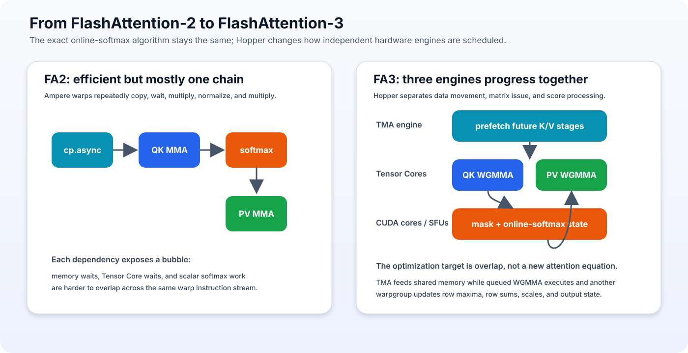
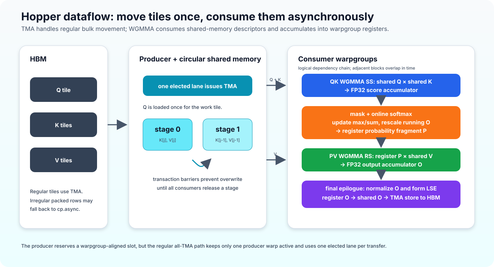
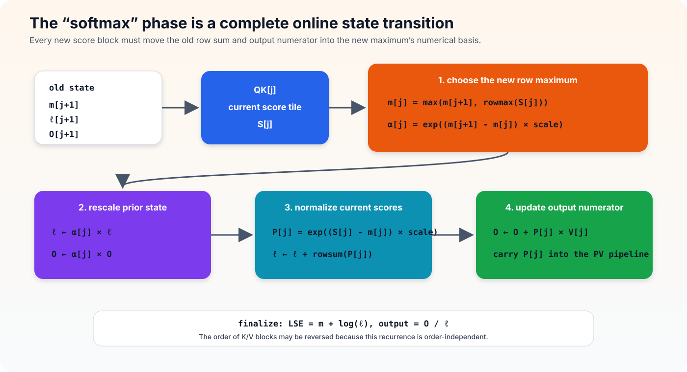
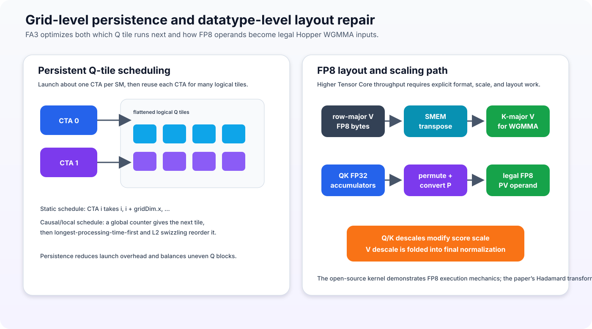

FlashAttention-2 established the modern work partition for exact attention:
one CTA owns a Q tile, streams K/V tiles, updates online softmax state, and
stores the output without materializing the quadratic score matrix.
FlashAttention-3 keeps that algorithmic invariant but changes the schedule to
match NVIDIA Hopper.

The key difference is **asynchrony**. Hopper provides:

- **TMA**, a Tensor Memory Accelerator that moves multidimensional tiles
  between HBM and shared memory;
- **WGMMA**, asynchronous Tensor Core matrix multiplication issued by a
  four-warp warpgroup; and
- named barriers and register reallocation that make producer/consumer warp
  specialization practical.

This post connects the
[FlashAttention-3 paper](https://arxiv.org/html/2407.08608) to the open-source
Hopper implementation. All source links are pinned to
[`Dao-AILab/flash-attention@b038b49`](https://github.com/Dao-AILab/flash-attention/tree/b038b4974f26ba3bc8ab3c8b840c60b0432ce39b).

## 1. What remains unchanged from FA2

For a Q tile and a sequence of K/V tiles, both FA2 and FA3 maintain:

$$
m_j = \max(m_{j-1}, \operatorname{rowmax}(S_j)),
$$

$$
\ell_j =
e^{m_{j-1}-m_j}\ell_{j-1}
+ \operatorname{rowsum}(e^{S_j-m_j}),
$$

$$
O_j =
e^{m_{j-1}-m_j}O_{j-1}
+ e^{S_j-m_j}V_j.
$$

The final output is $O = O_T / \ell_T$. Score and probability tiles remain
temporary on-chip values; the quadratic attention matrix is never written to
HBM.

FA3 does not replace this recurrence. It reorganizes data movement, Tensor
Core issue, and scalar score processing so that Hopper's independent engines
remain busy at the same time.

## 2. FA2 versus FA3 in one picture



FA2 already minimizes HBM traffic, but each warp still follows a relatively
tight dependency chain: load a tile, compute QK, update softmax, and compute
PV. FA3 breaks that chain into work for three hardware resources:

- TMA moves future tiles;
- Tensor Cores execute asynchronously queued matrix multiplications; and
- CUDA cores and SFUs update online-softmax state.

The optimization target is therefore **temporal overlap**. The mathematical
result stays exact.

## 3. Hopper-native WGMMA

Ampere tensor-core instructions are issued by one warp and consume
register-resident fragments. Hopper WGMMA is issued collectively by a
four-warp, 128-thread warpgroup and can consume operands through
shared-memory descriptors.

For QK, FA3 normally lets WGMMA read both Q and K from shared memory. For PV,
the probability fragment can remain in registers while V is read from shared
memory. In both cases, FP32 accumulators remain distributed across the
warpgroup's registers.



This removes an explicit shared-to-register Q load from the normal path and
avoids keeping a large Q fragment live in every consumer warpgroup. It does
not make shared-memory bandwidth free: swizzled layouts, alignment, and bank
conflict avoidance still determine whether WGMMA can consume operands at full
rate.

## 4. TMA and producer/consumer specialization

TMA turns a regular multidimensional transfer into a bulk asynchronous
operation. One elected producer lane can describe a whole Q, K, or V tile,
associate it with a transaction barrier, and let the TMA engine populate
shared memory.

The CTA is divided into two roles:

- a producer slot owns tile movement and shared-memory pipeline state; and
- consumer warpgroups own WGMMA issue, online softmax, and output
  accumulation.

In the regular all-TMA path, the CTA still reserves a warpgroup-aligned
producer slot so consumer warpgroups start on 128-thread boundaries. Only one
producer warp remains active, and one elected lane issues each TMA transfer.
All 128 producer threads participate only when the kernel needs software
copies or transforms, such as packed-GQA Q gathering, non-TMA paged KV, or an
FP8 V transpose.

K and V are not loaded in their entirety. For each scheduled Q tile, the
producer streams the legal K/V blocks through a small circular set of
shared-memory stages. A stage cannot be overwritten until its consumers
release it.

## 5. Inter- and intra-warpgroup overlap

TMA overlap hides memory latency, but attention also alternates short Tensor
Core bursts with reductions and exponentials. FA3 combines two schedules.

**Intra-warpgroup overlap** issues QK for block $j$ and PV for the previously
prepared block $j+1$ before processing the score epilogue for $j$. Already
issued WGMMA can execute while that same warpgroup updates softmax state.

**Inter-warpgroup ping-pong** lets another consumer warpgroup issue its QK/PV
pair while the first warpgroup is occupied by scalar score processing. A
named-barrier token controls issue order; the token is handed over after
WGMMA issue, not after all Tensor Core work completes.


Each consumer warpgroup owns a different subset of the CTA's Q rows and reads
the same staged K/V blocks. Because the kernel traverses K/V blocks from right
to left, $j+1$ denotes the block processed immediately before $j$.

> **Side note: why not use only intra-warpgroup overlap?**
>
> One warpgroup has one sequential instruction stream. While its threads run
> masking, reductions, exponentials, and rescaling, they cannot also issue
> another instruction.
>
> Issuing QK for another future block first would keep an additional score
> accumulator and pipeline stage live, increasing register pressure and
> potentially reducing occupancy. Ping-pong instead gives the next issue
> opportunity to another warpgroup. Intra-warpgroup scheduling overlaps
> already-issued WGMMA with scalar work; ping-pong keeps supplying new WGMMA
> during that scalar work.

## 6. The complete online-softmax state transition

The region often labeled “softmax” contains much more than exponentiation.
For every score block, FA3 must:

1. apply masking;
2. find the new per-row maximum;
3. compute the scale that moves old state into the new maximum's basis;
4. rescale the previous row sum and output numerator;
5. exponentiate the current score tile;
6. accumulate its row sum;
7. convert and arrange probabilities for PV; and
8. eventually normalize O and construct LSE.



Two placements of output rescaling are legal. The kernel may rescale the
existing O accumulator before adding the next PV result, or add a PV result
that is still in the old basis and then rescale the combined accumulator.
Both schedules preserve the same invariant as long as the two terms share a
normalization basis at addition time.

The final cross-lane row-sum reduction produces:

$$
\operatorname{LSE} = m + \log(\ell),
\qquad
\operatorname{output} = O / \ell.
$$

## 7. Persistent scheduling

A logical attention workload contains Q tiles across sequence blocks, heads,
batches, and optional splits. FA3 does not need to launch one physical CTA
for every logical tile. On the normal Hopper path it launches approximately
one CTA per available SM and lets each persistent CTA request more work.

For uniform non-causal work, each CTA walks a deterministic grid-strided list
of flattened Q tiles. For causal or local attention, later Q blocks generally
process more K/V blocks than earlier ones. A dynamic scheduler therefore uses
a global counter, longest-processing-time-first ordering, and L2-aware
swizzling to improve load balance and K/V locality.



The scheduler chooses only the Q-side coordinate: Q block, head, batch, and
split. The mainloop then derives the legal K/V range and streams those K/V
tiles through shared memory.

## 8. FP8: layout repair and fused scaling

H100 offers much higher FP8 matrix throughput, but FP8 attention is not merely
a datatype substitution.

The V operand must use a legal K-major WGMMA layout. If V arrives row-major,
the producer performs an in-kernel shared-memory transpose before consumers
use it. The FP32 QK accumulator also has a different register organization
from the FP8 matrix-A operand expected by PV, so FA3 permutes and converts the
probability fragment.

Scaling is fused into the attention recurrence. Q and K descales modify the
score scale, while the V descale is folded into final output normalization.
This avoids separate full-tensor passes.

The FA3 paper additionally proposes block quantization and randomized
Hadamard transforms to spread outliers. The pinned open-source Hopper kernel
demonstrates FP8 WGMMA, descales, register permutations, and V layout repair,
but it does not integrate that Hadamard transform into the attention kernel.

## 9. Performance and the correct interpretation

The FA3 paper reports, on H100:

- **1.5-2.0x** forward speedup over FA2 for FP16;
- up to **740 TFLOP/s** for FP16, about 75% of H100's theoretical maximum;
- close to **1.2 PFLOP/s** for FP8; and
- **2.6x lower numerical error** than baseline FP8 attention in the paper's
  outlier experiment when block quantization and incoherent processing are
  applied.

These are the paper authors' measurements, not benchmarks reproduced for this
article. Performance depends on sequence length, head dimension, masking,
datatype, GPU clocks, and the exact library revision.

## 10. Takeaways

FlashAttention-3 is not a new softmax identity. It is a Hopper-native schedule
for the same exact tiled-attention recurrence:

1. TMA moves future Q/K/V tiles with little issuing-thread overhead.
2. WGMMA consumes shared-memory descriptors and executes asynchronously.
3. Producer/consumer specialization separates movement from computation.
4. Ping-pong warpgroups keep supplying Tensor Core work during scalar phases.
5. Intra-warpgroup pipelining overlaps adjacent QK, PV, and score work.
6. Persistent scheduling balances logical Q tiles across resident CTAs.
7. FP8 requires explicit scaling, operand-layout repair, and conversion.

FA2's central insight was to make attention IO-aware. FA3's central insight is
to make that IO-aware algorithm **asynchrony-aware**.

## Appendix A: reading the Hopper forward path and its optimizations top to bottom

This appendix follows one ordinary fixed-length forward call through the
source. The goal is not to enumerate every template branch, but to provide a
stable route through the code that can be followed in an editor. Each
optimization is introduced where its controlling type, branch, or instruction
first appears in that route.

Snippets are shortened source excerpts: surrounding template qualifiers and
unrelated branches may be elided, with pinned links provided for the complete
context.

### A.1 Fix one concrete configuration

Assume:

```python
q, k, v: [batch, 384, heads, 128]
dtype: torch.bfloat16
GPU: H100 / SM90

flash_attn_func(
    q, k, v,
    causal=False,
    window_size=(-1, -1),
    num_splits=1,
    pack_gqa=False,
    softcap=0.0,
)
```

Also assume:

```text
Q heads == KV heads
Q/K/V head dimensions are all 128
no variable-length metadata
no page table or KV cache append
no extra Qv tensor
row-major V
```

For this configuration, the important compile-time choices are:

```text
Arch              = 90
Element           = cutlass::bfloat16_t
kHeadDim          = 128
kHeadDimV         = 128
Is_causal/local   = false / false
Varlen            = false
Split             = false
PackGQA           = false
PagedKVNonTMA     = false
AppendKV / HasQv  = false / false
V_colmajor        = false
ClusterM          = 1 for this three-Q-tile example
```

The SM90 tile selector returns:

```cpp
return {128, 176, true, true};
//       M    N    PV-RS intra-WG overlap
```

Source:
[`tile_size.h`, lines 10-45](https://github.com/Dao-AILab/flash-attention/blob/b038b4974f26ba3bc8ab3c8b840c60b0432ce39b/hopper/tile_size.h#L10-L45).

The complete call path is:

```text
flash_attn_func
  -> FlashAttnFunc.forward
  -> _flash_attn_forward
  -> torch.ops.flash_attn_3.fwd
  -> boxed_mha_fwd
  -> mha_fwd
  -> run_mha_fwd
  -> run_mha_fwd_constexpr
  -> run_mha_fwd_<90, bf16, 128, 128, ...>
  -> run_flash_fwd
  -> device_kernel<FlashAttnFwdSm90>
  -> FlashAttnFwdSm90::operator()
       producer WG -> mainloop.load
       consumer WGs -> mainloop.mma
       consumer WGs -> epilogue.store
```

### A.2 Python entry point

Start at
[`flash_attn_func`](https://github.com/Dao-AILab/flash-attention/blob/b038b4974f26ba3bc8ab3c8b840c60b0432ce39b/hopper/flash_attn_interface.py#L809-L887).
It is a convenience wrapper around the autograd function:

```python
return FlashAttnFunc.apply(
    q, k, v,
    softmax_scale,
    causal,
    ...
)
```

Next open
[`FlashAttnFunc.forward`, lines 552-600](https://github.com/Dao-AILab/flash-attention/blob/b038b4974f26ba3bc8ab3c8b840c60b0432ce39b/hopper/flash_attn_interface.py#L552-L600).
It supplies the default scale:

```python
softmax_scale = q.shape[-1] ** (-0.5)
```

and makes the normal fixed-length call by passing `None` for:

```text
k_new / v_new
cu_seqlens_q / cu_seqlens_k
page_table
rotary tensors
```

That distinction is important: the same lower-level API implements fixed
length, varlen, paged KV, append-KV, and several other modes. The ordinary
path is selected mostly by which optional pointers remain null.

### A.3 Python custom op to the C++ extension

`FlashAttnFunc.forward` calls
[`_flash_attn_forward`, lines 60-151](https://github.com/Dao-AILab/flash-attention/blob/b038b4974f26ba3bc8ab3c8b840c60b0432ce39b/hopper/flash_attn_interface.py#L60-L151).

This wrapper:

1. makes required tensors contiguous;
2. calls `flash_attn_3_gpu.fwd`;
3. converts optional accumulation outputs into empty tensors when unused; and
4. returns `out` and `softmax_lse`.

```python
out, softmax_lse, out_accum, softmax_lse_accum = (
    flash_attn_3_gpu.fwd(...)
)
```

On newer PyTorch builds, `flash_attn_3_gpu` is:

```python
torch.ops.flash_attn_3
```

The build chooses
[`flash_api_stable.cpp` for newer PyTorch and `flash_api.cpp` otherwise](https://github.com/Dao-AILab/flash-attention/blob/b038b4974f26ba3bc8ab3c8b840c60b0432ce39b/hopper/setup.py#L645-L660).
This appendix follows the stable API; the kernel path after argument
unpacking is the same.

The operator schema is registered at
[`flash_api_stable.cpp`, lines 1896-1953](https://github.com/Dao-AILab/flash-attention/blob/b038b4974f26ba3bc8ab3c8b840c60b0432ce39b/hopper/flash_api_stable.cpp#L1896-L1953).
Its boxed adapter unpacks the operator stack and calls `mha_fwd`:

```cpp
auto [out, lse, out_accum, lse_accum] =
    mha_fwd(q, k, v, ...);
```

Source:
[`boxed_mha_fwd`, lines 1758-1805](https://github.com/Dao-AILab/flash-attention/blob/b038b4974f26ba3bc8ab3c8b840c60b0432ce39b/hopper/flash_api_stable.cpp#L1758-L1805).

### A.4 `mha_fwd`: validate tensors and construct runtime parameters

[`mha_fwd`, lines 742-990](https://github.com/Dao-AILab/flash-attention/blob/b038b4974f26ba3bc8ab3c8b840c60b0432ce39b/hopper/flash_api_stable.cpp#L742-L990)
is the large runtime-validation layer. Read it in this order:

1. validate GPU architecture and Q/K/V dtype;
2. require contiguous head dimensions;
3. determine fixed versus variable-length shapes;
4. validate head-count divisibility;
5. canonicalize causal/window arguments;
6. allocate `out` and FP32 `softmax_lse`; and
7. populate `Flash_fwd_params`.

For the normal path:

```cpp
is_varlen_q = false;
is_varlen_k = false;
paged_KV = false;
head_size = 128;
head_size_v = 128;
```

`set_params_fprop` records pointers, strides, dimensions, the softmax scale,
masking configuration, and device properties in `Flash_fwd_params`.
The final launch occurs at:

```cpp
run_mha_fwd(params, stream);
```

Source:
[`flash_api_stable.cpp`, lines 962-1244](https://github.com/Dao-AILab/flash-attention/blob/b038b4974f26ba3bc8ab3c8b840c60b0432ce39b/hopper/flash_api_stable.cpp#L962-L1244).

A useful debugging boundary is:

```text
Above run_mha_fwd: runtime tensor validation and parameter packing
Below run_mha_fwd: compile-time kernel dispatch and device execution
```

### A.5 Runtime flags become template parameters

[`run_mha_fwd`, lines 432-450](https://github.com/Dao-AILab/flash-attention/blob/b038b4974f26ba3bc8ab3c8b840c60b0432ce39b/hopper/flash_api_stable.cpp#L432-L450)
turns runtime booleans into template constants:

```cpp
ARCH_SWITCH(...)
SPLIT_SWITCH(...)
PAGEDKV_SWITCH(...)
PACKGQA_SWITCH(...)
SOFTCAP_SWITCH(...)
```

For the chosen configuration this becomes conceptually:

```cpp
run_mha_fwd_constexpr<
    90,     // Arch
    false,  // Split
    false,  // PagedKVNonTMA
    false,  // PackGQA
    false   // Has_softcap
>(params, stream);
```

`run_mha_fwd_constexpr` then dispatches dtype and rounded head dimension:

```cpp
run_mha_fwd_<
    90,
    cutlass::bfloat16_t,
    128,
    128,
    false, false, false, false
>(params, stream);
```

Source:
[`flash_api_stable.cpp`, lines 321-430](https://github.com/Dao-AILab/flash-attention/blob/b038b4974f26ba3bc8ab3c8b840c60b0432ce39b/hopper/flash_api_stable.cpp#L321-L430).

These explicit instantiations are generated from
[`generate_kernels.py`, lines 30-48](https://github.com/Dao-AILab/flash-attention/blob/b038b4974f26ba3bc8ab3c8b840c60b0432ce39b/hopper/generate_kernels.py#L30-L48)
to keep compilation parallel and avoid instantiating every combination in one
translation unit.

### A.6 Final feature switches and tile selection

Open
[`run_mha_fwd_`, lines 202-220](https://github.com/Dao-AILab/flash-attention/blob/b038b4974f26ba3bc8ab3c8b840c60b0432ce39b/hopper/flash_fwd_launch_template.h#L202-L220).
It resolves the remaining feature switches:

```text
causal versus local
V row-major versus column-major
fixed length versus varlen
extra Qv
append KV
one-CTA versus two-CTA cluster
```

For the concrete example, it calls:

```cpp
run_flash_fwd<
    90, 128, 128, 1,
    cutlass::bfloat16_t,
    cutlass::bfloat16_t,
    false, false, false, false,
    false, false, false, false,
    false, false
>(params, stream);
```

Do not try to memorize this positional template list. Read the declaration
immediately above it and annotate the values in an editor.

### A.7 `run_flash_fwd`: assemble the kernel type

[`run_flash_fwd`, lines 31-81](https://github.com/Dao-AILab/flash-attention/blob/b038b4974f26ba3bc8ab3c8b840c60b0432ce39b/hopper/flash_fwd_launch_template.h#L31-L81)
is the kernel type factory.

For this example:

```text
TileShape_MNK    = (128, 176, 128)  # QK
TileShape_MNK_PV = (128, 128, 176)  # PV
kStages          = 2
MmaPV_is_RS      = true
IntraWGOverlap   = true
```

It combines three major types:

```cpp
CollectiveMainloopFwdSm90<...>
CollectiveEpilogueFwd<...>
StaticPersistentTileScheduler<...>
```

into:

```cpp
FlashAttnFwdSm90<
    CollectiveMainloop,
    CollectiveEpilogue,
    Scheduler>
```

The same function also:

- converts raw pointers and strides into typed CuTe arguments;
- constructs scheduler arguments;
- converts them into device-side kernel parameters;
- asks the kernel for grid/block/shared-memory sizes; and
- launches `cutlass::device_kernel<AttnKernel>`.

Source:
[`flash_fwd_launch_template.h`, lines 82-199](https://github.com/Dao-AILab/flash-attention/blob/b038b4974f26ba3bc8ab3c8b840c60b0432ce39b/hopper/flash_fwd_launch_template.h#L82-L199).

### A.8 Understand the persistent scheduler before the kernel

#### Optimization: persistent Q-tile scheduling

The launch layer chooses among variable-length, static, and dynamic persistent
schedulers:

```cpp
using SchedulerPersistent = std::conditional_t<
    Varlen,
    VarlenDynamicPersistentTileScheduler<...>,
    std::conditional_t<
        !Is_causal && !Is_local,
        StaticPersistentTileScheduler<Split>,
        DynamicPersistentTileScheduler<...>>>;
```

Source:
[`flash_fwd_launch_template.h`, lines 60-76](https://github.com/Dao-AILab/flash-attention/blob/b038b4974f26ba3bc8ab3c8b840c60b0432ce39b/hopper/flash_fwd_launch_template.h#L60-L76).

For non-causal, non-local SM90 without splits, the selected scheduler is
[`StaticPersistentTileScheduler`](https://github.com/Dao-AILab/flash-attention/blob/b038b4974f26ba3bc8ab3c8b840c60b0432ce39b/hopper/tile_scheduler.hpp#L141-L217).

The launch grid contains approximately one CTA per usable SM:

```cpp
get_grid_shape(...) {
    return {num_sm};
}
```

Each resident CTA repeatedly advances through logical attention tiles with a
grid-sized stride:

```cpp
WorkTileInfo get_initial_work(...) const {
    return {int(blockIdx.x)};
}

WorkTileInfo get_next_work(
    Params const&,
    WorkTileInfo const& current) const {
    return {current.tile_idx + int(gridDim.x)};
}
```

Source:
[`tile_scheduler.hpp`, lines 192-212](https://github.com/Dao-AILab/flash-attention/blob/b038b4974f26ba3bc8ab3c8b840c60b0432ce39b/hopper/tile_scheduler.hpp#L192-L212).

`get_block_coord` converts one linear tile index into:

```text
(m_block, attention_head, batch, split_idx)
```

This is why one physical CTA can process multiple Q tiles over its lifetime.
The scheduler decides **which Q tile** to process; the mainloop decides how
that tile streams through K/V.

For causal or local attention, the dynamic scheduler instead obtains work
through a global counter before applying its ordering and swizzle:

```cpp
current_work.tile_idx =
    atomicAdd(params.tile_count_semaphore, 1)
    + int(gridDim.x);
```

Source:
[`tile_scheduler.hpp`, lines 334-360](https://github.com/Dao-AILab/flash-attention/blob/b038b4974f26ba3bc8ab3c8b840c60b0432ce39b/hopper/tile_scheduler.hpp#L334-L360).

### A.9 Enter the device kernel and split producer from consumers

The CUDA entry body is
[`FlashAttnFwdSm90::operator()`, lines 170-451](https://github.com/Dao-AILab/flash-attention/blob/b038b4974f26ba3bc8ab3c8b840c60b0432ce39b/hopper/flash_fwd_kernel_sm90.h#L170-L451).

The kernel contains:

```text
one load warpgroup
one to three MMA warpgroups
```

Source:
[`flash_fwd_kernel_sm90.h`, lines 62-79](https://github.com/Dao-AILab/flash-attention/blob/b038b4974f26ba3bc8ab3c8b840c60b0432ce39b/hopper/flash_fwd_kernel_sm90.h#L62-L79).

For the normal TMA path, only the first warp of the producer warpgroup needs
to issue most transfers, but reserving a warpgroup keeps role assignment and
register reallocation simple.

#### Optimization: one active producer warp for regular TMA

The mainloop keeps a full producer warpgroup only for paths that need software
copies or transformations:

```cpp
static constexpr int NumProducerThreads =
    !Transpose_V && Use_TMA_KV && Use_TMA_Q
        ? cutlass::NumThreadsPerWarp
        : cutlass::NumThreadsPerWarpGroup;
```

Source:
[`mainloop_fwd_sm90_tma_gmma_ws.hpp`, lines 117-123](https://github.com/Dao-AILab/flash-attention/blob/b038b4974f26ba3bc8ab3c8b840c60b0432ce39b/hopper/mainloop_fwd_sm90_tma_gmma_ws.hpp#L117-L123).

The source numbering differs from the conceptual diagram earlier:

```text
source warp_group_idx == 0: producer warpgroup
source warp_group_idx > 0: consumer MMA warpgroups
diagram WG0 / WG1:         the two consumer warpgroups
```

After pipeline/barrier initialization, the branch is explicit:

```cpp
if (warp_group_idx == 0) {
    // Producer
    mainloop.load(...);
} else {
    // Consumer
    mainloop.mma(...);
    epilogue.store(...);
}
```

The producer gives registers back:

```cpp
warpgroup_reg_dealloc<LoadRegisterRequirement>();
```

while consumers request more:

```cpp
warpgroup_reg_alloc<MmaRegisterRequirement>();
```

This is Hopper's dynamic register redistribution in the actual kernel.

### A.10 Producer path: construct tiles and issue TMA

The producer calls
[`CollectiveMainloopFwdSm90::load`, lines 591-925](https://github.com/Dao-AILab/flash-attention/blob/b038b4974f26ba3bc8ab3c8b840c60b0432ce39b/hopper/mainloop_fwd_sm90_tma_gmma_ws.hpp#L591-L925).

Read this function in five pieces:

1. calculate legal K/V block bounds for the current Q tile;
2. construct shared-memory Q/K/V tensors and layouts;
3. construct global-memory TMA tensor views;
4. partition global and shared tensors into TMA source/destination views; and
5. run the descending K/V pipeline.

The actual K transfer is:

```cpp
pipeline_k.producer_acquire(stage);
copy(
    params.tma_load_K.with(
        *pipeline_k.producer_get_barrier(stage),
        mcast_mask_kv),
    global_K_tile,
    shared_K_stage);
```

V follows the same pattern:
[`mainloop_fwd_sm90_tma_gmma_ws.hpp`, lines 749-772](https://github.com/Dao-AILab/flash-attention/blob/b038b4974f26ba3bc8ab3c8b840c60b0432ce39b/hopper/mainloop_fwd_sm90_tma_gmma_ws.hpp#L749-L772).

This is the TMA optimization in its operational form: one elected lane binds
an entire multidimensional transfer to the transaction barrier for the
destination stage. The consumers wait on pipeline state rather than issuing
per-thread address calculations and copies.

Q is loaded once per work tile through its own transaction barrier:

```cpp
barrier_Q.arrive_and_expect_tx(TmaTransactionBytesQ);
copy(params.tma_load_Q.with(barrier_Q, ...), gQ, sQ);
```

The producer starts at:

```cpp
int n_block = n_block_max - 1;
```

and walks toward smaller K/V block indices. As discussed earlier, this handles
the right-edge mask first; causal configurations also handle their masked
frontier before reaching the simpler fully valid blocks.

#### Optimization branch: repair row-major FP8 V in the producer

The concrete configuration is BF16, so it skips this branch. For FP8,
row-major V is not directly legal for the selected WGMMA operand mode:

```cpp
static constexpr bool Transpose_V =
    Is_FP8 && !V_colmajor;

static constexpr GMMA::Major MmaMajorV =
    !Is_FP8 && !V_colmajor
        ? GMMA::Major::MN
        : GMMA::Major::K;
```

Source:
[`mainloop_fwd_sm90_tma_gmma_ws.hpp`, lines 44-66](https://github.com/Dao-AILab/flash-attention/blob/b038b4974f26ba3bc8ab3c8b840c60b0432ce39b/hopper/mainloop_fwd_sm90_tma_gmma_ws.hpp#L44-L66).

The producer performs the byte-level shared-memory transpose at
[`lines 720-742`](https://github.com/Dao-AILab/flash-attention/blob/b038b4974f26ba3bc8ab3c8b840c60b0432ce39b/hopper/mainloop_fwd_sm90_tma_gmma_ws.hpp#L720-L742).

### A.11 Consumer path: build WGMMA fragments

The consumer calls
[`CollectiveMainloopFwdSm90::mma`, lines 983-1390](https://github.com/Dao-AILab/flash-attention/blob/b038b4974f26ba3bc8ab3c8b840c60b0432ce39b/hopper/mainloop_fwd_sm90_tma_gmma_ws.hpp#L983-L1390).

#### Optimization: WGMMA operand modes

The collective selects shared/shared QK and a register/shared PV operation:

```cpp
using TiledMmaQK = decltype(cute::make_tiled_mma(
    cute::GMMA::ss_op_selector<
        Element, Element, ElementAccum, TileShape_MNK>(),
    AtomLayoutQK{}));

using TiledMmaPV_RS = decltype(cute::make_tiled_mma(
    cute::GMMA::rs_op_selector<
        Element, Element, ElementAccum,
        TileShape_MNK_PV, GMMA::Major::K, MmaMajorV>(),
    AtomLayoutPV{}));
```

Source:
[`mainloop_fwd_sm90_tma_gmma_ws.hpp`, lines 88-116](https://github.com/Dao-AILab/flash-attention/blob/b038b4974f26ba3bc8ab3c8b840c60b0432ce39b/hopper/mainloop_fwd_sm90_tma_gmma_ws.hpp#L88-L116).

The explicit Q shared-to-register path is disabled:

```cpp
// Register bandwidth is actually a bottleneck
// so we don't want Q to be in registers.
static constexpr bool MmaQK_is_RS = false;
```

Source:
[`mainloop_fwd_sm90_tma_gmma_ws.hpp`, lines 79-96](https://github.com/Dao-AILab/flash-attention/blob/b038b4974f26ba3bc8ab3c8b840c60b0432ce39b/hopper/mainloop_fwd_sm90_tma_gmma_ws.hpp#L79-L96).

The function first maps shared-memory tensors into warpgroup WGMMA fragments:

```cpp
Tensor tSrQ = wg_mma_qk.partition_fragment_A(sQ);
Tensor tSrK = wg_mma_qk.partition_fragment_B(sK);
Tensor tOrV = wg_mma_pv.partition_fragment_B(sV);
```

It also allocates:

```text
tSrS: FP32 QK score accumulator
tOrP: converted probability operand for PV
tOrO: FP32 output accumulator
```

The Q transaction barrier ensures Q is visible before WGMMA reads it:

```cpp
barrier_Q.wait(work_idx % 2);
```

At this point, the templates and layouts are mostly resolved. The remaining
code resembles the algorithm:

```text
wait for K stage
QK WGMMA
mask and online softmax
convert scores to P
PV WGMMA
repeat
```

### A.12 Prologue, steady state, and epilogue inside `mma`

With `IntraWGOverlap=true`, the prologue:

1. waits for the rightmost K tile;
2. computes its QK product;
3. applies the right-edge mask;
4. initializes `row_max` and `row_sum`;
5. converts the first probability tile; and
6. clears the output accumulator.

Source:
[`mainloop_fwd_sm90_tma_gmma_ws.hpp`, lines 1166-1198](https://github.com/Dao-AILab/flash-attention/blob/b038b4974f26ba3bc8ab3c8b840c60b0432ce39b/hopper/mainloop_fwd_sm90_tma_gmma_ws.hpp#L1166-L1198).

#### Optimization: ping-pong WGMMA issue

Before a consumer issues its WGMMA pair, it waits for its named-barrier token.
After issue, it passes the token to the next consumer warpgroup:

```cpp
void warp_scheduler_barrier_sync() {
    NamedBarrier::sync(
        2 * NumThreadsPerWarpGroup,
        WarpSchedulerWG1 - 1
            + canonical_warp_group_idx_nosync());
}

void warp_scheduler_barrier_arrive() {
    int const cur_WG =
        canonical_warp_group_idx_nosync() - 1;
    int const next_WG = NumMmaWarpGroups == 2
        ? 1 - cur_WG
        : (cur_WG < NumMmaWarpGroups - 1
            ? cur_WG + 1
            : 0);
    NamedBarrier::arrive(
        2 * NumThreadsPerWarpGroup,
        WarpSchedulerWG1 + next_WG);
}
```

Source:
[`mainloop_fwd_sm90_tma_gmma_ws.hpp`, lines 920-950](https://github.com/Dao-AILab/flash-attention/blob/b038b4974f26ba3bc8ab3c8b840c60b0432ce39b/hopper/mainloop_fwd_sm90_tma_gmma_ws.hpp#L920-L950).

##### Example: two consumer warpgroups pass one issue token

`NamedBarrier::sync(256, id)` makes the calling warpgroup's 128 threads
arrive and then wait for 256 total thread arrivals. `arrive(256, id)` adds
the calling warpgroup's 128 arrivals without waiting. The count is 256
because one handoff combines the 128-thread sender and 128-thread receiver.

The source warpgroup indices and logical barriers are:

```text
source warpgroup 0: producer
source warpgroup 1: first consumer, waits on B1
source warpgroup 2: second consumer, waits on B2
```

`mma_init` seeds B1 with 128 arrivals so the first consumer can start:

```cpp
if (warp_group_idx == 1) {
    NamedBarrier::arrive(
        2 * NumThreadsPerWarpGroup,
        WarpSchedulerWG1);
}
```

Source:
[`mainloop_fwd_sm90_tma_gmma_ws.hpp`, lines 940-957](https://github.com/Dao-AILab/flash-attention/blob/b038b4974f26ba3bc8ab3c8b840c60b0432ce39b/hopper/mainloop_fwd_sm90_tma_gmma_ws.hpp#L940-L957).

The first cycle is:

```text
initial: B1 has 128 arrivals; B2 has 0

consumer 0: sync(B1)
    B1 = 128 seeded + 128 receiver -> released

consumer 1: sync(B2)
    B2 = 128 receiver -> blocked

consumer 0: issue QK/PV; arrive(B2)
    B2 = 128 receiver + 128 sender -> consumer 1 released
    consumer 0 continues into its score epilogue

consumer 1: issue QK/PV; arrive(B1)
    seeds consumer 0's next sync(B1)
```

Named barriers are reusable: completing the 256-arrival phase resets that
barrier for its next phase. With three consumer warpgroups, the same arithmetic
forms B1 -> B2 -> B3 -> B1.

This scheduler barrier answers only **whose turn is it to issue WGMMA?** It is
different from `consumer_wait`, which waits for a K/V shared-memory stage, and
`warpgroup_wait<N>`, which waits for asynchronous WGMMA results.

#### Optimization: intra-warpgroup QK/PV overlap

The steady-state `fwd_step` then performs:

```text
QK[j]
PV[j+1]
named-barrier handoff
wait for QK[j]
mask / rowmax / alpha / exp / row_sum update
wait for PV[j+1]
prepare P[j]
rescale O
```

Source:
[`mainloop_fwd_sm90_tma_gmma_ws.hpp`, lines 1199-1238](https://github.com/Dao-AILab/flash-attention/blob/b038b4974f26ba3bc8ab3c8b840c60b0432ce39b/hopper/mainloop_fwd_sm90_tma_gmma_ws.hpp#L1199-L1238).

The source ordering is:

```cpp
warp_scheduler_barrier_sync();
flash::gemm</*zero_init=*/true, /*wg_wait=*/-1>(
    tiled_mma_qk, tSrQ, tSrK(...), tSrS);
flash::gemm</*zero_init=*/false, /*wg_wait=*/-1>(
    tiled_mma_pv, tOrP, tOrV(...), tOrO);
warp_scheduler_barrier_arrive();

warpgroup_wait<1>();
mask_fn(tSrS, n_block);
cute::copy(
    softmax.max_get_scale(tSrS),
    scores_scale);
softmax.online_softmax(tSrS);
```

QK for the current block and PV for the preceding block are issued before
the score epilogue reaches the QK dependency. Ping-pong and intra-warpgroup
overlap are therefore visible in the same `fwd_step`.

##### `IntraWGOverlap=true` versus `false`

The two branches compute the same recurrence but schedule it differently.
For the ordinary path without Qv:

| | `IntraWGOverlap=true` | `IntraWGOverlap=false` |
| --- | --- | --- |
| One steady step | QK for block `j` plus PV for block `j+1` | QK, softmax, and PV for the same block `j` |
| WGMMA waits | `wait<1>` after issuing QK and PV, then `wait<0>` at the later dependency | `wait<0>` after QK and again after PV |
| Probability fragment | `P[j]` remains live for the next step | `P[j]` is produced and consumed in the same step |
| K/V stages | current K stage and preceding V stage | K and V from the same block |
| Loop shape | separate QK/softmax prologue and final PV drain | first iteration is handled by an `Is_first_iter` flag |
| Tradeoff | more overlap, more live registers | less overlap, shorter fragment lifetimes |

The overlap branch is a cross-block software pipeline:

```text
prologue:       QK[j+1] -> softmax[j+1] -> keep P[j+1]

steady step:    issue QK[j]
                issue PV[j+1]
                wait until QK[j] is usable
                softmax[j] -> keep P[j]

final drain:    PV[last]
```

Its `warpgroup_wait<1>()` permits one later WGMMA group, normally PV, to remain
outstanding while the warpgroup processes the current scores.

The non-overlap branch instead serializes each matrix dependency:

```text
QK[j] -> wait<0>
      -> mask + online softmax -> P[j]
      -> rescale O
      -> PV[j] -> wait<0>
```

It still uses ping-pong between consumer warpgroups, but the barrier placement
changes. The warpgroup hands off after QK, waits for the token again before
PV, and fully completes each WGMMA before consuming its result. It therefore
does not keep QK for one block and PV for another block simultaneously in
flight.

Sources:
[`overlap branch, lines 1166-1282`](https://github.com/Dao-AILab/flash-attention/blob/b038b4974f26ba3bc8ab3c8b840c60b0432ce39b/hopper/mainloop_fwd_sm90_tma_gmma_ws.hpp#L1166-L1282)
and
[`non-overlap branch, lines 1284-1369`](https://github.com/Dao-AILab/flash-attention/blob/b038b4974f26ba3bc8ab3c8b840c60b0432ce39b/hopper/mainloop_fwd_sm90_tma_gmma_ws.hpp#L1284-L1369).

#### Optimization branch: convert FP8 QK output into the PV operand

After online softmax, FP8 requires register-layout repair before the score
fragment can become WGMMA's matrix-A operand:

```cpp
if constexpr (Is_FP8 && !V_colmajor) {
    permute_Cregs_fp8(tSrS);
}
convert_type_out(tOrP_acc, tOrP);
if constexpr (Is_FP8 && V_colmajor) {
    permute_Aregs_fp8(tOrP);
}
```

Source:
[`mainloop_fwd_sm90_tma_gmma_ws.hpp`, lines 1185-1189](https://github.com/Dao-AILab/flash-attention/blob/b038b4974f26ba3bc8ab3c8b840c60b0432ce39b/hopper/mainloop_fwd_sm90_tma_gmma_ws.hpp#L1185-L1189).

The final iteration drains the remaining PV operation, calls
`softmax.finalize`, waits for WGMMA completion, and applies the final
normalization scale:

```cpp
gemm(P[last], V[last], O);
scores_scale = softmax.finalize(v_descale);
warpgroup_wait<0>();
softmax.rescale_o(O, scores_scale);
```

Source:
[`mainloop_fwd_sm90_tma_gmma_ws.hpp`, lines 1266-1282](https://github.com/Dao-AILab/flash-attention/blob/b038b4974f26ba3bc8ab3c8b840c60b0432ce39b/hopper/mainloop_fwd_sm90_tma_gmma_ws.hpp#L1266-L1282).

### A.13 Follow the online-softmax state separately

When the mainloop becomes difficult to read, keep
[`hopper/softmax.h`](https://github.com/Dao-AILab/flash-attention/blob/b038b4974f26ba3bc8ab3c8b840c60b0432ce39b/hopper/softmax.h)
open beside it.

#### Optimization: keep the exact recurrence entirely on chip

`max_get_scale` updates the row maximum and moves the old row sum into the new
normalization basis:

```cpp
reduce_max<false>(scores, row_max);
scores_scale(mi) = exp2f(
    (scores_max_prev(mi) - scores_max_cur)
    * softmax_scale_log2);
row_sum(mi) *= scores_scale(mi);
```

The assignment that actually changes `row_max` is inside the reduction helper:

```cpp
summary(mi) = zero_init && ni == 0
    ? tensor(mi, ni)
    : op(summary(mi), tensor(mi, ni));
```

`reduce_max` supplies `MaxOp<float>` as `op`:

```cpp
MaxOp<float> max_op;
reduce_<zero_init>(tensor, max, max_op);
```

For the first score tile, `reduce_max<true>` initializes `row_max` from that
tile. For later tiles, `reduce_max<false>` starts with the existing
`row_max`, computes `max(old_row_max, current_scores)`, performs the
four-thread all-reduce, and writes the result back into `row_max`.

Sources:
[`softmax.h`, lines 19-55](https://github.com/Dao-AILab/flash-attention/blob/b038b4974f26ba3bc8ab3c8b840c60b0432ce39b/hopper/softmax.h#L19-L55)
and
[`softmax.h`, lines 101-124](https://github.com/Dao-AILab/flash-attention/blob/b038b4974f26ba3bc8ab3c8b840c60b0432ce39b/hopper/softmax.h#L101-L124).

`online_softmax` replaces scores with the current unnormalized probabilities
and accumulates their row sum:

```cpp
scale_apply_exp2(
    scores, row_max, softmax_scale_log2);
reduce_sum<Is_first, false>(scores, row_sum);
```

The running sum is therefore updated in two stages:

```cpp
// max_get_scale: move the old sum into the new maximum's basis
row_sum(mi) *= scores_scale(mi);

// online_softmax: add the current probability tile
reduce_sum<Is_first, false>(scores, row_sum);
```

`reduce_sum` supplies `SumOp<float>` to the same `thread_reduce_` helper. On
the first tile, `Is_first=true` initializes the partial sums. On later tiles,
`Is_first=false` adds into the existing `row_sum`, giving:

```text
row_sum =
    alpha * old_row_sum
    + sum(exp(current_scores - new_row_max))
```

These remain per-thread partial sums during the mainloop because
`warp_reduce=false`. `finalize` later calls `quad_allreduce_` to combine the
four threads that represent each logical row.

`rescale_o` applies the same basis change to the output numerator:

```cpp
acc_o_rowcol(mi, ni) *= scores_scale(mi);
```

`finalize` performs the deferred cross-lane sum reduction, changes
`row_sum` into LSE, and returns `1 / sum` for final output normalization:

```cpp
row_sum(mi) =
    row_max(mi) * softmax_scale + log(sum);
scores_scale(mi) = 1.f / sum;
```

Source:
[`hopper/softmax.h`, lines 101-166](https://github.com/Dao-AILab/flash-attention/blob/b038b4974f26ba3bc8ab3c8b840c60b0432ce39b/hopper/softmax.h#L101-L166).

### A.14 Epilogue: store LSE and O

Back in `FlashAttnFwdSm90::operator()`, a valid tile calls:

```cpp
epilogue.store(
    params.epilogue,
    tOrO,
    softmax.row_sum,
    ...);
```

Source:
[`flash_fwd_kernel_sm90.h`, lines 438-447](https://github.com/Dao-AILab/flash-attention/blob/b038b4974f26ba3bc8ab3c8b840c60b0432ce39b/hopper/flash_fwd_kernel_sm90.h#L438-L447).

The epilogue:

1. converts the FP32 output fragment to the output dtype;
2. writes O from registers to shared memory;
3. writes FP32 LSE directly to global memory; and
4. uses TMA to store the fixed-length output tile when legal.

Source:
[`epilogue_fwd.hpp`, lines 240-390](https://github.com/Dao-AILab/flash-attention/blob/b038b4974f26ba3bc8ab3c8b840c60b0432ce39b/hopper/epilogue_fwd.hpp#L240-L390).

#### Optimization: TMA output store when the layout is regular

The epilogue enables TMA output stores only when the output tile has a regular
fixed-length layout:

```cpp
static constexpr bool Use_TMA_O =
    ArchTag::kMinComputeCapability >= 90
    && !Varlen
    && !Split
    && !PackGQA;
```

Source:
[`epilogue_fwd.hpp`, lines 30-38](https://github.com/Dao-AILab/flash-attention/blob/b038b4974f26ba3bc8ab3c8b840c60b0432ce39b/hopper/epilogue_fwd.hpp#L30-L38).

The normal fixed-length Hopper path satisfies these conditions, so one elected
thread launches the shared-to-global TMA store and waits for its completion
before releasing the output/shared-memory barrier.

### A.15 Return to Python

After the kernel completes:

```text
mha_fwd returns O, LSE, and optional split accumulators
boxed_mha_fwd repacks operator outputs
_flash_attn_forward returns tensors to Python
FlashAttnFunc.forward saves Q/K/V/O/LSE for backward
flash_attn_func returns O
```

If `return_attn_probs=True`, the wrapper also returns LSE for inspection. It
does not materialize the complete probability matrix.

### A.16 A practical source-reading checklist

Read these files in order:

| Step | File | Question |
| --- | --- | --- |
| 1 | [`flash_attn_interface.py`](https://github.com/Dao-AILab/flash-attention/blob/b038b4974f26ba3bc8ab3c8b840c60b0432ce39b/hopper/flash_attn_interface.py) | Which optional modes are absent or enabled? |
| 2 | [`flash_api_stable.cpp`](https://github.com/Dao-AILab/flash-attention/blob/b038b4974f26ba3bc8ab3c8b840c60b0432ce39b/hopper/flash_api_stable.cpp) | What runtime parameters and template switches are selected? |
| 3 | [`tile_size.h`](https://github.com/Dao-AILab/flash-attention/blob/b038b4974f26ba3bc8ab3c8b840c60b0432ce39b/hopper/tile_size.h) | What are `kBlockM`, `kBlockN`, PV operand mode, and overlap mode? |
| 4 | [`flash_fwd_launch_template.h`](https://github.com/Dao-AILab/flash-attention/blob/b038b4974f26ba3bc8ab3c8b840c60b0432ce39b/hopper/flash_fwd_launch_template.h) | Which mainloop, epilogue, scheduler, and kernel types are assembled? |
| 5 | [`tile_scheduler.hpp`](https://github.com/Dao-AILab/flash-attention/blob/b038b4974f26ba3bc8ab3c8b840c60b0432ce39b/hopper/tile_scheduler.hpp) | Which logical Q tile does this persistent CTA own next? |
| 6 | [`flash_fwd_kernel_sm90.h`](https://github.com/Dao-AILab/flash-attention/blob/b038b4974f26ba3bc8ab3c8b840c60b0432ce39b/hopper/flash_fwd_kernel_sm90.h) | Which warpgroup is producer, and which are consumers? |
| 7 | [`mainloop_fwd_sm90_tma_gmma_ws.hpp`](https://github.com/Dao-AILab/flash-attention/blob/b038b4974f26ba3bc8ab3c8b840c60b0432ce39b/hopper/mainloop_fwd_sm90_tma_gmma_ws.hpp) | Which TMA stage and WGMMA fragment correspond to the current K/V block? |
| 8 | [`softmax.h`](https://github.com/Dao-AILab/flash-attention/blob/b038b4974f26ba3bc8ab3c8b840c60b0432ce39b/hopper/softmax.h) | How are `row_max`, `row_sum`, and O kept in the same normalization basis? |
| 9 | [`epilogue_fwd.hpp`](https://github.com/Dao-AILab/flash-attention/blob/b038b4974f26ba3bc8ab3c8b840c60b0432ce39b/hopper/epilogue_fwd.hpp) | When are LSE and normalized O committed to global memory? |

For each function, write down only:

```text
compile-time configuration
runtime tile coordinate
current K/V pipeline stage
values resident in registers
barrier waited on
barrier released
```

That is enough to reconstruct the normal FA3 forward path without expanding
every CuTe type or optional feature branch.
