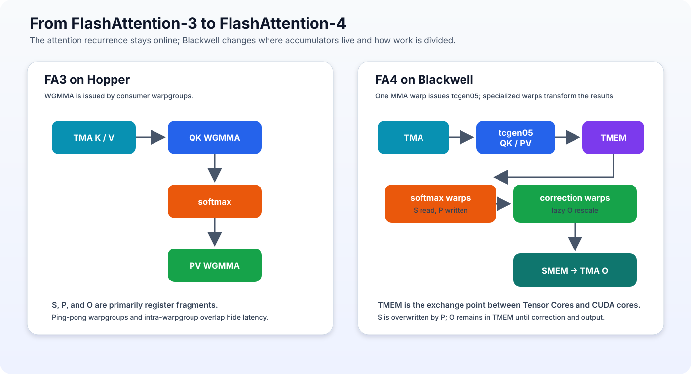
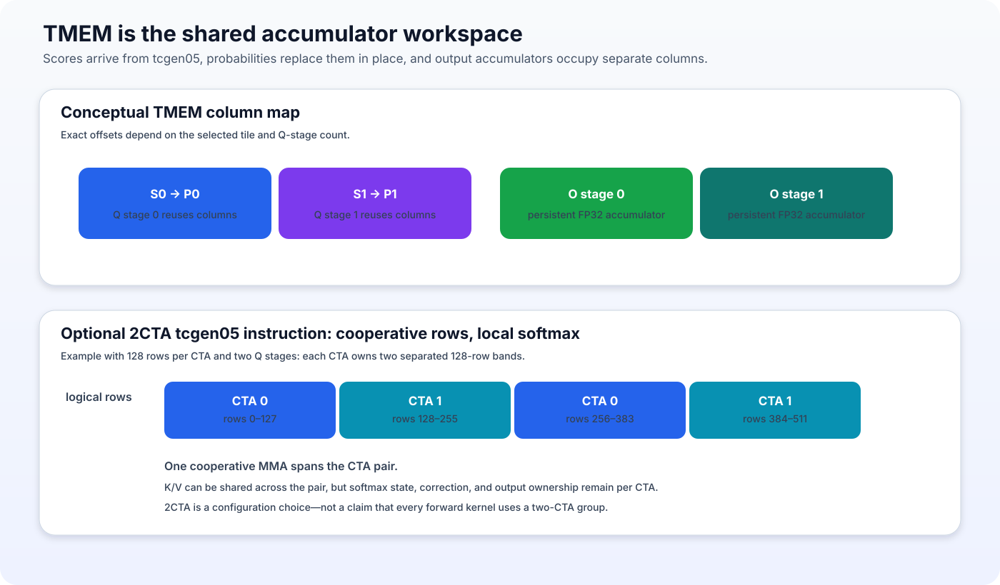
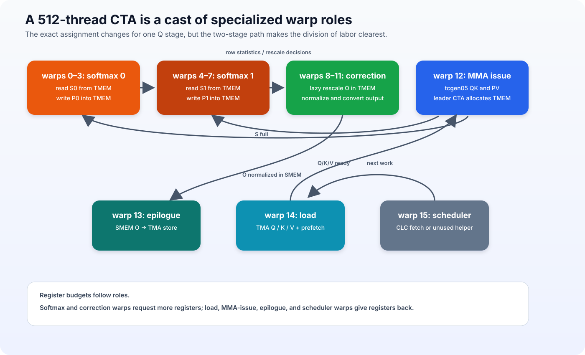
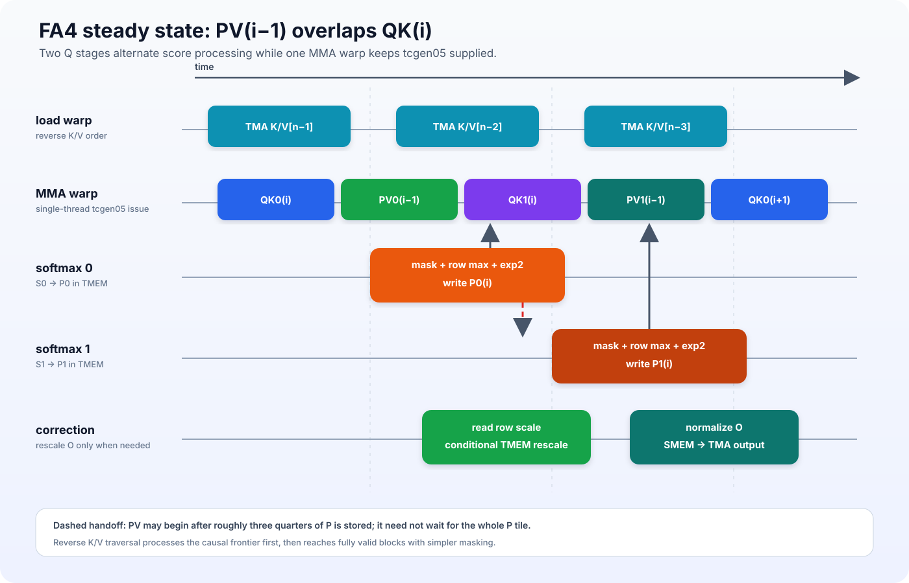
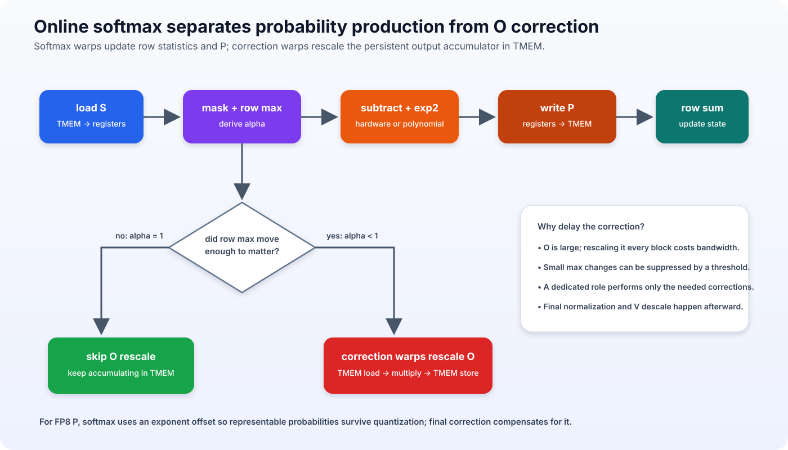

FlashAttention-3 reorganized attention around Hopper's TMA and asynchronous
WGMMA. FlashAttention-4 keeps the same mathematical recurrence but reorganizes
the kernel again for Blackwell:

- QK and PV use Blackwell's `tcgen05` MMA family;
- score and output accumulators live in Tensor Memory, or TMEM;
- one MMA warp issues matrix operations while separate warp groups perform
  softmax and output correction;
- some configurations use a cooperative two-CTA MMA;
- probability production can hand data to PV before the complete tile is
  written; and
- output rescaling is deferred to dedicated correction warps and skipped when
  it is unnecessary.

The result is not "FlashAttention with a faster Tensor Core instruction." It
is a different division of state, synchronization, and labor.

This article follows the public CuTe-DSL implementation at commit
[`2676a7be`](https://github.com/Dao-AILab/flash-attention/tree/2676a7be000545279a692d97151eac0762df6842).
That pin matters because FA4 is moving quickly: configuration heuristics,
2CTA eligibility, scheduling, FP8, MXFP8, and special decode kernels can
change independently.

The scope here is the standard SM100 forward kernel. MLA, SwapAB decode,
backward, and every sparse or paged-KV branch deserve separate articles.

## 1. The shortest mental model

FA3's consumer warpgroup owns score fragments, online-softmax state, and output
fragments in registers. It alternates asynchronous QK and PV WGMMA while CUDA
cores process the score epilogue.

FA4 moves the large matrix state to TMEM:

1. TMA places Q, K, and V in shared memory.
2. One MMA warp issues QK into a score region in TMEM.
3. Softmax warps load scores from TMEM into registers.
4. They mask, normalize, and write probabilities back into the same TMEM
   region.
5. The MMA warp issues PV using P directly from TMEM.
6. O accumulates in a different TMEM region.
7. Correction warps rescale O only when the online maximum changed enough.
8. The epilogue converts O through shared memory and uses TMA for the global
   output store.



The key Blackwell idea is:

> TMEM becomes the exchange point between Tensor Cores and specialized CUDA
> warps.

FA3 uses register ownership to keep the recurrence close to the MMA
warpgroup. FA4 uses an on-chip accumulator workspace so different warp roles
can operate on the same logical tile without carrying every large fragment in
their own registers.

## 2. What did not change

For each row, the kernel still maintains:

- the running maximum \(m\);
- the running exponential sum \(\ell\); and
- the running unnormalized output \(O\).

For a new score block with local maximum \(m_b\):

\[
m' = \max(m, m_b)
\]

\[
\alpha = e^{m-m'}
\]

\[
\ell' = \alpha \ell + \sum_j e^{S_j-m'}
\]

\[
O' = \alpha O + P V
\]

At the end:

\[
\text{output} = O / \ell
\]

The architecture changes where \(S\), \(P\), and \(O\) live, which threads
update them, and when \(\alpha O\) is applied. It does not change the online
softmax proof.

## 3. Configuration is part of the algorithm

There is no single FA4 launch shape. Before constructing the kernel, a
configuration layer chooses:

- M and N tile sizes;
- one or two Q stages;
- one-CTA or two-CTA MMA instructions;
- packed or unpacked GQA;
- static, dynamic, or CLC scheduling;
- SplitKV count;
- S ping-pong;
- per-role register budgets;
- hardware versus polynomial-assisted exponentiation; and
- FP8 or MXFP8 paths.

The most important consequence is that diagrams should be read as one
representative configuration, not as a promise that every input uses the same
kernel.

Two examples:

- Two Q stages are useful when there is enough query work to alternate two
  score/softmax streams, but head-dimension-V 256 can make two stages exceed
  TMEM capacity.
- Two-CTA MMA can enlarge the cooperative row tile and share K/V work, but it
  is enabled only when the input satisfies an eligibility check.

## 4. TMEM replaces large register-owned intermediates

Blackwell Tensor Memory is not ordinary shared memory. The Tensor Core path
writes accumulators there, and specialized TMEM load/store operations move
fragments between TMEM and registers.

The forward kernel assigns conceptual column regions to:

- score stage 0;
- score stage 1;
- output stage 0; and
- output stage 1.

After softmax reads one score stage, it writes P back over that score
workspace. The same columns therefore transition from S to P rather than
requiring separate full-size regions.



This creates a four-step dependency: `tcgen05` writes S; softmax consumes S
and overwrites it with P; `tcgen05` consumes P and updates O; correction warps
conditionally rescale O. It is a dependency graph, not a serial timeline. The
kernel uses multiple stages and barriers so different blocks occupy different
parts of that graph concurrently.

### 4.1 What 2CTA means

A two-CTA `tcgen05` instruction lets a CTA pair cooperate on a larger MMA
tile. In the representative 128-row, two-Q-stage coordinate model:

- CTA 0 owns logical rows 0-127 and 256-383;
- CTA 1 owns rows 128-255 and 384-511.

This is easy to misdescribe. The matrix instruction is cooperative across the
CTA pair, but online-softmax state and output ownership remain partitioned per
CTA. It is not one giant cluster-wide softmax reduction.

## 5. The 16-warp cast

The two-Q-stage kernel launches 512 threads, or 16 warps. Its default role map
is:

| Warps | Role |
| --- | --- |
| 0-3 | softmax stage 0 |
| 4-7 | softmax stage 1 |
| 8-11 | output correction and normalization |
| 12 | `tcgen05` MMA issue and TMEM ownership |
| 13 | output TMA epilogue |
| 14 | Q/K/V loading |
| 15 | scheduler or empty helper |



This table is a useful mental model, with two qualifications:

1. One-Q-stage kernels remove the second softmax group and can reassign those
   warps.
2. Non-TMA loading, packed GQA, direct-output paths, and CLC scheduling can
   reassign load, epilogue, empty, and scheduler roles.

### 5.1 Why isolate the MMA warp?

The warp does not own the entire numerical algorithm. Its job is to keep the
Tensor Core instruction stream legal and supplied:

- wait until Q/K/V operands are available;
- issue QK or PV;
- publish that S or O is ready;
- wait until softmax has produced P and correction has made O reusable; and
- advance pipeline state.

That is a much narrower job than FA3's consumer warpgroup, which both issues
WGMMA and executes much of the score epilogue.

### 5.2 Why dedicated correction warps?

O is a large FP32 accumulator. Applying \(\alpha\) to every O fragment inside
the softmax path would lengthen the critical path and require the softmax
warps to move more TMEM data.

FA4 instead sends the per-row scale to correction warps. They touch O only
when a rescale is actually needed, then later perform final normalization,
conversion, and output staging.

### 5.3 Register redistribution still matters

Role specialization is not useful if every warp reserves the same large
register budget. The kernel reduces the register allocation of load,
MMA-issue, epilogue, scheduler, and empty warps, then raises it for softmax
and correction roles according to a tuned configuration table.

This is the same architectural principle used by FA3, but FA4 has more roles
and different register consumers.

## 6. The pipeline in motion

The load path walks K/V blocks from right to left. For causal attention, that
processes the diagonal frontier first; later iterations can reach fully valid
blocks that need less masking.

With two Q stages, the MMA loop first issues QK for both stages. In steady
state, each stage issues PV for the previous K/V block and then QK for the next
block. The loop drains the final PV after no new QK remains. This is an issue
order: asynchronous pipelines permit Tensor Core execution, TMA movement,
score processing, and correction to overlap.



### 6.1 The partial-P handoff

PV does not always wait until the complete P tile has been written to TMEM.
The softmax path signals once an early portion—roughly three quarters for the
configured tile—is available, allowing the MMA warp to begin consuming it.
A second signal covers the remaining split.

Instead of finishing all of P before starting PV, FA4 can start PV after the
early portion of P is written, then finish the remaining P while PV
progresses.

The exact split is a compile-time tile-dependent boundary, not a universal
75-percent API guarantee.

### 6.2 S ping-pong is a different one-stage schedule

Some one-Q-stage configurations use two alternating S/P TMEM slots. They
issue the first QK, repeatedly overlap the next QK with the current PV, then
drain the final PV. This is called S ping-pong in the source. It is separate
from the normal two-Q-stage schedule and is enabled only for supported tile
shapes.

## 7. Online softmax and lazy O rescaling

Each softmax step:

1. waits until the MMA warp publishes S;
2. loads a score fragment from TMEM;
3. applies score modification and masking;
4. reduces the row maximum;
5. computes the scale relating the old and new maxima;
6. publishes that scale to correction warps;
7. subtracts the maximum and computes exponentials;
8. converts and stores P into TMEM; and
9. updates the running row sum.



### 7.1 What "lazy rescale" means

For 16-bit paths, the softmax state can suppress a small movement in the row
maximum. When the resulting correction would be close enough to one, it keeps
the old maximum and reports an exact scale of one.

The correction warps use a warp vote:

- if every relevant scale equals one, do not touch O;
- if any lane needs a smaller scale, load O from TMEM, multiply it, and store
  it back.

The optimization is not mathematically free. It trades a controlled amount of
numerical slack for fewer large-accumulator rescale passes. The threshold is
configuration-dependent and is disabled for paths where that approximation is
not appropriate.

### 7.2 Why emulate some exponentials?

Hardware exponential instructions use a special-function pipeline. If every
score element goes through that same path, exp throughput can become a
bottleneck even while other arithmetic resources are available.

FA4 can route selected fragments through a degree-three polynomial
approximation plus exponent-bit construction. The configuration chooses how
frequently to use this emulation.

This is not "replace exp2 everywhere." It is load balancing:

- most fragments can still use hardware exp2;
- selected fragments use packed FP32 arithmetic; and
- the schedule can consume otherwise underused arithmetic capacity.

## 8. Barriers are the actual dataflow graph

The kernel allocates distinct mbarrier-backed pipelines for different
ownership transitions:

| Pipeline | Meaning |
| --- | --- |
| Q ready | load warp produced Q; MMA warp may consume it |
| K/V ready | load warp produced one shared-memory stage |
| S/P/O reusable | MMA produced S; softmax produced P; correction made O reusable |
| final P split | softmax completed the late portion of P |
| O ready | MMA completed a PV update |
| softmax statistics | row scale is available to correction |
| O epilogue | normalized output is staged for the store warp |
| load/epilogue reuse | persistent CTA may reuse overlapping shared storage |

The S/P/O pipeline is unusual because ownership cycles among three roles:
MMA produces S, softmax consumes S and produces P, correction makes O safe to
reuse, and MMA consumes P while updating O. This is why a single
"producer/consumer" label is insufficient. The barrier phase encodes a cyclic
protocol over reused TMEM slots.

## 9. Persistent scheduling: static, dynamic, and CLC

FA4 still wants a small physical grid whose CTAs repeatedly claim logical Q
tiles. The source contains multiple policies:

- static persistent scheduling for regular dense work;
- dynamic persistent scheduling for irregular or variable-length work;
- single-tile and longest-processing-time variants; and
- CLC scheduling on supported configurations.

CLC adds a scheduler warp that requests work through Blackwell's cluster
launch-control mechanism. It is useful when causal or irregular tiles have
different runtimes: a CTA that finishes early can claim another tile instead
of waiting for the slowest original assignment.

CLC is not universally enabled. It depends on cluster geometry, TMA
eligibility, the selected scheduler, and measured configuration policy.

## 10. The output path

After the final PV:

1. correction warps wait for O;
2. they read final row maximum and row sum;
3. they compute reciprocal normalization and LSE;
4. they load O from TMEM in column fragments;
5. they apply normalization and any V descale;
6. they convert to the output type and write shared memory; and
7. the epilogue warp performs the global TMA store.

Some irregular layouts cannot use a rectangular TMA output store. Packed GQA,
for example, can route output directly through correction warps with
predication and scatter addressing.

## 11. FP8 and MXFP8

The pinned SM100 path supports FP8 inputs and BF16 output. Its probability
operand is converted to the V type before PV.

Very small probabilities are difficult to preserve in an eight-bit format.
The softmax path therefore adds an exponent offset before conversion, making P
larger in the FP8 representation. Final correction compensates by the matching
power-of-two factor.

The implementation also contains MXFP8 block-scaled QK and PV paths. Their
scale factors use dedicated layouts and can be copied into TMEM for
block-scaled MMA. Those paths have narrower constraints: supported head
dimensions and tile sizes, no two-CTA instruction in the checked
configuration, and restrictions around varlen, SplitKV, and local attention.

The important distinction is:

- ordinary FP8 uses tensor descales around the attention recurrence;
- MXFP8 additionally supplies block scale factors to the MMA operations.

## 12. FA3 versus FA4

| Concern | FA3 on Hopper | FA4 on Blackwell |
| --- | --- | --- |
| Matrix instruction | asynchronous WGMMA | `tcgen05` / UMMA |
| MMA issuer | consumer warpgroup | one dedicated MMA warp |
| Large accumulators | register fragments | TMEM |
| P operand for PV | registers or shared memory | TMEM |
| Score work | MMA consumer warpgroup | dedicated softmax warps |
| O rescale | performed with consumer-owned fragments | dedicated correction warps, conditionally |
| Inter-warp overlap | ping-pong consumer warpgroups | two Q stages or S ping-pong plus role pipelines |
| CTA cooperation | Hopper cluster multicast | optional two-CTA MMA |
| Work scheduling | static/dynamic persistent | static/dynamic/LPT/CLC persistent |
| exp2 | hardware path in the examined FA3 kernel | hardware plus selected polynomial emulation |
| FP8 layout | V transpose and register permutation | TMEM P, exponent offset, FP8 and MXFP8 paths |

The deepest change is not the instruction mnemonic:

> FA3 overlaps work by making consumer warpgroups more autonomous. FA4
> overlaps work by decomposing the recurrence into TMEM-connected services.

## 13. What to measure instead of assuming

The source contains detailed heuristics, but those choices should not be
treated as universal performance laws. When evaluating FA4:

- record the exact source commit;
- record GPU model, CUDA, driver, and CuTe-DSL versions;
- separate prefill from decode;
- sweep Q/K lengths, head dimensions, GQA ratio, causal mode, and dtype;
- compare one-CTA and two-CTA eligibility;
- compare one versus two Q stages;
- measure SplitKV and combine overhead;
- inspect whether CLC is selected;
- distinguish ordinary FP8 from MXFP8; and
- examine generated PTX/SASS rather than inferring instructions from Python
  class names.

The configuration system is intentionally empirical. A fast choice for one
B200 shape is not automatically optimal for another shape or future
Blackwell-family GPU.

---

## Appendix A: top-down source walk

This appendix follows one standard SM100 forward launch through the pinned
source. Code appears only here so the conceptual model above stays independent
of CuTe-DSL syntax.

### A.1 Start at the public API

`flash_attn_func` invokes `FlashAttnFunc.forward`, which reaches
`_flash_attn_fwd`.

Source:
[`interface.py`, lines 3853-3862](https://github.com/Dao-AILab/flash-attention/blob/2676a7be000545279a692d97151eac0762df6842/flash_attn/cute/interface.py#L3853-L3862)
and
[`_flash_attn_fwd`, line 616](https://github.com/Dao-AILab/flash-attention/blob/2676a7be000545279a692d97151eac0762df6842/flash_attn/cute/interface.py#L616).

The interface validates shapes, dtypes, masks, varlen metadata, paged KV,
descale tensors, and architecture. FP8 forward is restricted to the SM100
family at this pin.

### A.2 Let `FwdConfig` choose the kernel shape

The selection path computes the initial tile, then derives Q stages, SplitKV,
2CTA, CLC, persistence, and tuned overrides:

```python
tile_m, tile_n, mma_pv_is_rs, intra_wg_overlap = (
    select_initial_fwd_tile(inputs)
)

q_stage = (
    2
    if is_sm100_family
    and packed_seqlen_q > tile_m
    and inputs.head_dim_v != 256
    else 1
)

use_2cta_instrs = (
    is_sm100_family
    and not inputs.disable_2cta
    and is_2cta_eligible(...)
)

use_clc_scheduler = (
    is_sm100_family
    and (tuned.clc or default_clc)
    and can_use_clc(...)
)
```

Source:
[`config.py`, lines 1583-1660](https://github.com/Dao-AILab/flash-attention/blob/2676a7be000545279a692d97151eac0762df6842/flash_attn/cute/config.py#L1583-L1660).

Per-head-dimension register and exponent-emulation tuning lives in
[`SM100_TUNING`, lines 307-381](https://github.com/Dao-AILab/flash-attention/blob/2676a7be000545279a692d97151eac0762df6842/flash_attn/cute/config.py#L307-L381).

### A.3 Dispatch to the SM100 implementation

The architecture branch chooses MLA, SwapAB, standard SM100, or SM120:

```python
elif arch // 10 in [10, 11]:
    ...
    fwd_cls = FlashAttentionForwardSm100
    if use_swapab:
        fwd_cls = FlashAttentionForwardSm100SwapAB

    fa_fwd = fwd_cls(
        head_dim,
        head_dim_v,
        config=config,
        ...
    )
```

Source:
[`interface.py`, lines 1446-1544](https://github.com/Dao-AILab/flash-attention/blob/2676a7be000545279a692d97151eac0762df6842/flash_attn/cute/interface.py#L1446-L1544).

The object is compiled through `cute.compile`, cached by a configuration key,
then invoked. SplitKV launches a combine pass afterward.

Source:
[`interface.py`, lines 1257-1323 and 1570-1755](https://github.com/Dao-AILab/flash-attention/blob/2676a7be000545279a692d97151eac0762df6842/flash_attn/cute/interface.py#L1570-L1755).

### A.4 Read the role table before the kernel body

`FlashAttentionForwardSm100.__init__` makes the role split explicit:

```python
self.softmax0_warp_ids = (0, 1, 2, 3)
self.softmax1_warp_ids = (4, 5, 6, 7)
self.correction_warp_ids = (8, 9, 10, 11)
self.mma_warp_id = 12
self.epilogue_warp_ids = (13,)
self.load_warp_ids = (14,)
self.empty_warp_ids = (15,)
```

It then asserts the 512-thread launch:

```python
self.threads_per_cta = cute.arch.WARP_SIZE * len(...)
assert self.threads_per_cta == SM100_THREADS_PER_CTA
```

Source:
[`flash_fwd_sm100.py`, lines 375-397](https://github.com/Dao-AILab/flash-attention/blob/2676a7be000545279a692d97151eac0762df6842/flash_attn/cute/flash_fwd_sm100.py#L375-L397).

Continue reading through the following role-reassignment branches. They
explain why one-Q-stage, non-TMA Q/KV, direct epilogue, and CLC configurations
do not use the table literally.

### A.5 Map TMEM columns

The constructor reserves score and output regions:

```python
self.tmem_s_offset = [0, self.n_block_size]

self.tmem_o_offset = [
    self.tmem_s_offset[-1]
    + self.n_block_size
    + i * self.head_dim_v_padded
    for i in range(self.q_stage)
]

self.tmem_s_to_p_offset = self.n_block_size // 2
self.tmem_p_offset = [
    self.tmem_s_offset[i] + self.tmem_s_to_p_offset
    for i in range(2)
]
```

Source:
[`flash_fwd_sm100.py`, lines 445-461](https://github.com/Dao-AILab/flash-attention/blob/2676a7be000545279a692d97151eac0762df6842/flash_attn/cute/flash_fwd_sm100.py#L445-L461).

The exact CuTe layout explains why the P pointer has an offset within the S
region rather than looking identical in raw column arithmetic:
[`flash_fwd_sm100.py`, lines 4093-4124](https://github.com/Dao-AILab/flash-attention/blob/2676a7be000545279a692d97151eac0762df6842/flash_attn/cute/flash_fwd_sm100.py#L4093-L4124).

### A.6 Construct `tcgen05` QK and PV

The configuration selects a one- or two-CTA instruction:

```python
cta_group = (
    tcgen05.CtaGroup.TWO
    if self.use_2cta_instrs
    else tcgen05.CtaGroup.ONE
)
```

Q and K are K-major. V is MN-major. Most importantly, P comes from TMEM:

```python
p_source = tcgen05.OperandSource.TMEM

tiled_mma_pv = sm100_utils_basic.make_trivial_tiled_mma(
    self.v_dtype,
    self.v_dtype,
    p_major_mode,
    v_major_mode,
    self.pv_acc_dtype,
    cta_group,
    self.mma_tiler_pv[:2],
    p_source,
)
```

Source:
[`flash_fwd_sm100.py`, lines 588-645](https://github.com/Dao-AILab/flash-attention/blob/2676a7be000545279a692d97151eac0762df6842/flash_attn/cute/flash_fwd_sm100.py#L588-L645).

### A.7 Create TMA descriptors and launch geometry

`__call__` creates TMA atoms for Q, K, V, and O, scheduler arguments, shared
barrier storage, and the launch:

```python
self.kernel(...).launch(
    grid=grid,
    block=[self.threads_per_cta, 1, 1],
    cluster=cluster_shape_mn,
    min_blocks_per_mp=1,
)
```

Source:
[`flash_fwd_sm100.py`, lines 472-1078](https://github.com/Dao-AILab/flash-attention/blob/2676a7be000545279a692d97151eac0762df6842/flash_attn/cute/flash_fwd_sm100.py#L472-L1078).

For two-CTA operation, the launch layer sets the M cluster dimension to two.
The coordinate-system note is worth reading before interpreting row
ownership:
[`flash_fwd_sm100.py`, lines 105-127](https://github.com/Dao-AILab/flash-attention/blob/2676a7be000545279a692d97151eac0762df6842/flash_attn/cute/flash_fwd_sm100.py#L105-L127).

### A.8 Build the mbarrier graph

Q and K/V use TMA-to-UMMA pipelines:

```python
pipeline_q = PipelineTmaUmma.create(
    producer_group=tma_warp,
    consumer_group=mma_warp,
    tx_count=self.tma_copy_bytes["Q"],
    ...
)

pipeline_kv = PipelineTmaUmma.create(
    producer_group=tma_warp,
    consumer_group=mma_warp,
    tx_count=self.tma_copy_bytes["K"],
    ...
)
```

The cyclic S/P/O ownership uses a different pipeline:

```python
pipeline_s_p_o = PipelineUmmaAsync.create(
    producer_group=mma_warp,
    consumer_group=softmax_correction_threads_cluster,
    ...
)
```

The source comment states the protocol directly: MMA signals S ready;
softmax writes P; correction finishes rescaling O; then MMA may issue PV.

Source:
[`flash_fwd_sm100.py`, lines 1240-1370](https://github.com/Dao-AILab/flash-attention/blob/2676a7be000545279a692d97151eac0762df6842/flash_attn/cute/flash_fwd_sm100.py#L1240-L1370).

### A.9 Enter the device kernel and dispatch warps

The device body constructs the scheduler and branches on `warp_idx`.

The MMA warp allocates TMEM:

```python
if warp_idx == self.mma_warp_id:
    cute.arch.setmaxregister_decrease(self.num_regs_other)
    tmem.allocate(self.tmem_alloc_cols)
    tmem_alloc_barrier.arrive_and_wait_unaligned()
    tmem_ptr = tmem.retrieve_ptr(self.qk_acc_dtype)
    self.mma(...)
```

Softmax warps increase their register allocation:

```python
cute.arch.setmaxregister_increase(
    self.num_regs_softmax
)
```

Correction warps independently select their register budget before retrieving
the same TMEM allocation.

Source:
[`flash_fwd_sm100.py`, lines 1528-1701](https://github.com/Dao-AILab/flash-attention/blob/2676a7be000545279a692d97151eac0762df6842/flash_attn/cute/flash_fwd_sm100.py#L1528-L1701).

### A.10 Follow reverse-order Q/K/V loading

The load warp computes legal K/V bounds for the work tile, loads the last K
block and Q stages, then walks backward:

```python
n_block_first = n_block_max - 1

load_K(block=n_block_max - 1, ...)
load_Q(block=0, stage=0)
if self.q_stage == 2:
    load_Q(block=1, stage=1)
load_V(block=n_block_max - 1, ...)

for i in cutlass.range(
    n_block_max - 1 - n_block_min,
    unroll=1,
):
    n_block = n_block_max - 2 - i
    load_K(block=n_block, ...)
    load_V(block=n_block, ...)
```

Source:
[`flash_fwd_sm100.py`, lines 1991-2058](https://github.com/Dao-AILab/flash-attention/blob/2676a7be000545279a692d97151eac0762df6842/flash_attn/cute/flash_fwd_sm100.py#L1991-L2058).

The concrete TMA copy helpers are near
[`load_KV`, lines 3957-4016](https://github.com/Dao-AILab/flash-attention/blob/2676a7be000545279a692d97151eac0762df6842/flash_attn/cute/flash_fwd_sm100.py#L3957-L4016).

### A.11 Follow the MMA software pipeline

The one-stage S-ping-pong branch documents its intended schedule:

```python
# QK(0); [QK(i+1), PV(i)] for i in 0..n-2;
# PV(n-1).
```

The normal path first issues QK for each Q stage. Its steady loop then, for
each stage:

1. waits for corrected O and produced P;
2. issues PV for the previous V stage;
3. advances to the next K stage;
4. issues QK into the reused S/P slot; and
5. publishes S ready.

The source ordering is visible around:

```python
self.gemm_pv(...)
...
gemm_Si[stage](
    smem_desc_start_b=...
)
pipeline_s_p_o.producer_commit_w_index(stage)
```

Source:
[`flash_fwd_sm100.py`, lines 2316-2495](https://github.com/Dao-AILab/flash-attention/blob/2676a7be000545279a692d97151eac0762df6842/flash_attn/cute/flash_fwd_sm100.py#L2316-L2495).

The generated helper uses precomputed shared-memory descriptors and the
Blackwell MMA instruction descriptor:
[`flash_fwd_sm100.py`, lines 2176-2246](https://github.com/Dao-AILab/flash-attention/blob/2676a7be000545279a692d97151eac0762df6842/flash_attn/cute/flash_fwd_sm100.py#L2176-L2246).

### A.12 Read one softmax step

`softmax_step` first waits for its S/P/O stage, then forms TMEM-to-register and
register-to-TMEM tensors:

```python
pipeline_s_p_o.consumer_wait_w_index_phase(...)

tSrS_t2r = cute.make_rmem_tensor(...)
tSrP = cute.make_rmem_tensor(...)
```

It then follows the recurrence:

```python
row_max, acc_scale = softmax.update_row_max(...)
sm_stats_barrier.arrive_w_index(...)
softmax.scale_subtract_rowmax(...)
softmax.apply_exp2_convert(...)
tiled_tmem_store.copy(tSrP, tStP_r2t)
...
softmax.update_row_sum(...)
```

Source:
[`flash_fwd_sm100.py`, lines 3052-3181](https://github.com/Dao-AILab/flash-attention/blob/2676a7be000545279a692d97151eac0762df6842/flash_attn/cute/flash_fwd_sm100.py#L3052-L3181).

SM103 can select a TMEM load-reduce operation for row maximum, while the
standard SM100 path loads and reduces through registers.

### A.13 See the early P handoff

After storing the initial portion of P, softmax signals the MMA warp:

```python
if col_limit >= self.split_P_arrive:
    pipeline_s_p_o.consumer_release_w_index(...)
```

It then stores the remaining portion and uses `pipeline_p_lastsplit` for the
late completion.

Source:
[`flash_fwd_sm100.py`, lines 3144-3159](https://github.com/Dao-AILab/flash-attention/blob/2676a7be000545279a692d97151eac0762df6842/flash_attn/cute/flash_fwd_sm100.py#L3144-L3159).

The split boundary is computed from the N tile:

```python
self.split_P_arrive = (
    self.n_block_size // 4 * 3
) // 32 * 32
```

Source:
[`flash_fwd_sm100.py`, lines 229-231](https://github.com/Dao-AILab/flash-attention/blob/2676a7be000545279a692d97151eac0762df6842/flash_attn/cute/flash_fwd_sm100.py#L229-L231).

### A.14 Understand lazy rescaling

The softmax object computes the correction scale from old and new maxima:

```python
acc_scale_ = (
    row_max_old - row_max_safe
) * self.scale_log2
acc_scale = cute.math.exp2(acc_scale_)

if self.rescale_threshold > 0.0:
    if acc_scale_ >= -self.rescale_threshold:
        row_max_new = row_max_old
        row_max_safe = row_max_old
        acc_scale = 1.0
```

Source:
[`softmax.py`, lines 344-363](https://github.com/Dao-AILab/flash-attention/blob/2676a7be000545279a692d97151eac0762df6842/flash_attn/cute/softmax.py#L344-L363).

Correction waits for those statistics, votes across the warp, and only touches
O when some scale is below one:

```python
should_rescale = (
    vote_ballot_sync(scale < 1.0) != 0
)

if should_rescale:
    self.correction_rescale(...)
```

Source:
[`flash_fwd_sm100.py`, lines 3300-3356](https://github.com/Dao-AILab/flash-attention/blob/2676a7be000545279a692d97151eac0762df6842/flash_attn/cute/flash_fwd_sm100.py#L3300-L3356)
and
[`correction_rescale`, lines 3578-3627](https://github.com/Dao-AILab/flash-attention/blob/2676a7be000545279a692d97151eac0762df6842/flash_attn/cute/flash_fwd_sm100.py#L3578-L3627).

### A.15 Inspect packed exponentiation

Subtracting the row maximum uses a packed FP32 FMA:

```python
acc_S_row[i], acc_S_row[i + 1] = (
    cute.arch.fma_packed_f32x2(
        ...,
        (self.scale_log2, self.scale_log2),
        (bias, bias),
    )
)
```

`apply_exp2_convert` either calls hardware exp2 or the emulation helper for
selected fragments:

```python
if ex2_emu_freq == 0:
    acc_S_row_frg[k, j] = cute.math.exp2(...)
else:
    ...
    acc_S_row_frg[k, j], acc_S_row_frg[k + 1, j] = (
        utils.ex2_emulation_2(...)
    )
```

Source:
[`softmax.py`, lines 471-548](https://github.com/Dao-AILab/flash-attention/blob/2676a7be000545279a692d97151eac0762df6842/flash_attn/cute/softmax.py#L471-L548).

The emulation clamps the argument, separates integer and fractional parts,
evaluates a polynomial, and combines the exponent bits:
[`utils.py`, lines 828-860](https://github.com/Dao-AILab/flash-attention/blob/2676a7be000545279a692d97151eac0762df6842/flash_attn/cute/utils.py#L828-L860).

### A.16 Finish correction and output

At the final step, correction computes:

```python
scores_scale = rcp_approx(row_sum) * v_descale
```

and derives LSE from the final row maximum and sum.

Source:
[`flash_fwd_sm100.py`, lines 3400-3422](https://github.com/Dao-AILab/flash-attention/blob/2676a7be000545279a692d97151eac0762df6842/flash_attn/cute/flash_fwd_sm100.py#L3400-L3422).

`correction_epilogue` loads O from TMEM, scales and converts it, and places it
in shared memory:

```python
tiled_tmem_load.copy(tOtO_t2r, tOrO)
...
tOrO[...] = tOrO[...] * scores_scale
...
cute.copy(tiled_copy_r2s, tOrO_out, tOsO)
```

Source:
[`flash_fwd_sm100.py`, lines 3629-3738](https://github.com/Dao-AILab/flash-attention/blob/2676a7be000545279a692d97151eac0762df6842/flash_attn/cute/flash_fwd_sm100.py#L3629-L3738).

The epilogue warp waits for that shared-memory tile and issues the TMA store:

```python
cute.copy(
    tma_atom_O,
    tOsO,
    tOgO,
)
```

Source:
[`epilogue_s2g`, lines 3789-3876](https://github.com/Dao-AILab/flash-attention/blob/2676a7be000545279a692d97151eac0762df6842/flash_attn/cute/flash_fwd_sm100.py#L3789-L3876).

### A.17 Follow persistent and CLC scheduling

The constructor chooses among scheduler classes according to varlen,
persistence, SplitKV, LPT, and CLC configuration:

Source:
[`flash_fwd_sm100.py`, lines 309-371](https://github.com/Dao-AILab/flash-attention/blob/2676a7be000545279a692d97151eac0762df6842/flash_attn/cute/flash_fwd_sm100.py#L309-L371).

The device body creates `ClcDynamicPersistentTileScheduler` and its async
fetch pipeline when CLC is selected:
[`flash_fwd_sm100.py`, lines 1480-1521](https://github.com/Dao-AILab/flash-attention/blob/2676a7be000545279a692d97151eac0762df6842/flash_attn/cute/flash_fwd_sm100.py#L1480-L1521).

The dedicated scheduler warp repeatedly requests and publishes work:
[`flash_fwd_sm100.py`, lines 3878-3898](https://github.com/Dao-AILab/flash-attention/blob/2676a7be000545279a692d97151eac0762df6842/flash_attn/cute/flash_fwd_sm100.py#L3878-L3898).

The scheduler implementations and state encodings are in
[`tile_scheduler.py`](https://github.com/Dao-AILab/flash-attention/blob/2676a7be000545279a692d97151eac0762df6842/flash_attn/cute/tile_scheduler.py).

### A.18 Locate FP8 and MXFP8 branches

FP8 sets a positive probability exponent offset:

```python
max_offset = 8 if self.v_dtype.width == 8 else 0
```

Correction later compensates with the corresponding power-of-two scale.

Source:
[`softmax.py`, lines 471-485](https://github.com/Dao-AILab/flash-attention/blob/2676a7be000545279a692d97151eac0762df6842/flash_attn/cute/softmax.py#L471-L485)
and
[`flash_fwd_sm100.py`, lines 2761-2781](https://github.com/Dao-AILab/flash-attention/blob/2676a7be000545279a692d97151eac0762df6842/flash_attn/cute/flash_fwd_sm100.py#L2761-L2781).

MXFP8 builds block-scaled MMA atoms and copies scale factors into their TMEM
layout before issue:
[`flash_fwd_sm100.py`, lines 199-209 and 4041-4091](https://github.com/Dao-AILab/flash-attention/blob/2676a7be000545279a692d97151eac0762df6842/flash_attn/cute/flash_fwd_sm100.py#L4041-L4091).

## Appendix B: a source-reading checklist

For any concrete SM100 launch, write down these values before stepping through
the body:

```text
tile_m / tile_n
q_stage
use_2cta_instrs
use_s_ping_pong
use_tma_Q / use_tma_KV / use_tma_O
pack_gqa
is_split_kv
use_clc_scheduler
rescale_threshold
ex2_emu_freq
input dtype / V dtype / output dtype
```

Then trace five state transitions:

```text
global Q/K/V -> shared memory
shared Q/K -> S in TMEM
S in TMEM -> P in TMEM
P in TMEM + shared V -> O in TMEM
O in TMEM -> shared O -> global output
```

Finally, attach one barrier to every arrow. If an arrow has no wait/release
pair, the reading is incomplete.

## Appendix C: reproduction notes

To reproduce instruction-level behavior:

1. pin the exact FlashAttention commit;
2. record the selected `FwdConfig`;
3. record GPU, driver, CUDA, PyTorch, and CuTe-DSL versions;
4. retain the compile cache key and generated artifact;
5. inspect PTX for `tcgen05` instructions;
6. inspect SASS and profiler timelines for the actual overlap; and
7. compare against a configuration with one optimization disabled at a time.

The Python source explains the intended pipeline. Generated code and hardware
traces determine whether a particular environment realizes that intent.
